# Foundation 3L — execution-domain and native-egress ownership decision

**Architecture verdict: DESIGN NOT QUALIFIED — SPECIFIC BLOCKERS.** An exclusive
pooled-server support lease is the smallest defensible *proposed* capacity
boundary for the packaged ServerHost. It does not correct that server's measured
Local32 failure. An OS-only send worker remains a targeted hypothesis, but a
separately authorized native32 prototype is premature until the ACK/history
transaction, F1 chronology, protected opportunities and close path below have
finite, reviewable contracts. This is a documentation-only design assessment;
no policy or native egress code is adopted by this document. The source review
found no impossibility proof against preserving GNS reliability/security with
off-thread OS sends; it found an incomplete ownership specification.

## 1. Authority, revisions and source register

The starting draft [PR #6](https://github.com/gmoddev/gargantuan/pull/6) head
is `ee1c5e8407f254021a2ec2dcf4cb9454ba91ae4a`; it remains draft. The
integration pins GNS revision
`2cb93a06350bb065db53abdb0d87cf297e0bfd34` in
[`GameNetworkingSockets.cmake`](../../cmake/GameNetworkingSockets.cmake). At the
start of this review, all six checks on that PR head were successful. Those
checks did not test this design. The governing contract remains
[`D01`](../../docs/adr/D01-pooled-service-curve.md), with KI-006
[`OPEN`](../../KNOWN_ISSUES.md), Foundation 3L B **PARTIALLY READY**, actual
Local32 strict F1 failed, and Node32 unrun. The four-client physical PASS is
limited to its qualified source and environment. Historical failing execution
CI jobs remain failures even where counterpart jobs later passed.

| Source | Use in this decision |
| --- | --- |
| [`AICONTEXT.md`](../../AICONTEXT.md), [agent policy](../../docs/src/content/docs/meta/agents.mdx), [architecture index](../../docs/architecture/README.md), [Core invariants](../../docs/invariants/Core.md) | Documentation authority, bounded state, generation and evidence rules. |
| [3L.3 ledger](../CurrentArchitecture/ContentAvailabilityFoundation3L_3Validation.md), [physical receipt](../CurrentArchitecture/PooledPhysicalQualification3L.md), [recovery contract](../CurrentArchitecture/PooledReliableServiceRecoveryContract3L.md) | Current qualification and terminal/accepted-debt constraints. |
| [Capacity review](Foundation3LNetworkingCapacityReview.md), [egress investigation](Foundation3LEgressInvestigation.md), [B04 JSON](evidence/Foundation3LEgressStage1/critical-B04.json) | Prior measured limits and the first failed interval. |
| [`ServerHost.cpp`](../../src/host/server/ServerHost.cpp), [`GameSession.cpp`](../../src/network/GameSession.cpp), [`ReliableByteAdmission.hpp`](../../src/network/ReliableByteAdmission.hpp), [profile](../../include/gargantuan/network/ReliableServiceProfile.hpp) | Actual topology, acceptance, local funding and unchanged rates. |
| [GNS adapter](../../src/network/GameNetworkingSocketsTransport.cpp), [feedback bridge](../../cmake/gns/ReliableServiceFeedbackBridge.cpp), [pooled feedback](../../src/network/PooledReliableServiceFeedback.hpp), [F1 curve](../../src/network/FiniteGrantServiceCurve.hpp), [native patch](../../cmake/gns/ApplyReliableServiceFeedback.cmake) | Adapter lifetime, native-positive attribution and observation order. |
| [Pinned SNP](https://github.com/ValveSoftware/GameNetworkingSockets/blob/2cb93a06350bb065db53abdb0d87cf297e0bfd34/src/steamnetworkingsockets/clientlib/steamnetworkingsockets_snp.cpp), [UDP](https://github.com/ValveSoftware/GameNetworkingSockets/blob/2cb93a06350bb065db53abdb0d87cf297e0bfd34/src/steamnetworkingsockets/clientlib/steamnetworkingsockets_udp.cpp), [socket thread](https://github.com/ValveSoftware/GameNetworkingSockets/blob/2cb93a06350bb065db53abdb0d87cf297e0bfd34/src/steamnetworkingsockets/clientlib/steamnetworkingsockets_socketthread.cpp), [thinker](https://github.com/ValveSoftware/GameNetworkingSockets/blob/2cb93a06350bb065db53abdb0d87cf297e0bfd34/src/steamnetworkingsockets/steamnetworkingsockets_thinker.cpp) | Protocol mutations, ACK/history, raw I/O, global service and lock ownership. |

The supplied `gargantuan-3l-static-architecture-review-2026-10-10.html`
(SHA-256 `30055081e24b14bca6ad9463ac1d5588547161c0e971843910154c08842849b9`)
is advisory. Its corrections are well founded: one packaged server does not
need a dynamic cross-session broker to explain its failure; source-reachable
multi-world composition still lacks aggregate pre-acceptance funding; a
1,248-byte F1 allowance quantum is not the pinned encrypted packet's
1,137-byte reliable payload; and an ACK boolean or worker-only evidence
watermark is insufficient. Its suggested one-worker/32-slot experiment is a
future falsifier, not a proven worker count or a ready test plan. No current
invariant was found that contradicts those limited conclusions.

## 2. Supported execution domain: narrow owner, explicit co-tenants

The packaged ServerHost loads one world, constructs one Engine and at most one
server GameSession after its Local, injected-provider or Node content branch
([`ServerHost.cpp` 430–622](../../src/host/server/ServerHost.cpp)). Its 32-client
farm is one Server process and 32 separate Player processes. A second server
session cannot attach to the *same* Engine's CharacterControl runtime; the
[overlap test](../../tests/GameSessionTests.cpp) exercises that exclusion.
Distinct DataModels/Engines can, however, construct separate GameSessions,
each with its own admission state, while adapters share one refcounted GNS
interface and native service domain ([`GameSession.cpp` 149–210](../../src/network/GameSession.cpp),
[`GameNetworkingSocketsTransport.cpp` 56–66, 376–402](../../src/network/GameNetworkingSocketsTransport.cpp)).
That is source-reachable internal composition, not a packaged or measured
multi-server product. Two four-grant sessions could accept eight incomplete
grants, imposing 128 MiB/s of structural F1 service in one domain. The
profile's 96 MiB/s configured backend cap is not a measured universal hardware
limit. Existing global `RunningStructuralGrants` and the
[ordinary pacer](../../cmake/gns/OrdinaryWirePacer.cpp) coordinate activity or
limit ordinary DATA; they do not reserve structural/protected service before
two sessions accept it.

**Chosen design scope for later adoption:** one authoritative
`POOLED_SERVICE` server workload holds the process-local GNS execution-domain
lease. The lease names the native service thread/global lock, raw sockets,
listener/pre-connection sends, all compatible adapters, future worker and
result storage, protected ACK/control/retry traffic and ordinary traffic.
Enforcement must sit in a shared native-domain registry reachable by adapter
startup **and** GameSession grant admission; a ServerHost-only check can be
bypassed by direct native composition. The proposed owner acquires a
generation-qualified permit before `GameSession::Start` and before any
scheduler acceptance or qualified activation. Existing
[`GameSession.cpp` 1654–1730](../../src/network/GameSession.cpp) reserves local
credit, submits to the scheduler, then records activation and debt. A future
domain permit joins that boundary without moving its true activation time.

| Co-tenant in the same native process | Proposed treatment during strict pooled qualification |
| --- | --- |
| One packaged authoritative pooled server | Exclusive owner, subject to the unchanged 32-peer/profile and protected workload envelope. |
| Its ordinary peers, ACK/control/retry, listener/handshake and diagnostic callbacks | Included in the owner's envelope; none is free background work. |
| Client GameSession with an independently bounded, declared same-domain workload | Potentially compatible through an explicit capacity reservation and native resource bound; not banned categorically. A client in another process has another GNS domain, though hardware contention still matters. |
| Existing same-process server/client GNS test fixtures | Remain valid as fixtures; they do not claim the strict production F1 support lease. The policy must provide a test-domain mode or explicit finite fixture reservation. |
| Second pooled server, FULL_RESERVATION server, unprofiled adapter or unbounded client | Incompatible with the exclusive strict-F1 envelope unless separately funded before either accepts work. Do not silently run it as a compatible peer. |
| Non-GNS transport in the process | Does not consume this GNS domain directly; host CPU/NIC contention remains a deployment qualification input. |

The **domain lease is not a CPU, driver or NIC reservation across processes**.
The current single-server Local32 failure remains after the lease is imposed.
If product support later requires concurrent authoritative worlds in one GNS
process, choose bounded startup reservations for complete session envelopes or
a common grant allocator with protected service funding. Retain each session's
local fairness, debt and exact F1. A dynamic cross-session broker is warranted
only if that supported workload actually needs elastic sharing. The migration
seam is a domain permit consulted at acceptance, not a speculative rewrite of
the present per-session allocator.

```text
Unclaimed --reserve owner + declared co-tenants--> Reserved
Reserved --start succeeds--> Serving
Reserved --start fails, no accepted/pending state--> Released
Serving --stop/failure/replacement requested--> Quiescing
Quiescing --all accepted grants terminally accounted, native results
              reconciled, leases and quarantines resolved--> Released
```

Reservation failure accepts zero structural bytes. Quiescing fences new
acceptance, preserves already accepted F1 clocks and exact debt, and delays
replacement generation until old results and raw-socket leases resolve.
[`GameSession::Stop`](../../src/network/GameSession.cpp) currently handles
terminal debt, but future worker outcomes would extend this lifetime. A
rollback to synchronous egress is legal only after all old-mode transactions
are resolved or the process has truthfully failed stopped; mode switching
cannot reinterpret an unresolved attempt as unsent.

## 3. Current send, ACK and lock/owner graph

```mermaid
flowchart LR
  Main["GameSession Main: local funding, acceptance, activation"] --> Adapter["Adapter enqueue and adapter mutex"]
  Adapter --> GNS["GNS actor: native global and connection locks"]
  GNS --> SNP["SNP selection, sequence and AEAD"]
  SNP --> Raw["Synchronous raw UDP"]
  Raw --> Positive["Positive native return: unique first-send"]
  Positive --> Flight["In-flight map, pacing and timeout"]
  Flight --> Ack["ACK/NACK history, references and retirement"]
  Ack --> Feedback["Native snapshot and Main reconciliation"]
```



The adapter's `GlobalState().Mutex` and GNS's native global/connection locks
are distinct. The native service thread, raw socket collection and thinker
queue are process shared; extra interfaces/poll groups do not supply an
independent executor. Current SNP prepares under native locks, moves reliable
queue cursors and references, allocates packet sequence/nonce, encrypts, and
calls raw UDP. It inserts the sent packet into the in-flight map **after**
positive send ([SNP 1833–2000](https://github.com/ValveSoftware/GameNetworkingSockets/blob/2cb93a06350bb065db53abdb0d87cf297e0bfd34/src/steamnetworkingsockets/clientlib/steamnetworkingsockets_snp.cpp#L1833-L2000)).
UDP consumes sequence before the call
([UDP 537–599](https://github.com/ValveSoftware/GameNetworkingSockets/blob/2cb93a06350bb065db53abdb0d87cf297e0bfd34/src/steamnetworkingsockets/clientlib/steamnetworkingsockets_udp.cpp#L537-L599));
negative attempts cannot reuse that nonce/packet number. GNS's protocol
`m_usecWhenSent` is based on preparation time and participates in RTT/pacing.
The Gargantuan hook separately stamps **post-positive-native-return** unique
first-send for F1
([patch 149–194](../../cmake/gns/ApplyReliableServiceFeedback.cmake)).
An enqueue, fake-loss/lag helper success, Windows pending submission or
unsuccessful OS call is not F1 first-send. Native GNS sent-rate statistics may
be attempt-oriented before the raw call; they must remain separate from
Gargantuan's positive-result ledger.

The existing raw helper requires native global ownership and consults mutable
configuration, simulation and socket state
([socket thread 1114–1287](https://github.com/ValveSoftware/GameNetworkingSockets/blob/2cb93a06350bb065db53abdb0d87cf297e0bfd34/src/steamnetworkingsockets/clientlib/steamnetworkingsockets_socketthread.cpp#L1114-L1287)).
Moving that helper unchanged to a worker retains lock serialization. The
candidate worker boundary is therefore **one OS-only synchronous call** over
copied final bytes, destination/address family, resolved ECN/options and a
leased actual raw socket/OS descriptor. The worker never reads a connection
pointer or takes GNS/adapter protocol locks. Windows currently invokes
`WSASendMsg` with null overlapped and completion arguments; Linux `sendmsg`
could implement the same synchronous worker contract, but Linux scheduler,
error and first-send behavior remain unmeasured. IOCP, RIO, `sendmmsg` and
`io_uring` introduce different submission/completion semantics and do not
remove the pending protocol transaction.

## 4. Candidate pending-send state and ownership

```text
Free -> Reserved/Prepared -> Queued -> Executing -> ResultReady
                               |         |                 |
                     CancelledUnstarted  |          exact native return,
                      (never dispatched) |          bytes/error/time
                                         v                 v
                                QuarantinedUnknown   Actor reconciliation
                                    (fail-stop)        /             \
                                                CommittedSuccess  CommittedFailure
                                                       \             /
                                                        Released
```

| State/transition | Exclusive owner and rule |
| --- | --- |
| Free → Reserved/Prepared | Actor reserves domain slot, mandatory result storage, final datagram capacity, raw-socket lease, generation and reliable references **before** dispatch. It records pending packet identity before OS execution can begin. Final bytes and destination/options become immutable. |
| Prepared → Queued/Executing | Atomic queue/cancel handshake decides if a worker began. Exactly one unresolved sequenced packet per connection is the candidate FIFO rule; no later DATA, ACK-only, retry, stats or control packet is prepared for that connection until commit. |
| Prepared/Queued → CancelledUnstarted | Legal only with proof that no native call began. Burn allocated sequence/nonce, restore/retry reliable ownership and give zero F1 credit. |
| Executing → ResultReady | Worker makes one synchronous OS attempt, captures native return, bytes, error and post-return clock, and publishes into its **pre-reserved** slot without waiting on actor/global locks. A started attempt always owes a result. |
| ResultReady → CommittedSuccess | Actor checks domain/connection/raw-socket generations, applies the real positive F1 first-send once per never-sent segment, then normal in-flight/history state and safe deferred ACK effects. Transaction refs release only after this reconciliation; reliable refs may remain ACK-owned. |
| ResultReady → CommittedFailure | No native service credit. Attempt identity stays burned; retry ownership is established before failed-attempt refs release. |
| Started → QuarantinedUnknown | Timeout, lost result or worker hang does **not** prove unsent. Fence admission, close and generation reuse; retain counted slot/lease/refs until outcome or process fail-stop. Never recycle a possibly referenced socket in-process. |
| Committed/terminal → Released | Release result slot only after actor reconciliation, ACK/protocol dependencies and required terminal evidence are safe. |

The actor owns protocol sequence, reliable segment identity, encryption,
congestion/pacing, ACK/NACK and all F1 counters. A worker owns only immutable
I/O arguments, its leased raw socket and result publication. This is a
candidate contract, **not** a claim that current SNP exposes a read-only
prepare stage. SNP currently mutates reliable queues, pending/sent-unacked
counters and packet metadata while preparing; introducing a pending record is
a substantial native change. Failure and timeout paths must preserve GNS
message/reference semantics, not merely Gargantuan counters.

## 5. Ten adversarial races and present disposition

| Case and concrete counterexample | Required rule | Remaining proof obligation |
| --- | --- | --- |
| **1. ACK/NACK before commit.** Worker sends packet N; its authenticated ACK arrives while N is absent from the in-flight map. SNP lookup can select N−1, advance its floor and later send STOP_WAITING through N ([ACK 1106–1426](https://github.com/ValveSoftware/GameNetworkingSockets/blob/2cb93a06350bb065db53abdb0d87cf297e0bfd34/src/steamnetworkingsockets/clientlib/steamnetworkingsockets_snp.cpp#L1106-L1426)). | Register provisional N before dispatch. Defer all N-dependent history/floor, RTT, NACK/retry, stats and ref effects; on positive commit replay in original receive order/time. An ACK boolean is insufficient. | A finite normalized ACK/NACK record or bounded authenticated packet replay that is equivalent to every current ACK/timeout path; overflow cannot silently manufacture progress. **Open.** |
| **2. Failure after preparation.** Sequence and AEAD nonce already consumed; segment references were moved. | Burn attempt identity, zero native credit, transfer refs to retry before release; later first positive attempt credits exactly once. | Source-level mapping of every SNP failure branch and Gargantuan failed-attempt ref repair to the new pending state. |
| **3. Same-connection result reorder.** Independent workers can send B before A although actor prepared A first. | One unresolved sequenced packet per connection, with actor commit before preparing the next, is the first bounded FIFO candidate. | Show all sequenced send entry points honor it; quantify throughput and protected head-of-line cost. |
| **4. DATA versus urgent control.** A due ACK/control packet becomes eligible after DATA was queued. | Select protected work before finalizing a numbered packet; never bypass a prepared nonce with another numbered packet. Reserve protected worker opportunity across connections. | Bound same-connection pending wait plus queued-ahead work, worker execution and actor result commit against each real protected deadline. **Open.** |
| **5. Feedback while outcome pending.** Native call returns positively at T0, snapshot T1, actor commit T2; current snapshot may latch a false F1 failure despite T0 < T1. | Expose explicit incomplete/unavailable evidence and last truly resolved time; advance a chronology frontier only after activation and native-result producers are ordered. No healthy retimestamp or clock pause. | Define producer handshake, snapshot API and bounded freshness behavior; the existing 50-ms limit is not worker slack. **Open.** |
| **6. Result predates published evidence.** T0 positive result arrives after a T1 qualified F1 maximum has been published. | Treat as frontier invariant failure; keep published maximum/failure and fail qualification. Never backfill a healthier curve or lower a maximum. | Prove the frontier prevents this in conforming operation and detects it otherwise. |
| **7. Close/replacement.** Worker still owns raw socket as adapter closes connection and reuses slot generation. | Fence dispatch and physical close, carry domain/connection/socket generations, reconcile old results before reuse. Lease the actual possibly shared raw socket, not merely a connection handle. | New raw-socket ref/close protocol and adapter quiescing API; existing deferred polling cleanup is insufficient. **Open.** |
| **8. Hang/lost result/saturation.** Worker was started, timeout fires, shutdown wants to free memory. | Reserve result before dispatch; keep started slot/lease counted, fence new admission, finite escalation to process fail-stop if outcome remains unknowable. No result queue overflow path may drop mandatory evidence. | Define who initiates fail-stop, durable final diagnostic and bounded shutdown decision without claiming bounded OS completion. **Open.** |
| **9. Compatible sessions share resources.** A client or second world fills slots/results. | Domain permit classifies and funds co-tenants before accepted work; count every state and protected lane process-wide. | Explicit supported co-tenant envelope and aggregate worker/actor capacity qualification. |
| **10. Join deadlock.** Stop holds adapter/GNS lock while worker needs it to publish or actor needs it to commit. | Worker publishes without these locks; actor drops adapter/global/connection locks before any join; close has Quiescing then terminal phases. | Audit every stop, callback and global Kill path for lock-order and generation barriers. **Open.** |

The strongest N example is packet 10 prepared while packet 9 is the last
committed map entry. An ACK for 10 may arrive before 10's result. Existing
`upper_bound` finds 9; ACK-block processing can advance
`m_nMinPktWaitingOnAck` through 10 and serialize STOP_WAITING before 10 is
committed. A bounded provisional map placeholder plus normalized ACK/NACK
metadata is a plausible design. A two-event (first NACK, first ACK) record is
*not yet proven sufficient*: current ACK parsing interleaves ranges, packet
history, RTT, retry, reference release and STOP_WAITING progression, while
timeout traversal assumes ordinary in-flight records. Whole-packet replay
has its own finite storage and protected-delay problem. This is the first
specific design blocker.

## 6. Chronology, protected traffic and resource bounds

Grant activation is stamped at scheduler acceptance
([`GameSession.cpp` 1693–1728](../../src/network/GameSession.cpp)). The
native feedback path later attaches that time to the exact F1 curve. A
post-positive-return send timestamp is separate from GNS's earlier protocol
send timestamp. ACK receive time may precede worker return, so substituting
the F1 timestamp into RTT can create an invalid protocol interval. Protocol
history keeps its own prepared/send clock; F1 gets only real positive native
result time. Counters must distinguish native attempt, positive packet,
unique structural first-send, ACK and retirement. Retransmission never adds
unique first-send.

A candidate evidence frontier has to merge **both** Main acceptance/activation
and native outcome producers. Before a qualified snapshot at T, all accepted
activations and potentially positive results at or before T must be registered
and resolved in timestamp order. An unresolved operation blocks the frontier
at its earliest possible result time. While blocked, feedback must be marked
incomplete with its last genuinely resolved timestamp; it must not stamp
`now` over old evidence. The current
[`ReliableServiceFeedbackBridge.cpp` 27–43](../../cmake/gns/ReliableServiceFeedbackBridge.cpp)
observes active service at snapshot time, and the
[`FiniteGrantServiceCurve`](../../src/network/FiniteGrantServiceCurve.hpp)
rejects a first-send older than its last observation and latches failures.
[`GameSession.cpp` 1619–1646](../../src/network/GameSession.cpp) requires actual
feedback freshness within 50 ms. Pending evidence can therefore defer new
admission or fail qualification; it cannot extend that freshness allowance or
erase a genuine elapsed F1 gap. A late result older than an already qualified
sample is an invariant failure. The acceptance-producer publication handshake
and exact cross-producer frontier are the second specific design blocker.

One pending packet per connection simplifies FIFO but delays a newly eligible
same-peer ACK/control/retry behind that packet's queue wait, OS call, result
publication and actor commit. SNP reserves ACK *packet bytes*, not worker
execution time. The [prompt ACK budget](../../cmake/gns/PromptAckWireBudget.hpp)
explicitly excludes loss/retry and future control from its healthy periodic
estimate. A priority queue can reorder across connections, not bypass an
already numbered packet on one connection. The required protected delay is
`same-peer pending tail + global queued-ahead work + worker execution +
result wake + actor commit + protected preparation/send`; no retained bound
exists for those terms, and current thinker eligibility is not a full deadline
model. Listener/handshake challenge replies may use an unsequenced shared raw
socket and must be inventoried separately. This missing protected predicate
and coverage is the third specific blocker.

For a later candidate let `P` be the declared total native peer/socket
envelope, `N` transaction slots, `K` workers and `M` maximum owned datagram
bytes. The storage invariant must count all compatible sessions and classes:

```text
Prepared + Queued + Executing + ResultReady + CancelledAwaitingCommit
         + QuarantinedUnknown <= N
DatagramStorage <= N × M                 MandatoryResultRecords = N
SimultaneousNativeCalls <= min(K, N)     RawSocketLeases <= N
PerConnectionUnresolvedSequenced <= 1    QuarantinedUnknown consumes N
```

`N=32`, `M=1,300 B`, `K=1` is a *possible experiment configuration* for the
packaged 32-peer server, not a proved bound or worker sizing result. It misses
listener/pre-connection packets and any declared client co-tenant unless the
domain descriptor adds their capacity. Separately cap reliable segment refs,
provisional ACK/NACK bytes/entries, activation and native-result journal,
protected intents, queued control, socket generations and terminal records.
For each cap, reserve before creating an obligation; on overflow, fail closed
with truthful terminal/incomplete evidence rather than discarding mandatory
results. A quarantine stays inside `N`; repeated replacements cannot allocate
unbounded abandoned generations. If a begun OS call never returns, bounded
*decision and escalation* can end in process fail-stop, but no in-process
completion bound is claimed. Existing synchronous Stop under adapter mutex
([transport 753–772](../../src/network/GameNetworkingSocketsTransport.cpp))
does not yet express this Quiescing state. No worker may require a lock held by
a joining actor.

## 7. Static capacity test and alternatives

The unchanged F1 requires 16 MiB/s unique first-send while each accepted
grant is incomplete, or 64 MiB/s for four. Peer admission still refills at
2 MiB/s with a 512 KiB maximum complete grant and one ACK-gated grant per
peer; this proposal changes none of those rules, fairness, reserves or finite
and running envelopes. The pinned default encrypted
long-message path puts at most about 1,137 B of reliable stream in a full DATA
datagram ([SNP segmentation](https://github.com/ValveSoftware/GameNetworkingSockets/blob/2cb93a06350bb065db53abdb0d87cf297e0bfd34/src/steamnetworkingsockets/clientlib/steamnetworkingsockets_snp.cpp#L2632-L2696)).
The [profile](../../include/gargantuan/network/ReliableServiceProfile.hpp)
configures a 96 MiB/s backend cap, 64 structural pool, and 8 gameplay,
4 control and 8 transport MiB/s reserves for one pooled profile. Those
configured byte rates are neither a measured actor packet-service lower bound
nor a process-wide co-tenant funding authority.
Thus four interior drains require approximately **59,023 DATA packets/s**,
one packet opportunity every **16.94 µs**, before ACK-only, control, retries,
tails and other traffic. B04's first failed 4,657-µs interval had 208 positive
packets and 3,551.1 µs of instrumented raw spans, averaging **17.07 µs** per
call; its actor was continuously on CPU. Multiplying that *observed* average
by ideal DATA demand yields about **1.008 seconds of observed raw-span time
per second** if one worker serializes it. That is a warning against presuming
one worker sufficient, **not** measured kernel-only work, worker utilization,
or a general impossibility proof. The B05 timing control retained observers,
had different work counts and was confounded by brief offline analysis.

After OS-only offload, actor SNP selection, segmentation, encryption, locks,
receive, ACK/control and result commit remain serialized. Worker dispatch,
queueing, wake, native call tails, result publication, actor reconciliation,
same-peer FIFO blocking and snapshot-frontier delay are unmeasured. A single
worker is worth a **bounded falsifying** trial only after correctness and
protected contracts close, because removing the observed raw span from the
actor could expose useful overlap. It has no source-backed positive capacity
margin today. Failure of one worker would reject only that configuration; a
pass would still require zero peer/pool F1 violations, exact conservation,
protected bounds and later platform qualification. It would not prove every
possible offload layout, Linux, Node32 or physical Local32. The smallest
future discriminating observation is a paired native32 actor/worker timing and
F1 record with true positive-result times and protected eligibility/latency,
using existing verifier/capture tools after a separately approved design.
No new general evidence framework is indicated.

| Rank | Alternative | Present evidence and tradeoff |
| ---: | --- | --- |
| 1 | Explicit narrow domain policy, then source-complete OS-only egress design | Matches packaged topology and targets measured actor raw spans; pending ACK/protected/close gaps block a prototype now. |
| 2 | Qualified stronger execution environment | Keeps GNS semantics; ordinary pin19 already failed, so a distinct supported host restriction needs its own capacity and physical proof. |
| 3 | Narrow serial selection or native batching | Less lifetime risk, but a prior raw-call substitution showed no useful F1 correction. Batching can alter pacing, packet ordering and native timestamp evidence; no passing capacity case exists. |
| 4 | Separate processes for independent worlds | Isolates GNS globals between worlds but does not fix one 32-peer world or reserve shared CPU/NIC; splitting one world adds IPC/ordering/feedback ownership. |
| 5 | Replace GNS transport | No reviewed comparator supplies an equivalent F1 guarantee; reliability, encryption, first-send and retirement would all require requalification. |

## 8. Independent challenge, decision and next gate

Three focused static reviewers independently challenged (a) ACK/NACK and F1
chronology, (b) raw-socket lifetime and protected FIFO traffic, and (c)
capacity/topology. The protocol reviewer found the packet-N ACK-floor
counterexample and proposed a provisional record, but could not establish
that finite normalized metadata preserves every ACK/timeout side effect. The
lifetime reviewer found that GNS's current deferred socket cleanup is for
polling, not a future worker lease, and that a hanging OS call needs counted
quarantine plus a non-deadlocking fail-stop. The capacity reviewer confirmed
one packaged server, source-reachable distinct-world overcommit, and the
one-worker 17.07-versus-16.94-µs warning. These are counterexamples and
design obligations, not votes or test results; I reconciled them into the
narrow support policy and the three specific blockers above.

**NO-GO for a separately authorized native32 prototype now; confidence high
in the ownership/protected gaps, limited on eventual egress performance.**
The minimum next design review must supply:

1. A finite provisional ACK/NACK and in-flight placeholder contract whose
   replay is proven against every SNP ACK, timeout, retry, RTT/statistics,
   STOP_WAITING and reference transition, including overflow behavior.
2. An activation-aware, native-result-aware F1 chronology and snapshot API
   that cannot publish a qualified sample past unresolved earlier evidence.
3. A complete native send-path inventory and protected eligibility/deadline
   predicate, plus a raw-socket lease/Quiescing/fail-stop contract that bounds
   resources and cannot deadlock current Stop/Kill paths.

The product choice about future multi-world-in-one-process support is isolated
at the domain-permit seam. The packaged one-owner policy is the working design
scope, not an adoption of a blanket ban on clients or fixtures. If concurrent
authoritative worlds become a supported requirement, funding policy must be
decided before those worlds accept qualified work. Even after the three
engineering blockers close, a fixed, separately authorized native32 A/B may
only test that one configuration. No prototype, native benchmark, physical
Local32/Node32 attempt, CI execution campaign, canonical ADR/F1 change,
Foundation 3M step or merge was performed here. KI-006 and Foundation 3L
status remain unchanged.
