# Foundation 3L — execution-domain and native-egress ownership decision

**Current verdict: NATIVE ACTOR SERVICE REMAINS UNQUALIFIED; RECOVERY
PREPARATION IS UNDER INDEPENDENT CAUSAL INVESTIGATION.** The
original static review below found the exclusive pooled-server lease to be the
smallest defensible capacity boundary for the packaged ServerHost and identified
ACK/history, chronology, protected-service, and close-path blockers before a
prototype. Sections 1–8 preserve that review at its recorded revision. Section
9 records the subsequent domain lease and incomplete-feedback implementation;
Section 10 records the bounded worker candidate, its failed native32 A/B, and
the later causal-evidence correction. Neither the lease nor the worker supplies
a Local32 or real-TLS Node32 qualification pass. The source review found no
impossibility proof against retaining GNS reliability and security with an
off-thread OS call; the measured candidate still fails the unchanged service
contract. Sections 12–13 record the implemented reconciliation correction,
truthful cessation baseline, required CI and fresh failed capacity measurement.
Section 14 records the separately authorized parallel blocker investigation;
the section 13 stop is the preceding task's receipt, not a claim that recovery
work requires a native protocol redesign.

## 1. Authority, revisions and source register

The starting draft [PR #6](https://github.com/gmoddev/gargantuan/pull/6) head
is `ee1c5e8407f254021a2ec2dcf4cb9454ba91ae4a`; it remains draft. The
integration pins GNS revision
`2cb93a06350bb065db53abdb0d87cf297e0bfd34` in
[`GameNetworkingSockets.cmake`](../../cmake/GameNetworkingSockets.cmake). At the
start of this review, all six checks on that PR head were successful. Those
checks did not test this design. The governing contract remains
[`D01`](../../docs/adr/D01-pooled-service-curve.md), with KI-006
[`OPEN`](../../KNOWN_ISSUES.md), Foundation 3L B **PARTIALLY READY**, actual
Local32 strict F1 failed, and Node32 unrun. The four-client physical PASS is
limited to its qualified source and environment. Historical failing execution
CI jobs remain failures even where counterpart jobs later passed.

| Source | Use in this decision |
| --- | --- |
| [`AICONTEXT.md`](../../AICONTEXT.md), [agent policy](../../docs/src/content/docs/meta/agents.mdx), [architecture index](../../docs/architecture/README.md), [Core invariants](../../docs/invariants/Core.md) | Documentation authority, bounded state, generation and evidence rules. |
| [3L.3 ledger](../CurrentArchitecture/ContentAvailabilityFoundation3L_3Validation.md), [physical receipt](../CurrentArchitecture/PooledPhysicalQualification3L.md), [recovery contract](../CurrentArchitecture/PooledReliableServiceRecoveryContract3L.md) | Current qualification and terminal/accepted-debt constraints. |
| [Capacity review](Foundation3LNetworkingCapacityReview.md), [egress investigation](Foundation3LEgressInvestigation.md), [B04 JSON](evidence/Foundation3LEgressStage1/critical-B04.json) | Prior measured limits and the first failed interval. |
| [`ServerHost.cpp`](../../src/host/server/ServerHost.cpp), [`GameSession.cpp`](../../src/network/GameSession.cpp), [`ReliableByteAdmission.hpp`](../../src/network/ReliableByteAdmission.hpp), [profile](../../include/gargantuan/network/ReliableServiceProfile.hpp) | Actual topology, acceptance, local funding and unchanged rates. |
| [GNS adapter](../../src/network/GameNetworkingSocketsTransport.cpp), [feedback bridge](../../cmake/gns/ReliableServiceFeedbackBridge.cpp), [pooled feedback](../../src/network/PooledReliableServiceFeedback.hpp), [F1 curve](../../src/network/FiniteGrantServiceCurve.hpp), [native patch](../../cmake/gns/ApplyReliableServiceFeedback.cmake) | Adapter lifetime, native-positive attribution and observation order. |
| [Pinned SNP](https://github.com/ValveSoftware/GameNetworkingSockets/blob/2cb93a06350bb065db53abdb0d87cf297e0bfd34/src/steamnetworkingsockets/clientlib/steamnetworkingsockets_snp.cpp), [UDP](https://github.com/ValveSoftware/GameNetworkingSockets/blob/2cb93a06350bb065db53abdb0d87cf297e0bfd34/src/steamnetworkingsockets/clientlib/steamnetworkingsockets_udp.cpp), [socket thread](https://github.com/ValveSoftware/GameNetworkingSockets/blob/2cb93a06350bb065db53abdb0d87cf297e0bfd34/src/steamnetworkingsockets/clientlib/steamnetworkingsockets_socketthread.cpp), [thinker](https://github.com/ValveSoftware/GameNetworkingSockets/blob/2cb93a06350bb065db53abdb0d87cf297e0bfd34/src/steamnetworkingsockets/steamnetworkingsockets_thinker.cpp) | Protocol mutations, ACK/history, raw I/O, global service and lock ownership. |

The supplied `gargantuan-3l-static-architecture-review-2026-10-10.html`
(SHA-256 `30055081e24b14bca6ad9463ac1d5588547161c0e971843910154c08842849b9`)
is advisory. Its corrections are well founded: one packaged server does not
need a dynamic cross-session broker to explain its failure; source-reachable
multi-world composition still lacks aggregate pre-acceptance funding; a
1,248-byte F1 allowance quantum is not the pinned encrypted packet's
1,137-byte reliable payload; and an ACK boolean or worker-only evidence
watermark is insufficient. Its suggested one-worker/32-slot experiment is a
future falsifier, not a proven worker count or a ready test plan. No current
invariant was found that contradicts those limited conclusions.

## 2. Supported execution domain: narrow owner, explicit co-tenants

The packaged ServerHost loads one world, constructs one Engine and at most one
server GameSession after its Local, injected-provider or Node content branch
([`ServerHost.cpp` 430–622](../../src/host/server/ServerHost.cpp)). Its 32-client
farm is one Server process and 32 separate Player processes. A second server
session cannot attach to the *same* Engine's CharacterControl runtime; the
[overlap test](../../tests/GameSessionTests.cpp) exercises that exclusion.
Distinct DataModels/Engines can, however, construct separate GameSessions,
each with its own admission state, while adapters share one refcounted GNS
interface and native service domain ([`GameSession.cpp` 149–210](../../src/network/GameSession.cpp),
[`GameNetworkingSocketsTransport.cpp` 56–66, 376–402](../../src/network/GameNetworkingSocketsTransport.cpp)).
That is source-reachable internal composition, not a packaged or measured
multi-server product. Two four-grant sessions could accept eight incomplete
grants, imposing 128 MiB/s of structural F1 service in one domain. The
profile's 96 MiB/s configured backend cap is not a measured universal hardware
limit. Existing global `RunningStructuralGrants` and the
[ordinary pacer](../../cmake/gns/OrdinaryWirePacer.cpp) coordinate activity or
limit ordinary DATA; they do not reserve structural/protected service before
two sessions accept it.

**Chosen design scope for later adoption:** one authoritative
`POOLED_SERVICE` server workload holds the process-local GNS execution-domain
lease. The lease names the native service thread/global lock, raw sockets,
listener/pre-connection sends, all compatible adapters, future worker and
result storage, protected ACK/control/retry traffic and ordinary traffic.
Enforcement must sit in a shared native-domain registry reachable by adapter
startup **and** GameSession grant admission; a ServerHost-only check can be
bypassed by direct native composition. The proposed owner acquires a
generation-qualified permit before `GameSession::Start` and before any
scheduler acceptance or qualified activation. Existing
[`GameSession.cpp` 1654–1730](../../src/network/GameSession.cpp) reserves local
credit, submits to the scheduler, then records activation and debt. A future
domain permit joins that boundary without moving its true activation time.

| Co-tenant in the same native process | Proposed treatment during strict pooled qualification |
| --- | --- |
| One packaged authoritative pooled server | Exclusive owner, subject to the unchanged 32-peer/profile and protected workload envelope. |
| Its ordinary peers, ACK/control/retry, listener/handshake and diagnostic callbacks | Included in the owner's envelope; none is free background work. |
| Client GameSession with an independently bounded, declared same-domain workload | Potentially compatible through an explicit capacity reservation and native resource bound; not banned categorically. A client in another process has another GNS domain, though hardware contention still matters. |
| Existing same-process server/client GNS test fixtures | Remain valid as fixtures; they do not claim the strict production F1 support lease. The policy must provide a test-domain mode or explicit finite fixture reservation. |
| Second pooled server, FULL_RESERVATION server, unprofiled adapter or unbounded client | Incompatible with the exclusive strict-F1 envelope unless separately funded before either accepts work. Do not silently run it as a compatible peer. |
| Non-GNS transport in the process | Does not consume this GNS domain directly; host CPU/NIC contention remains a deployment qualification input. |

The **domain lease is not a CPU, driver or NIC reservation across processes**.
The current single-server Local32 failure remains after the lease is imposed.
If product support later requires concurrent authoritative worlds in one GNS
process, choose bounded startup reservations for complete session envelopes or
a common grant allocator with protected service funding. Retain each session's
local fairness, debt and exact F1. A dynamic cross-session broker is warranted
only if that supported workload actually needs elastic sharing. The migration
seam is a domain permit consulted at acceptance, not a speculative rewrite of
the present per-session allocator.

```text
Unclaimed --reserve owner + declared co-tenants--> Reserved
Reserved --start succeeds--> Serving
Reserved --start fails, no accepted/pending state--> Released
Serving --stop/failure/replacement requested--> Quiescing
Quiescing --all accepted grants terminally accounted, native results
              reconciled, leases and quarantines resolved--> Released
```

Reservation failure accepts zero structural bytes. Quiescing fences new
acceptance, preserves already accepted F1 clocks and exact debt, and delays
replacement generation until old results and raw-socket leases resolve.
[`GameSession::Stop`](../../src/network/GameSession.cpp) currently handles
terminal debt, but future worker outcomes would extend this lifetime. A
rollback to synchronous egress is legal only after all old-mode transactions
are resolved or the process has truthfully failed stopped; mode switching
cannot reinterpret an unresolved attempt as unsent.

## 3. Current send, ACK and lock/owner graph

```mermaid
flowchart LR
  Main["GameSession Main: local funding, acceptance, activation"] --> Adapter["Adapter enqueue and adapter mutex"]
  Adapter --> GNS["GNS actor: native global and connection locks"]
  GNS --> SNP["SNP selection, sequence and AEAD"]
  SNP --> Raw["Synchronous raw UDP"]
  Raw --> Positive["Positive native return: unique first-send"]
  Positive --> Flight["In-flight map, pacing and timeout"]
  Flight --> Ack["ACK/NACK history, references and retirement"]
  Ack --> Feedback["Native snapshot and Main reconciliation"]
```



The adapter's `GlobalState().Mutex` and GNS's native global/connection locks
are distinct. The native service thread, raw socket collection and thinker
queue are process shared; extra interfaces/poll groups do not supply an
independent executor. Current SNP prepares under native locks, moves reliable
queue cursors and references, allocates packet sequence/nonce, encrypts, and
calls raw UDP. It inserts the sent packet into the in-flight map **after**
positive send ([SNP 1833–2000](https://github.com/ValveSoftware/GameNetworkingSockets/blob/2cb93a06350bb065db53abdb0d87cf297e0bfd34/src/steamnetworkingsockets/clientlib/steamnetworkingsockets_snp.cpp#L1833-L2000)).
UDP consumes sequence before the call
([UDP 537–599](https://github.com/ValveSoftware/GameNetworkingSockets/blob/2cb93a06350bb065db53abdb0d87cf297e0bfd34/src/steamnetworkingsockets/clientlib/steamnetworkingsockets_udp.cpp#L537-L599));
negative attempts cannot reuse that nonce/packet number. GNS's protocol
`m_usecWhenSent` is based on preparation time and participates in RTT/pacing.
The Gargantuan hook separately stamps **post-positive-native-return** unique
first-send for F1
([patch 149–194](../../cmake/gns/ApplyReliableServiceFeedback.cmake)).
An enqueue, fake-loss/lag helper success, Windows pending submission or
unsuccessful OS call is not F1 first-send. Native GNS sent-rate statistics may
be attempt-oriented before the raw call; they must remain separate from
Gargantuan's positive-result ledger.

The existing raw helper requires native global ownership and consults mutable
configuration, simulation and socket state
([socket thread 1114–1287](https://github.com/ValveSoftware/GameNetworkingSockets/blob/2cb93a06350bb065db53abdb0d87cf297e0bfd34/src/steamnetworkingsockets/clientlib/steamnetworkingsockets_socketthread.cpp#L1114-L1287)).
Moving that helper unchanged to a worker retains lock serialization. The
candidate worker boundary is therefore **one OS-only synchronous call** over
copied final bytes, destination/address family, resolved ECN/options and a
leased actual raw socket/OS descriptor. The worker never reads a connection
pointer or takes GNS/adapter protocol locks. Windows currently invokes
`WSASendMsg` with null overlapped and completion arguments; Linux `sendmsg`
could implement the same synchronous worker contract, but Linux scheduler,
error and first-send behavior remain unmeasured. IOCP, RIO, `sendmmsg` and
`io_uring` introduce different submission/completion semantics and do not
remove the pending protocol transaction.

## 4. Candidate pending-send state and ownership

```text
Free -> Reserved/Prepared -> Queued -> Executing -> ResultReady
                               |         |                 |
                     CancelledUnstarted  |          exact native return,
                      (never dispatched) |          bytes/error/time
                                         v                 v
                                QuarantinedUnknown   Actor reconciliation
                                    (fail-stop)        /             \
                                                CommittedSuccess  CommittedFailure
                                                       \             /
                                                        Released
```

| State/transition | Exclusive owner and rule |
| --- | --- |
| Free → Reserved/Prepared | Actor reserves domain slot, mandatory result storage, final datagram capacity, raw-socket lease, generation and reliable references **before** dispatch. It records pending packet identity before OS execution can begin. Final bytes and destination/options become immutable. |
| Prepared → Queued/Executing | Atomic queue/cancel handshake decides if a worker began. Exactly one unresolved sequenced packet per connection is the candidate FIFO rule; no later DATA, ACK-only, retry, stats or control packet is prepared for that connection until commit. |
| Prepared/Queued → CancelledUnstarted | Legal only with proof that no native call began. Burn allocated sequence/nonce, restore/retry reliable ownership and give zero F1 credit. |
| Executing → ResultReady | Worker makes one synchronous OS attempt, captures native return, bytes, error and post-return clock, and publishes into its **pre-reserved** slot without waiting on actor/global locks. A started attempt always owes a result. |
| ResultReady → CommittedSuccess | Actor checks domain/connection/raw-socket generations, applies the real positive F1 first-send once per never-sent segment, then normal in-flight/history state and safe deferred ACK effects. Transaction refs release only after this reconciliation; reliable refs may remain ACK-owned. |
| ResultReady → CommittedFailure | No native service credit. Attempt identity stays burned; retry ownership is established before failed-attempt refs release. |
| Started → QuarantinedUnknown | Timeout, lost result or worker hang does **not** prove unsent. Fence admission, close and generation reuse; retain counted slot/lease/refs until outcome or process fail-stop. Never recycle a possibly referenced socket in-process. |
| Committed/terminal → Released | Release result slot only after actor reconciliation, ACK/protocol dependencies and required terminal evidence are safe. |

The actor owns protocol sequence, reliable segment identity, encryption,
congestion/pacing, ACK/NACK and all F1 counters. A worker owns only immutable
I/O arguments, its leased raw socket and result publication. This is a
candidate contract, **not** a claim that current SNP exposes a read-only
prepare stage. SNP currently mutates reliable queues, pending/sent-unacked
counters and packet metadata while preparing; introducing a pending record is
a substantial native change. Failure and timeout paths must preserve GNS
message/reference semantics, not merely Gargantuan counters.

## 5. Ten adversarial races and present disposition

| Case and concrete counterexample | Required rule | Remaining proof obligation |
| --- | --- | --- |
| **1. ACK/NACK before commit.** Worker sends packet N; its authenticated ACK arrives while N is absent from the in-flight map. SNP lookup can select N−1, advance its floor and later send STOP_WAITING through N ([ACK 1106–1426](https://github.com/ValveSoftware/GameNetworkingSockets/blob/2cb93a06350bb065db53abdb0d87cf297e0bfd34/src/steamnetworkingsockets/clientlib/steamnetworkingsockets_snp.cpp#L1106-L1426)). | Register provisional N before dispatch. Defer all N-dependent history/floor, RTT, NACK/retry, stats and ref effects; on positive commit replay in original receive order/time. An ACK boolean is insufficient. | A finite normalized ACK/NACK record or bounded authenticated packet replay that is equivalent to every current ACK/timeout path; overflow cannot silently manufacture progress. **Open.** |
| **2. Failure after preparation.** Sequence and AEAD nonce already consumed; segment references were moved. | Burn attempt identity, zero native credit, transfer refs to retry before release; later first positive attempt credits exactly once. | Source-level mapping of every SNP failure branch and Gargantuan failed-attempt ref repair to the new pending state. |
| **3. Same-connection result reorder.** Independent workers can send B before A although actor prepared A first. | One unresolved sequenced packet per connection, with actor commit before preparing the next, is the first bounded FIFO candidate. | Show all sequenced send entry points honor it; quantify throughput and protected head-of-line cost. |
| **4. DATA versus urgent control.** A due ACK/control packet becomes eligible after DATA was queued. | Select protected work before finalizing a numbered packet; never bypass a prepared nonce with another numbered packet. Reserve protected worker opportunity across connections. | Bound same-connection pending wait plus queued-ahead work, worker execution and actor result commit against each real protected deadline. **Open.** |
| **5. Feedback while outcome pending.** Native call returns positively at T0, snapshot T1, actor commit T2; current snapshot may latch a false F1 failure despite T0 < T1. | Expose explicit incomplete/unavailable evidence and last truly resolved time; advance a chronology frontier only after activation and native-result producers are ordered. No healthy retimestamp or clock pause. | Define producer handshake, snapshot API and bounded freshness behavior; the existing 50-ms limit is not worker slack. **Open.** |
| **6. Result predates published evidence.** T0 positive result arrives after a T1 qualified F1 maximum has been published. | Treat as frontier invariant failure; keep published maximum/failure and fail qualification. Never backfill a healthier curve or lower a maximum. | Prove the frontier prevents this in conforming operation and detects it otherwise. |
| **7. Close/replacement.** Worker still owns raw socket as adapter closes connection and reuses slot generation. | Fence dispatch and physical close, carry domain/connection/socket generations, reconcile old results before reuse. Lease the actual possibly shared raw socket, not merely a connection handle. | New raw-socket ref/close protocol and adapter quiescing API; existing deferred polling cleanup is insufficient. **Open.** |
| **8. Hang/lost result/saturation.** Worker was started, timeout fires, shutdown wants to free memory. | Reserve result before dispatch; keep started slot/lease counted, fence new admission, finite escalation to process fail-stop if outcome remains unknowable. No result queue overflow path may drop mandatory evidence. | Define who initiates fail-stop, durable final diagnostic and bounded shutdown decision without claiming bounded OS completion. **Open.** |
| **9. Compatible sessions share resources.** A client or second world fills slots/results. | Domain permit classifies and funds co-tenants before accepted work; count every state and protected lane process-wide. | Explicit supported co-tenant envelope and aggregate worker/actor capacity qualification. |
| **10. Join deadlock.** Stop holds adapter/GNS lock while worker needs it to publish or actor needs it to commit. | Worker publishes without these locks; actor drops adapter/global/connection locks before any join; close has Quiescing then terminal phases. | Audit every stop, callback and global Kill path for lock-order and generation barriers. **Open.** |

The strongest N example is packet 10 prepared while packet 9 is the last
committed map entry. An ACK for 10 may arrive before 10's result. Existing
`upper_bound` finds 9; ACK-block processing can advance
`m_nMinPktWaitingOnAck` through 10 and serialize STOP_WAITING before 10 is
committed. A bounded provisional map placeholder plus normalized ACK/NACK
metadata is a plausible design. A two-event (first NACK, first ACK) record is
*not yet proven sufficient*: current ACK parsing interleaves ranges, packet
history, RTT, retry, reference release and STOP_WAITING progression, while
timeout traversal assumes ordinary in-flight records. Whole-packet replay
has its own finite storage and protected-delay problem. This is the first
specific design blocker.

## 6. Chronology, protected traffic and resource bounds

Grant activation is stamped at scheduler acceptance
([`GameSession.cpp` 1693–1728](../../src/network/GameSession.cpp)). The
native feedback path later attaches that time to the exact F1 curve. A
post-positive-return send timestamp is separate from GNS's earlier protocol
send timestamp. ACK receive time may precede worker return, so substituting
the F1 timestamp into RTT can create an invalid protocol interval. Protocol
history keeps its own prepared/send clock; F1 gets only real positive native
result time. Counters must distinguish native attempt, positive packet,
unique structural first-send, ACK and retirement. Retransmission never adds
unique first-send.

A candidate evidence frontier has to merge **both** Main acceptance/activation
and native outcome producers. Before a qualified snapshot at T, all accepted
activations and potentially positive results at or before T must be registered
and resolved in timestamp order. An unresolved operation blocks the frontier
at its earliest possible result time. While blocked, feedback must be marked
incomplete with its last genuinely resolved timestamp; it must not stamp
`now` over old evidence. The current
[`ReliableServiceFeedbackBridge.cpp` 27–43](../../cmake/gns/ReliableServiceFeedbackBridge.cpp)
observes active service at snapshot time, and the
[`FiniteGrantServiceCurve`](../../src/network/FiniteGrantServiceCurve.hpp)
rejects a first-send older than its last observation and latches failures.
[`GameSession.cpp` 1619–1646](../../src/network/GameSession.cpp) requires actual
feedback freshness within 50 ms. Pending evidence can therefore defer new
admission or fail qualification; it cannot extend that freshness allowance or
erase a genuine elapsed F1 gap. A late result older than an already qualified
sample is an invariant failure. The acceptance-producer publication handshake
and exact cross-producer frontier are the second specific design blocker.

One pending packet per connection simplifies FIFO but delays a newly eligible
same-peer ACK/control/retry behind that packet's queue wait, OS call, result
publication and actor commit. SNP reserves ACK *packet bytes*, not worker
execution time. The [prompt ACK budget](../../cmake/gns/PromptAckWireBudget.hpp)
explicitly excludes loss/retry and future control from its healthy periodic
estimate. A priority queue can reorder across connections, not bypass an
already numbered packet on one connection. The required protected delay is
`same-peer pending tail + global queued-ahead work + worker execution +
result wake + actor commit + protected preparation/send`; no retained bound
exists for those terms, and current thinker eligibility is not a full deadline
model. Listener/handshake challenge replies may use an unsequenced shared raw
socket and must be inventoried separately. This missing protected predicate
and coverage is the third specific blocker.

For a later candidate let `P` be the declared total native peer/socket
envelope, `N` transaction slots, `K` workers and `M` maximum owned datagram
bytes. The storage invariant must count all compatible sessions and classes:

```text
Prepared + Queued + Executing + ResultReady + CancelledAwaitingCommit
         + QuarantinedUnknown <= N
DatagramStorage <= N × M                 MandatoryResultRecords = N
SimultaneousNativeCalls <= min(K, N)     RawSocketLeases <= N
PerConnectionUnresolvedSequenced <= 1    QuarantinedUnknown consumes N
```

`N=32`, `M=1,300 B`, `K=1` is a *possible experiment configuration* for the
packaged 32-peer server, not a proved bound or worker sizing result. It misses
listener/pre-connection packets and any declared client co-tenant unless the
domain descriptor adds their capacity. Separately cap reliable segment refs,
provisional ACK/NACK bytes/entries, activation and native-result journal,
protected intents, queued control, socket generations and terminal records.
For each cap, reserve before creating an obligation; on overflow, fail closed
with truthful terminal/incomplete evidence rather than discarding mandatory
results. A quarantine stays inside `N`; repeated replacements cannot allocate
unbounded abandoned generations. If a begun OS call never returns, bounded
*decision and escalation* can end in process fail-stop, but no in-process
completion bound is claimed. Existing synchronous Stop under adapter mutex
([transport 753–772](../../src/network/GameNetworkingSocketsTransport.cpp))
does not yet express this Quiescing state. No worker may require a lock held by
a joining actor.

## 7. Static capacity test and alternatives

The unchanged F1 requires 16 MiB/s unique first-send while each accepted
grant is incomplete, or 64 MiB/s for four. Peer admission still refills at
2 MiB/s with a 512 KiB maximum complete grant and one ACK-gated grant per
peer; this proposal changes none of those rules, fairness, reserves or finite
and running envelopes. The pinned default encrypted
long-message path puts at most about 1,137 B of reliable stream in a full DATA
datagram ([SNP segmentation](https://github.com/ValveSoftware/GameNetworkingSockets/blob/2cb93a06350bb065db53abdb0d87cf297e0bfd34/src/steamnetworkingsockets/clientlib/steamnetworkingsockets_snp.cpp#L2632-L2696)).
The [profile](../../include/gargantuan/network/ReliableServiceProfile.hpp)
configures a 96 MiB/s backend cap, 64 structural pool, and 8 gameplay,
4 control and 8 transport MiB/s reserves for one pooled profile. Those
configured byte rates are neither a measured actor packet-service lower bound
nor a process-wide co-tenant funding authority.
Thus four interior drains require approximately **59,023 DATA packets/s**,
one packet opportunity every **16.94 µs**, before ACK-only, control, retries,
tails and other traffic. B04's first failed 4,657-µs interval had 208 positive
packets and 3,551.1 µs of instrumented raw spans, averaging **17.07 µs** per
call; its actor was continuously on CPU. Multiplying that *observed* average
by ideal DATA demand yields about **1.008 seconds of observed raw-span time
per second** if one worker serializes it. That is a warning against presuming
one worker sufficient, **not** measured kernel-only work, worker utilization,
or a general impossibility proof. The B05 timing control retained observers,
had different work counts and was confounded by brief offline analysis.

After OS-only offload, actor SNP selection, segmentation, encryption, locks,
receive, ACK/control and result commit remain serialized. Worker dispatch,
queueing, wake, native call tails, result publication, actor reconciliation,
same-peer FIFO blocking and snapshot-frontier delay are unmeasured. A single
worker is worth a **bounded falsifying** trial only after correctness and
protected contracts close, because removing the observed raw span from the
actor could expose useful overlap. It has no source-backed positive capacity
margin today. Failure of one worker would reject only that configuration; a
pass would still require zero peer/pool F1 violations, exact conservation,
protected bounds and later platform qualification. It would not prove every
possible offload layout, Linux, Node32 or physical Local32. The smallest
future discriminating observation is a paired native32 actor/worker timing and
F1 record with true positive-result times and protected eligibility/latency,
using existing verifier/capture tools after a separately approved design.
No new general evidence framework is indicated.

| Rank | Alternative | Present evidence and tradeoff |
| ---: | --- | --- |
| 1 | Explicit narrow domain policy, then source-complete OS-only egress design | Matches packaged topology and targets measured actor raw spans; pending ACK/protected/close gaps block a prototype now. |
| 2 | Qualified stronger execution environment | Keeps GNS semantics; ordinary pin19 already failed, so a distinct supported host restriction needs its own capacity and physical proof. |
| 3 | Narrow serial selection or native batching | Less lifetime risk, but a prior raw-call substitution showed no useful F1 correction. Batching can alter pacing, packet ordering and native timestamp evidence; no passing capacity case exists. |
| 4 | Separate processes for independent worlds | Isolates GNS globals between worlds but does not fix one 32-peer world or reserve shared CPU/NIC; splitting one world adds IPC/ordering/feedback ownership. |
| 5 | Replace GNS transport | No reviewed comparator supplies an equivalent F1 guarantee; reliability, encryption, first-send and retirement would all require requalification. |

## 8. Independent challenge, decision and next gate

Three focused static reviewers independently challenged (a) ACK/NACK and F1
chronology, (b) raw-socket lifetime and protected FIFO traffic, and (c)
capacity/topology. The protocol reviewer found the packet-N ACK-floor
counterexample and proposed a provisional record, but could not establish
that finite normalized metadata preserves every ACK/timeout side effect. The
lifetime reviewer found that GNS's current deferred socket cleanup is for
polling, not a future worker lease, and that a hanging OS call needs counted
quarantine plus a non-deadlocking fail-stop. The capacity reviewer confirmed
one packaged server, source-reachable distinct-world overcommit, and the
one-worker 17.07-versus-16.94-µs warning. These are counterexamples and
design obligations, not votes or test results; I reconciled them into the
narrow support policy and the three specific blockers above.

**NO-GO for a separately authorized native32 prototype now; confidence high
in the ownership/protected gaps, limited on eventual egress performance.**
The minimum next design review must supply:

1. A finite provisional ACK/NACK and in-flight placeholder contract whose
   replay is proven against every SNP ACK, timeout, retry, RTT/statistics,
   STOP_WAITING and reference transition, including overflow behavior.
2. An activation-aware, native-result-aware F1 chronology and snapshot API
   that cannot publish a qualified sample past unresolved earlier evidence.
3. A complete native send-path inventory and protected eligibility/deadline
   predicate, plus a raw-socket lease/Quiescing/fail-stop contract that bounds
   resources and cannot deadlock current Stop/Kill paths.

The product choice about future multi-world-in-one-process support is isolated
at the domain-permit seam. The packaged one-owner policy is the working design
scope, not an adoption of a blanket ban on clients or fixtures. If concurrent
authoritative worlds become a supported requirement, funding policy must be
decided before those worlds accept qualified work. Even after the three
engineering blockers close, a fixed, separately authorized native32 A/B may
only test that one configuration. No prototype, native benchmark, physical
Local32/Node32 attempt, CI execution campaign, canonical ADR/F1 change,
Foundation 3M step or merge was performed here. KI-006 and Foundation 3L
status remain unchanged.

## 9. Follow-on implementation: strict domain and incomplete feedback

The follow-on 3L candidate adopts the narrow process boundary for the actual
packaged topology. A packaged `POOLED_SERVICE` server sets
`RequireExclusivePooledDomain` when constructing its GNS adapter. `Start`
claims the process-local GNS domain under the existing global adapter mutex
only when no other adapter has a GNS reference. While held, another ordinary
or strict adapter cannot start in that process. `Stop`, destruction, and every
post-acquisition failed `Start` release the same lease through guarded global
reference cleanup. A failed or duplicate `Stop` does not release a live lease.
The direct four-client physical funding probe also sets the strict flag on its
server; each probe client is a separate process. Ordinary same-process test
fixtures remain on the default shared adapter path and make no strict pooled
capacity claim. This deliberately narrows the earlier possible co-tenant
design: adding supported same-process co-tenants would require an explicit
aggregate funding proof before qualifying their accepted grants.

`EnableNativeEgressWorker` defaults off and configuration rejects enabling it
without the strict lease. The packaged server accepts the exact environment
setting `GARGANTUAN_NATIVE_EGRESS_EXPERIMENT=1` only for a bounded pooled farm
run; unset or `0` keeps the baseline path. This configuration flag is a gate
for the native candidate, not by itself evidence that F1 capacity improves.
The fixed A/B candidate starts four workers with the bounded 64-ticket native
pool. Four is a pre-experiment capacity-margin choice against B04's roughly
59,000 data packets per second, not a retuned PASS threshold; the farm workload
and its acceptance gates remain identical between A and B. Strict production
qualification requires the lease regardless of the worker flag. No profile
rate, F1 equation, 50-ms freshness bound, wire representation, or
ACK/retirement rule changes with this lease.

The worker dispatches the oldest protected ticket first, but gives the oldest
queued ordinary ticket a turn after at most eight protected dispatches while
ordinary work waits. This finite burst rule preserves per-connection packet
order and prevents sustained cross-peer control traffic from starving DATA.
It is a worker fairness bound, not a change to F1 or the admission reserves.

Worker-enabled adapter configuration limits maximum connections to the
canonical 32-peer pooled topology. The 64-ticket pool reserves eight slots
for protected packets, so admitting 33–64 simultaneous DATA peers would not
preserve that reserve even though terminal receipt storage has 64 slots. For
a worker-enabled peer, native opt-in reserves one finite terminal receipt slot
and returns a generation that the adapter stores before announcing
Connected. A close moves the adapter peer to Closing, rejects further sends,
and retains its handle and debt while any OS result is unresolved. Closed and
Disconnected events are emitted only after the adapter consumes the exact
generation's purged native receipt; a reused handle cannot consume an earlier
generation's evidence. Explicit `Disconnect` releases the adapter mutex for a
bounded per-peer native drain, then captures the receipt before returning so
Main's same-call terminal observation remains true. `Stop` drains all pending
results outside that mutex, captures retained closing receipts, and only then
disables workers and releases the GNS process lease. A begun OS attempt still
unresolved at the 250-ms safety bound triggers native process fail-stop without
a CRT dialog, preserving socket and SNP ownership until process termination.
Other missing terminal receipts return terminal transport failure while the
adapter retains ownership; neither path fabricates a completed receipt.

For F1 feedback, a native snapshot that cannot resolve an outstanding send
result is unavailable. The Main-owned pooled ledger retains accepted bytes,
ordinary debt, and its last genuinely observed timestamp on a missing sample,
but clears service eligibility and returns `Available=false` and
`Qualified=false`. It cannot make an earlier sample fresh by stamping the
current Main time. Once native code reconciles pending results at their actual
positive-return times, the next complete sample may advance observation; a
late result cannot rewrite a previously published qualified curve. The
deterministic pooled production fixture covers pending feedback, freshness
beyond 50 ms, and a later failed result. The real GNS lease fixture covers
conflicting adapters, post-acquisition listener failure, `Stop`, duplicate
`Stop`, and active-adapter destruction. The native chronology and worker
ownership regressions remain separate qualification gates. KI-006 stays open,
Foundation 3L B stays partially ready, and no Local32/Node32 PASS is inferred.

## 10. Bounded native32 A/B result and causal recovery correction

The later Windows OS-only worker candidate at `e5605c495` closed the source
ownership obligations in Section 8 with a fixed 64-ticket domain, eight
protected reservations, four workers, one unresolved numbered packet per peer,
bounded authenticated receive replay, actor-only protocol reconciliation,
generation-safe socket leases, and fail-stop for an unresolved begun OS call.
Deterministic linked native ownership and worker regressions passed; all six
exact-head hosted Windows Release and GNS sanitizer jobs passed. These are
correctness gates, not a capacity result. The predeclared native32 loopback A/B
used one Server and 32 separate Players, the same packaged workload and
unchanged F1/recovery gates; only `GARGANTUAN_NATIVE_EGRESS_EXPERIMENT` changed.
Its plan and sealed raw evidence are retained under
`C:\Sandbox\Codex\Artifacts\foundation3l-native-egress-ab-e5605c49` and
`C:\Sandbox\Codex\Evidence\Foundation3LNativeEgressABE560` on `dockerbox`.

| Arm | Run ID | Measured result |
| --- | --- | --- |
| A, synchronous raw send | `d241b8a7-f2b6-4864-bacb-61071022efc5` | 21 of 32 peer F1 summaries failed; structural recovery did not converge within 37.08 s. |
| B, four OS-only workers | `2278c9fc-802b-485e-be0d-ef22d784cbba` | Four of 32 peer F1 summaries failed. Their maximum running deficits were 20.39–23.81 billion byte-µs against the unchanged 18.025216-billion bound. Recovery aborted at its first sample because a causal delivery event was incorrectly recorded invalid while a native result was pending. |

The four B failures had individual first-send gaps of 1,196, 1,399, 1,370,
and 1,405 µs. Three distinct gaps coincide with long Server work ticks, but
the retained uninstrumented evidence does not separate native worker delay,
actor wake/reconciliation delay, global-lock contention, or host scheduling.
The B arm improved the observed peer failure count but **failed F1**. Byte
conservation and cleanup are not substitutes for that failed predicate.

The independently labeled service-timing diagnostic
`89d4f2c0-647e-4db6-8ca1-10ce8b9df2ba` also failed. Its 4.7 million
recorded timing events materially perturbed the first F1 failure (maximum
deficit about 53.77 billion byte-µs), so it cannot attribute the uninstrumented
B gaps or justify a timer/worker adjustment. Its raw evidence remains sealed.

At `ae805bf8c`, `GameSession::RecordCausalDelivery` now retains its last
complete delivery event when the pooled ledger reports a valid but unavailable
native sample. It still records invalid feedback as invalid. This is a narrow
causal-evidence correction; it changes no F1 equation, worker scheduling,
admission, reserve, native result, or ACK/retirement rule. The exact revision's
MSVC Release Server and affected test executables build, and four affected
CTest cases pass. All six exact-head hosted checks pass: two Windows Release,
two GNS ASan/UBSan/LSan, and two native headless ASan/UBSan jobs.

The separately identified B requalification `0e7c4916-4204-43a0-9334-ea7bf8e244cb`
uses the same 32-Player workload, unchanged limits and Player package, with
Server binary SHA-256
`12fdfd8f2f8f5e2a2ed44016f5f7330508788a17e0fa8d776c2e27cf3554b28d`.
It **fails**: eight of 32 peer summaries report F1 failure. The largest
running deficit is 506,835,571,968 byte-µs against 18,025,216,000; one peer
also reports 175,601,000,000 byte-µs finite shortfall. This variation is not
attributed to the three-line causal correction, which does not change native
scheduling. Twenty peer summaries remain valid; early recovery abort leaves
four additional summaries incomplete. No capacity PASS is inferred from the
other peers or from positive byte/ACK counts.

The prior invalid delivery event is absent: all 3,709 retained structural
recovery events have valid source scope and delivery. Recovery instead aborts
at tick 9,664 because `FarmRecoveryEvidence::ValidateSource` calls
`CaptureStructuralCausalSnapshot`, whose full native conservation precondition
rejects an unresolved pending send even though this validation uses only
source cursors, sequence and pending-token fields. The initial cessation quote
was captured READY. This is a separate causal-evidence integration defect;
it does not explain the already measured F1 failures. The run's 106 indexed
raw evidence members verify by size and SHA-256 (index SHA-256
`19d0967c50da1e9f9a31c5866e5a65c994182b1d4f52f284d64b20c9dce165c0`).
All task-owned Server/Player processes and the test port were clear after
cleanup. Its sealed evidence is retained under
`C:\Sandbox\Codex\Evidence\Foundation3LNativeEgressAe805bf` on `dockerbox`.
The original A/B and timing diagnostic remain failed evidence, not replaced
by this requalification.

The distinct source-validation defect was corrected at `0ad686ab0`:
`FarmRecoveryEvidence::ValidateSource` now captures only the live source
scope, journal cursor, sequence and pending-token identity it actually
compares. Its initial causal capture still requires complete native
conservation. This change leaves native egress, F1, admission, reserves and
the recovery contract unchanged. The clean exact-head MSVC Release build and
GameSession, real-GNS transport and frozen-recovery-quote executables pass.

One separately labeled, failure-only stage diagnostic used that correction
plus temporary in-memory per-grant timing maxima. It did **not** retain the
earlier 4.7-million-event callback observer. Run
`d7dd1fb1-9d31-4d1c-b028-009f3675be6a` used the same native32 workload
and failed F1 for nine of 32 peers; three recovery quote cases reached PASS,
but the server ultimately exited 10, with a structural strict-deadline
barrier also exceeding its bound. Ten failure-transition records show maximum
native-completion-to-actor-reconciliation delays of 755–2,200 µs and
completion-to-next-packet-entry delays of 762–2,218 µs. Within those grants,
worker queue maxima were 8–24 µs, OS-call maxima 23–129 µs, and packet
preparation maxima 3–13 µs. These records locate the dominant delay in the
traced build after the native OS result and before the actor can prepare the
next packet; they do not establish the exact uninstrumented stage durations
or separate GNS global-lock contention from host scheduling. All 107 indexed
files verify by size and SHA-256 (index SHA-256
`1cbd8e2b60d8593108ec6ef45cee3fd159a483da3bcb0735e11767672d294147`).
The diagnostic package and evidence are preserved under
`C:\Sandbox\Codex\Artifacts\foundation3l-egress-stage-diagnostic-339205e7`
and `C:\Sandbox\Codex\Evidence\Foundation3LEgressStageDiagnostic339205e7`
on `dockerbox`.

The uninstrumented exact-`0ad686ab0` B requalification
`448d75d1-2e64-49d0-9bd0-0855b95b4bce` used Server SHA-256
`25f950e5e497f2a9616fcdfd35b45073c7e1434bce71d3078abadb7f0801b029`
and the unchanged Player package. It **failed**: three of 32 peer F1
summaries failed, with maximum running deficits 18,505,269,248,
19,196,985,792 and 20,535,312,384 byte-µs against the unchanged
18,025,216,000 bound. Twenty-seven peer summaries were valid; early abort
left two incomplete. Gameplay quote recovery reached PASS, but the structural
case encountered an unresolved native send at its **initial** full causal
snapshot and was NOT_MEASURED. The source-only validation correction cannot
relax that initial conservation precondition or create a valid cessation cut
from incomplete feedback. The 105 indexed files verify by size and SHA-256
(index SHA-256
`709e27da361832eecb66500704d004081db3f3dbc49bc73ea979387e4464812e`).
Both new runs cleaned all task-owned processes and released the farm port.
The requalification package and raw evidence are preserved under
`C:\Sandbox\Codex\Artifacts\foundation3l-source-snapshot-b-0ad686ab`
and `C:\Sandbox\Codex\Evidence\Foundation3LSourceSnapshotB0ad686ab`
on `dockerbox`. Neither run is a capacity PASS.

## 11. Architecture stop decision for the OS-only worker candidate

This candidate preserves the reviewed protocol ownership, but it cannot be
qualified for the unchanged 32-peer F1 workload. The source permits only one
unresolved numbered packet per peer: after each positive OS result, that peer
needs an actor turn before another datagram can be prepared. At 16 MiB/s and
the 1,248-byte native quantum, an otherwise backlogged peer can consume the
running allowance after about 1,074 µs without a new first send. The measured
candidate has repeated longer gaps and failures in three uninstrumented B
runs. More workers or a shorter pending poll cannot eliminate a pause in
protocol preparation. The bounded failure-only diagnostic locates its
dominant delay after the worker's positive OS result: actor reconciliation
and the next actor packet entry can each wait beyond the peer's running
allowance while worker queue and OS-call stages remain short. That trace is
not a substitute for the uninstrumented F1 failures and does not distinguish
global-lock contention from host scheduling. No claimed scheduling correction
follows from either diagnostic.

Ranked paths for a new architecture decision are:

1. **Bound actor service within GNS while retaining the protocol.** A finite
   per-peer prepared-packet pipeline or another independently scheduled actor
   boundary could cover pauses, but must extend provisional packet identity,
   ACK/NACK replay, RTT, retries, pacing, nonce order, references and exact F1
   results across multiple unresolved packets. This is a substantial new
   ownership design and needs its own proof and capacity measurement.
2. **Qualify a stronger supported execution environment or narrower process
   topology.** It must demonstrate the unchanged 32-peer F1 curve and real
   protected traffic with a defensible actor service bound. The prior pin19
   environment study failed, so that configuration is not a qualified answer.
   Splitting a single world across GNS processes would also add authority and
   IPC ordering work.
3. **Make an explicit product-scope decision.** Reducing the supported
   concurrency or changing D01/F1 would change Foundation 3L's acceptance
   contract; neither follows from these engineering measurements and neither
   is adopted here.

Replacing GNS remains unsupported by a demonstrated necessity or a qualified
replacement. The source-only recovery validation defect was corrected, but
an initial cessation cut can still encounter incomplete native feedback;
that requires a coordinated, truthful frontier if a future candidate reaches
the capacity gate. The exact-head uninstrumented requalification still fails
F1, so no further qualifier-only retry is justified for this candidate.
KI-006 remains open; Foundation 3L remains B — PARTIALLY READY. Canonical Local32, real-TLS
Node32 and the final acceptance sweep are withheld because the prerequisite
native32 capacity gate failed. PR #6 remains draft; no 3M work or merge occurs.

## 12. Bounded actor reconciliation investigation (2026-10-11)

The renewed investigation first retains one unresolved numbered packet per
peer. Source identifies two avoidable batch waits without attributing every
historical failure to them. A worker release-publishes its immutable result
and signals `WakeServiceThread`. The service thread reacquires the GNS global
lock, drains raw sockets to would-block, then formerly scheduled ready peers
ASAP before its thinker pass. Thus a continuously readable socket could delay
all reconciliation. A result arriving during a thinker callback also missed
that pass's fixed eligibility cutoff. That cutoff is the qualified KI-008
receive-fairness correction and must remain.

The candidate supplies ready-result checkpoints after global lock acquisition,
between receive callbacks, and after thinker callbacks while the thinker table
lock is released. Each checkpoint visits the existing 64-entry registry once.
A connection lock is attempted without blocking. For a ready peer the actor
commits the exact native outcome, finishes the existing fixed receive journal,
then offers normal SNP send processing with a fresh timestamp. Connected or
lingering peers still require a usable transport; terminal purge follows its
existing path. Earlier state-machine deadlines remain scheduled. There is no
recursive registry scan or second unresolved numbered packet for one peer.

The work bound per checkpoint is 64 registry visits, at most one result per
entry, at most 64 replayed datagrams per entry, and at most one newly pending
numbered packet per peer. This does not bound an individual receive callback,
external global-lock hold, or OS dispatch delay. Those remain qualification
risks. Native-positive timestamps, ACK/NACK history, packet references, nonce
order, retries, STOP_WAITING, pacing, admission, reserves and F1 are unchanged.
The four-worker/64-ticket execution domain and exclusive pooled process
boundary remain the capacity boundary; no cross-session broker is introduced.

At 16 MiB/s a full 1,248-byte quantum represents approximately 74.39 us of
required service. Four simultaneous peers require approximately 53,773 full
quanta/s in aggregate, plus existing funded transport traffic. One-packet
ownership therefore requires repeated actor opportunities; worker concurrency
alone cannot supply them. The retained short worker stages make the bounded
checkpoint candidate plausible, but only the unchanged native32 workload can
qualify its measured capacity. An unqualified pipeline is not adopted: covering
an entire 2.2 ms actor blackout would require approximately 30 prepared quanta
per active peer and additional protected capacity, with new provisional packet
ownership and feedback-frontier proofs.

At `81f65d048`, the new fixed-cutoff callback regression fails against the old
`0ad686ab0` implementation and passes against the checkpoint candidate: the next
packet dispatch occurs within the already-running callback after native result
publication. This proves removal of that batch wait without relying on a host
timing threshold. Linked ownership, worker and fairness CTest preflights pass
3/3 with test hooks enabled. They cover native truth, exact retirement, retry
references, protected scheduling, socket generation/close, receive checkpoint
ordering and the new dispatch ordering. Production hooks are disabled in the
Release build. The affected production CTest selection passes 13/13 (95.78 s),
and the GameSession and seven-case frozen recovery quote executables pass.
Logs and JUnit are retained on `dockerbox` under
`C:\Sandbox\Codex\Artifacts\foundation3l-reconciliation-preflight`.

At this preflight revision, hosted CI and the fresh native32 campaign were still
outstanding. Section 13 records their subsequent outcomes. No preflight proves
an upper bound on host scheduling or establishes F1 capacity. The earlier failed
evidence remains historical; no Local32/Node32 qualification follows.

## 13. Reconciliation qualification and architecture decision (2026-10-11)

**Decision: retain the tested correction, leave native egress opt-in and
unqualified, and stop before a substantial multi-packet protocol redesign.**
The bounded checkpoint removes two source-proven batch waits, but the unchanged
native32 workload still fails F1. Independent reviews find no demonstrated
checkpoint, pacing, ownership or cessation-baseline defect supporting another
implementation retry. This is a rejection of this measured candidate, not an
impossibility proof against every one-packet design or every supported platform.

### Exact source and preflights

The measured source is `600912ed54d95855ae94b7f532040df0b448897a`.
It includes the `81f65d048` checkpoints and the V2 native-baseline/server-field
join, plus rejection if the shared absolute capture deadline expires during
final source revalidation. Historical standalone V1 replay remains supported;
new farm qualification rejects a V1 downgrade or a mismatched V2 baseline.
Causal replay passes 41 cases; recovery and final-acceptance mocks pass.
The exact production MSVC Release build has test hooks OFF; its affected
GameSession/frozen-quote CTest selection passes 2/2 (76.00 s), in addition to
the linked 3/3 and production 13/13 preflights recorded above.

All six required hosted jobs pass at the exact measured source:

| Workflow | Windows Release | Headless ASan/UBSan | GNS ASan/UBSan/LSan |
| --- | --- | --- | --- |
| PR | [114409198547](https://github.com/gmoddev/gargantuan/actions/runs/38118843009/job/114409198547) | [114419258353](https://github.com/gmoddev/gargantuan/actions/runs/38118843009/job/114419258353) | [114409198716](https://github.com/gmoddev/gargantuan/actions/runs/38118843039/job/114409198716) |
| Push | [114409190904](https://github.com/gmoddev/gargantuan/actions/runs/38118840191/job/114409190904) | [114420079917](https://github.com/gmoddev/gargantuan/actions/runs/38118840191/job/114420079917) | [114409191081](https://github.com/gmoddev/gargantuan/actions/runs/38118840251/job/114409191081) |

Original REST run/job metadata is retained locally under
`C:\Users\aiden\.codex\artifacts\foundation3l-reconciliation-600912ed5-ci`.
CI success proves its exercised correctness gates, not native32 capacity.

### One bounded native32 campaign

Run `9c2c6261-e750-44bd-a147-6dbc4895d067` uses the existing 32-Player
loopback workload, 18,000 client frames, unchanged scale/recovery gates and
fresh identities. The unused plan was amended to the final baseline-join
source before execution, with no known outcome. Native egress is enabled,
timing diagnostics and pause hooks are disabled, and no affinity, priority,
F1 constant or acceptance threshold is changed. The four-worker, 64-ticket,
eight-protected-reservation exclusive pooled process domain is unchanged.
This is a separately identified candidate measurement against the retained
baseline workload; the original synchronous A is not remeasured, and no
controlled performance improvement over previous runs is claimed.

| Package | Binary SHA-256 | Manifest SHA-256 |
| --- | --- | --- |
| Server `600912ed5` | `c854e4c69dbbc367417eb6817caff3b8be8dbec23afb23e563ea400cfffbd5ef` | `8ee81cbe7092ae2b60ebcaeaaf632f998e7e36d67d0b0d612a201c079f768f75` |
| Unchanged Player `c916` | `16edd167237e34afc5042f77c10966da60bccd645dd8f8dbc053906f9d5b3700` | `ceacd4a7912c240858599eeb093aa7739eabd2dec6fd92440ad0834bda9c2871` |

**Result: FAIL.** All 32 peer F1 summaries are present; five peers fail,
covering six grants. The other 27 pass. Finite shortfall, pending tokens and
storage/accounting-invalid counts are zero. Final accepted, first-sent, ACKed
and retired bytes agree; exact conservation does not erase running F1 failure.

| Failing peer | Maximum running deficit, byte-µs | Largest first-send gap in retained first-failed grant |
| --- | ---: | ---: |
| 2:1 | 38,574,670,272 | 2,254 µs, final 868-byte segment |
| 29:1 | 20,626,899,840 | 1,228 µs |
| 30:1 | 20,535,312,384 | 1,224 µs |
| 16:1 | 20,115,881,984 | 1,199 µs |
| 15:1 | 19,830,669,312 | 1,182 µs |

The unchanged running bound is **18,025,216,000 byte-µs**. These gaps use
actual native-positive segment timestamps. Peers 15 and 16 pause over the same
wall interval. The gaps overlap Server work, but this uninstrumented campaign
does not decompose worker dispatch, OS return, actor scheduling or lock holds.
The prior failure-only stage trace measured a dominant post-native actor delay;
it cannot supply missing stage measurements for this new source. No measured
global-lock cause, scheduling bound or worker saturation claim follows.

Raw evidence is retained on `dockerbox` at
`C:\Sandbox\Codex\Evidence\Foundation3LReconciliation600912ed5\9c2c6261-e750-44bd-a147-6dbc4895d067`.
All 106 indexed files match size and SHA-256; the index SHA-256 is
`a6a6fd7c97818cf8f719d8f6d12f677852262b0f5087a77a792f234bf1023c72`.
Plan, package pins, launch log and derived measurement summary are under
`C:\Sandbox\Codex\Artifacts\foundation3l-reconciliation-600912ed5`.
Cleanup verifies zero task-owned Server/Player processes and zero UDP sockets
on port 39450. Failed evidence remains sealed; no retry is performed.

### Separate recovery result

Initial structural cessation capture is **READY** with complete native
feedback. Source cessation is `1236455740765` µs and the V2 native baseline
is `1236455768495` µs, 27,730 µs later, within the unchanged 50 ms capture
budget. Frozen source-quote copying consumes 27,602 µs; the remaining entire
capture/validation interval is at most 128 µs. The 27 ms copy is not a measured
GNS global-lock hold. All four captured accepted debts have full native first
send and ACK accounting. The largest retained F1 failure completes 2.065 s
before this cut; the other retained first failures occur 18.7–38.2 s after it.
The evidence supports no cessation-bridge explanation for these failures.

Recovery nevertheless **fails its unchanged convergence bound**. Independent
V2 replay verifies the joined baseline and exact 811,937,369-byte causal
obligation. Earliest live prefix convergence is 42.196589 s; the server records
42.196909 s, 320 µs conservatively later. The allowed bound is 34.091909 s.
At 33.976641 s, 281,315,889 bytes of the fixed structural future remain
unaccepted and the journal backlog is 11,471 records, with only 1,574,608 bytes
already accepted and outstanding. This locates a large remaining backlog
upstream of native delivery, without proving a particular encoder/admission
defect. It must be addressed separately from actor egress capacity.

The detached quote starts after live convergence and finishes at 74.937739 s.
Its valid exact-byte PASS cannot repair the earlier approximately 8.105 s live
prefix miss. The server exits for `recovery_work_did_not_converge_within_bound`;
client-06's exit 7 follows the server closure. The initial pending-feedback
evidence gap is corrected; recovery throughput remains unqualified.

### Causal blocker and ranked alternatives

The exact architectural dependency is still **native completion → actor
reconciliation/journal replay → next eligible packet preparation → worker
dispatch** for each peer. Prioritized checkpoints shorten source-proven batch
waits but do not bound external global-lock holds, callback duration or host
dispatch. The measured candidate therefore supplies no defensible sufficient
actor-service bound for unchanged F1. The retained gaps do not establish that
a multi-packet pipeline is the only possible correction.

1. **Bound the actor execution opportunity while retaining one pending packet.**
   A genuinely bounded GNS actor execution boundary is the smallest ownership
   alternative. It needs a concrete bound covering lock holders, callbacks and
   scheduling, followed by unchanged F1 and protected-traffic measurement.
   Additional checkpoints or timer tuning alone provide no such bound; the
   earlier pin19 study is not a qualified execution environment.
2. **A bounded prepared-packet pipeline, if the actor bound cannot be supplied.**
   Two packets might cover peer 2's final-packet gap. Other observed gaps could
   require additional prepared packets; no sufficient minimum depth is measured. The
   approximately 30-quanta calculation in section 12 covers an entire 2.2 ms
   blackout at full service; it is not a proved minimum F1 pipeline depth.
   Even depth two requires explicit FIFO native dispatch and nonce ordering,
   provisional packet/history identity, early ACK/NACK handling, RTT and retry
   rules, STOP_WAITING, retained references, exact once retirement, complete
   feedback frontiers, protected service under failure, generation-safe socket
   leases, cancellation and shutdown reconciliation across several unresolved
   packets. This is substantial unqualified protocol ownership work; it is not
   started under this task's stop condition.
3. **Explicit product or supported-platform decision.** A stronger execution
   environment must actually pass unchanged gates. Lower concurrency or revised
   F1 is a product contract change and is not adopted. A general cross-session
   broker or replacement GNS is unsupported by the present topology/evidence.

Independent source, reconciliation and cessation reviews find no demonstrated
implementation defect permitting fresh requalification. Starting another
pipeline implementation campaign would cross the user's explicit stop boundary.
KI-006 stays OPEN; Foundation 3L remains B — PARTIALLY READY. Canonical Local32,
real-TLS Node32 and final acceptance remain withheld after native32 FAIL. The
separate structural production/drain miss also remains. PR #6 stays draft;
no Foundation 3M work or automatic merge occurs.

## 14. Parallel native-service and recovery investigations (2026-10-11)

The user separately authorizes useful recovery progress while Track A is
stopped. Each track permits at most two materially different, evidence-supported
corrections that fail qualification before returning to architecture review.
Diagnostic measurements are separately identified and cannot qualify capacity.
All F1, admission, fairness, reserve, security and reliability contracts remain.

### Track A — existing execution mechanisms do not establish a bound

An independent source review finds no additional demonstrated implementation
defect and no credible actor execution bound in the existing GNS mechanisms.
The reviewed applied dependency source is the pinned revision plus the local
patches at measured code `600912ed5`. References below are to that applied
source, retained on `dockerbox` under
`C:\Sandbox\Codex\Cache\foundation3l-native-egress-fetch\gamenetworkingsockets-src\src\steamnetworkingsockets\clientlib`.

| Execution stage | Source fact |
| --- | --- |
| Publication and wake | `cmake/gns/NativeEgressWorker.inc:209–213` assigns the immutable result, release-publishes Ready, notifies and wakes the service thread without a GNS protocol lock. |
| Existing dedicated thread | `steamnetworkingsockets_socketthread.cpp:3487–3518` already raises Windows service priority to `THREAD_PRIORITY_HIGHEST`; Linux elevation is best effort. |
| Global acquisition | `steamnetworkingsockets_socketthread.cpp:2811–2825` repeatedly tries the global lock with a 20 ms timeout slice until acquisition or shutdown. The slice is not a measured hold or mandatory sleep; there is no total F1 bound. |
| Ready reconciliation | `csteamnetworkingsockets.cpp:377–413` scans 64 entries under the global lock and attempts each ready connection lock without blocking, retaining ASAP service on collision. |
| Packet preparation | `steamnetworkingsockets_snp.cpp:2258–2276` commits the actual result, replays the complete fixed receive journal, handles terminal state and offers normal SNP processing with a fresh clock. |
| Replay | `steamnetworkingsockets_udp.cpp:713–731` drains up to 64 datagrams before another numbered packet; bounded count does not bound callback wall time. |
| Application-facing connection locks | `csteamnetworkingsockets.cpp:1447–1454` and `steamnetworkingsockets_connections.cpp:2051–2058` hold the connection lock through ordinary message allocation and full payload copying. Feedback copies its fixed history under that lock at `csteamnetworkingsockets.cpp:529–533`. |
| Manual polling | `steamnetworkingsockets_socketthread.cpp:4445–4490` stops the service thread and calls the same `InternalPoll` under the same global lock. It supplies no independent protocol domain. |
| Callbacks and deferred work | `csteamnetworkingsockets.cpp:1898–1941` releases the callback-queue lock before invoking callbacks. Deferred global-lock tasks, connection deletion and socket destruction remain in the service pass at `steamnetworkingsockets_socketthread.cpp:2987–3000`. Their individual work is not preemptible by a ready checkpoint. |

These are source exposures, not measured causes of the five current failing
peers. In particular, callback duration alone does not demonstrate global
contention. Allocation/copy could use existing `AllocateMessage`/`SendMessages`
to shorten one connection-lock hold, but no retained failing interval attributes
its delay to that hold. Applying it as a capacity correction would be speculative.

**Track A stops without another native correction or automatic pipeline.**
Ranked alternatives are: (1) qualify an execution environment together with
bounds on all intervening actor/lock work; (2) give one GNS actor bounded command
ownership of application-facing operations using existing manual polling,
with new completion/overload/lifecycle and scheduling proofs; (3) a defensible
prepared-packet pipeline with the ownership obligations in section 13; and
(4) an explicit product/platform decision. The second alternative is a
substantial execution-boundary design, not a polling switch. Neither all
one-packet designs' impossibility nor a sufficient pipeline depth is proved.
Track B may reduce Main CPU interference, but that alone establishes no actor
bound and does not turn the retained native32 failure into PASS.

### Track B — first bottleneck is incremental preparation before admission

The retained `600912ed5` recovery samples show approximately 94–103 ms per
Session step, comprising 71–79 ms of exclusive incremental preparation and
17–23 ms of validation/encoding. Early busy samples charge 18,904 journal
records and 25 geometric encoding retries per step. Planning/relevance are
near zero, materialization backlog is zero and the scheduler queue is empty.
No insufficient source production or relevance/planning cause follows: the
source tail is fixed at 23,250, and exact accepted obligations reconcile.

From cessation to live convergence, 2,130 new grants accept 810,387,360 bytes;
adding 1,550,009 bytes of initial accepted debt gives the exact 811,937,369-byte
cessation obligation. Observed grant ownership through release averages
48.354 ms, with maximum 127.762 ms. These are Main-observed lifecycle durations,
not measurements of native ACK latency. Lengthy Main preparation limits its
opportunities to offer and retire grants. Credit, four slots, one grant per
peer, exact retirement and scheduler policy must remain unchanged.

The production path is retained journal → bounded `ProduceIncremental`
selection/build/validation retries → exact encoded offer → pooled admission
→ immediate scheduler flush → real native first send/ACK → next Main
observation → exact retirement. Near the deadline most remaining work has
not reached acceptance; the native outstanding debt is only about one wave.

The existing all-native-Name size proof falls back on unsupported records.
Before selecting a correction, diagnostic source `348430c42` adds only fixed
first-fallback category counters to the existing bounded recovery samples:
non-property (including its Attribute subset), non-Name, nonreplicated,
Name-state and invalid-Name, plus whether the blocker is already filtered by
publication/relevance. No identities or payloads are retained. Selection,
validation, retries, read charges, encoding and publication are unchanged.
This diagnostic identifies the missing source-path fact; it is not a capacity
candidate. Its Release build and four affected native tests pass (76.90 s).
The single reproduction is run `2c7756d6-0b62-471e-83c3-29ed6053e354`.
In its first six busy structural samples, each step has 30 eligible proof calls
and 25 geometric retries. First fallback counts are 26, 22, 24, 23, 21 and 16;
every one is an Attribute, with zero filtered, non-Name, nonreplicated,
Name-state or invalid-Name fallback. Session time is 87–96 ms, exclusive
incremental time 67–75 ms and encode time 14–19 ms. This establishes a concrete
source path: selected Attributes disable the existing Name-only lower bound,
so large mixed candidates are repeatedly built and validated before rejection.

The diagnostic remains **FAIL**: six of 32 peer F1 summaries fail, maximum
23,122,854,336 byte-µs. Structural live convergence is 45.567431 s versus its
unchanged workload-derived 39.171720 s bound, using 1,088,452,477 reference
bytes. These fresh-cut sizes differ from the prior run; neither a controlled
speed comparison nor a new allowance follows. All 106 indexed files verify;
index SHA-256 is
`716a0a2e22ed453288f53bd79827a04a919332d8f1df85a81d42189aa54cb4c3`.
Cleanup finds zero runtime processes and zero UDP 39450 sockets. Raw evidence
is under `C:\Sandbox\Codex\Evidence\Foundation3LRecoveryFallback348430c42`
on `dockerbox`; plan, pins, preflight logs and summary are under
`C:\Sandbox\Codex\Artifacts\foundation3l-recovery-fallback-348430c42`.

The selected first correction is narrowly to validate selected Attributes
alongside native Names in this lower-bound proof. Attributes count toward the
existing operation limit, but add no inferred bytes to the Name-only size lower
bound. The complete selected candidate must remain valid before an encoding
attempt may be skipped. Actual encoding, frame limit, geometric retries and
charged reads remain unchanged; admission still uses exact complete bytes.
Other emitting record types retain ordinary fallback. The selected Attribute
records are borrowed in a call-local list bounded by existing read/operation
limits. Attribute validation is deferred until Name bytes prove oversize, so
small or pure Attribute candidates perform no duplicate Attribute validation.
No persistent value cache, alternate serializer, scheduler or native ownership
change is introduced.

The mixed-Attribute regression uses the real production coordinator against its
existing unoptimized reference and requires exact bytes, fingerprint, sequence,
cursor, Known, error, read-charge and retry equality. Against old `348430c42`
production behavior plus the new fixture/counter header, the first mixed case
fails its work assertion: six actual encodes versus six reference encodes.
With the correction, deferred, rejected and accepted cases each perform one
actual encode versus six reference encodes, preserving the exact outcomes.
Additional regressions cover malformed selected suffixes (key, UTF-8, JSON
size and NaN), unselected malformed suffixes, deletion, unknown references,
filtered/publication-covered history and zero extra Attribute validations for
small/pure Attribute frames. Independent source review finds no identified
correctness blocker. The candidate Release build with pause hooks OFF passes;
affected CTest passes 5/5 (83.32 s): GameSession, frozen recovery quote,
replication, replication relevance and real-GNS GameSession. Logs, source pins,
the expected old-control failure and JUnit are retained under
`C:\Sandbox\Codex\Artifacts\foundation3l-recovery-mixed-preflight`.
### First correction qualification — recovery passes; native F1 remains blocked

Measured production source is **`5de6135c877a65b26303662a64910d8c88f321c0`**.
All six required hosted jobs pass on their original attempts before native32:

| Workflow | Windows Release job | Ubuntu sanitizer job |
| --- | --- | --- |
| PR native `38127439855` | `114434629801` SUCCESS | `114445234870` SUCCESS |
| Push native `38127437510` | `114434622406` SUCCESS | `114444777757` SUCCESS |
| PR GNS `38127439863` | — | `114434629862` SUCCESS (ASan/UBSan/LSan) |
| Push GNS `38127437491` | — | `114434622266` SUCCESS (ASan/UBSan/LSan) |

The single fresh campaign is **`1f48c4dd-2a7b-4f3d-a578-63720bc16602`**,
using the existing 32-Player loopback Scale/Recovery workload, native egress
enabled, pause hooks OFF and detailed timing OFF. No affinity, priority, F1,
admission, fairness, reserves or workload thresholds change. The five Scale
phases pass. Each cessation capture is READY with a complete V2 native baseline;
incomplete feedback is never treated as complete.

| Recovery case | Live convergence | Unchanged workload-derived bound | Exact causal bytes |
| --- | ---: | ---: | ---: |
| Gameplay | 0.314908 s | 20.470926 s | 12,196 |
| Structural | 28.178837 s | 40.767221 s | 1,239,317,970 |
| Mixed | 0.368538 s | 20.471184 s | 13,416 |

All three exact quotes and causal conservation results pass. Independent existing
offline replay passes 164/14,453/167 events and 32/3,210/32 quoted frames;
replayed convergence is 314,517/28,178,458/368,163 µs respectively, slightly
earlier than the conservative server observations. Structural native baseline
is `1245088837636` µs after cessation `1245088804176` µs; that complete-feedback
delay remains counted. Its detached quote finishes at 64.635022 s, separately
from the successful 28.178837 s live convergence. Fresh cessation workloads
differ from earlier runs; these results are not a controlled absolute speed ratio.

The 101 active structural samples have zero fallback categories, and every
geometric encoding retry is covered by the Name preflight. Mean sampled Session
work is 6.615 ms: 4.233 ms exclusive incremental preparation and 0.289 ms actual
encoding. These bounded samples confirm the eliminated mixed-Attribute discard
path; they are not a whole-phase p95 or actor WCET certificate. No second recovery
correction is supported. **Track B's measured recovery convergence is qualified.**

The sealed campaign is nevertheless **FAIL** (`server exited 10`): one of 32
peers fails F1's finite phase. All 8,608 F1-eligible grants complete, but only
8,607 pass. Peer `12:1`, sequence 37, token 1071 has 1,057 bytes activated at
`1244987002289` µs and one native-positive segment completing at
`1244987009359` µs: **7,070 µs**, against its unchanged finite full-completion
envelope of approximately **6,137.389 µs**. Its maximum finite shortfall is
**1,057,000,000 byte-µs**. No running phase exists within this one-segment grant.
All running deficits in the campaign stay below 18,025,216,000, with maximum
**13,052,674,048 byte-µs**. Failure/storage/accounting records remain valid;
the peer's `valid=0` is the service failure, not an invalid evidence store.

The initial finite-curve intercept is 6,074.386597 µs. At 7,070 µs its
pre-event service is zero and required service has saturated at all 1,057 bytes;
`FiniteGrantServiceCurve::FirstSend` checks that interval before adding bytes.
Admission evidence independently agrees with the activation timestamp. This
failure precedes the first gameplay cessation/native baseline by about 66 s,
so no cessation-feedback bridge overlap is implicated.

This exact remaining counterexample is **activation → initial native-positive
service**, not demonstrated inter-packet reconciliation. The uninstrumented
campaign cannot separate initial actor opportunity, locks, worker dispatch and
OS scheduling. Earlier stage traces cannot attribute this fresh interval.
Current evidence therefore does not justify a prepared-packet pipeline: extra
packets alone do not supply an initial service opportunity. Track A remains
stopped at the execution-boundary assessment above, without blind retry or
another speculative patch. Existing priority and checkpoints supply no credible
total bound; no universal one-packet impossibility or platform incapacity follows.

Final accepted = native first-sent = ACKed = retired = **2,594,805,246 bytes**,
with zero pending tokens, terminal release, outstanding grants or journal backlog.
All **107** indexed members verify by size and SHA-256. Index SHA-256 is
`f7ba120800f0b026a3ecfb81e07c354f1e7615e5844b8c401ea7c44eb9197ae2`.
Cleanup confirms zero task runtime processes and zero UDP 39450 sockets.
Original sealed evidence remains on `dockerbox` at
`C:\Sandbox\Codex\Evidence\Foundation3LRecoveryMixed5de6135c8\1f48c4dd-2a7b-4f3d-a578-63720bc16602`;
plan, package pins, build log, independent replay and verification summary are at
`C:\Sandbox\Codex\Artifacts\foundation3l-recovery-mixed-5de6135c8`.
Original hosted metadata is retained locally under
`C:\Users\aiden\.codex\artifacts\foundation3l-parallel-blockers\ci-5de6135c8`.

Ranked next alternatives remain (1) a specified execution environment with
qualified bounds on initial and inter-packet actor/lock work; (2) bounded
actor ownership of application-facing GNS operations, with completion,
overload and lifecycle proofs; (3) a defensible pipeline only after proving
the ownership model and how it addresses the actual service failures; and
(4) an explicit supported-platform/product decision. None is implemented or
qualified by this recovery correction. **KI-006 OPEN; Foundation 3L B — PARTIALLY
READY; PR #6 draft.** Native F1 failure withholds canonical Local32, real-TLS
Node32 and final acceptance. No Foundation 3M work or merge occurs.

## 15. Initial-service causal investigation (2026-10-11)

This follow-up preserves section 14's qualified native32 recovery correction
and investigates the distinct finite initial-service failure. All six required
hosted jobs also pass at receipt head `ff2b23b9652bd98dc0791300b84f2189aa961b29`:
PR native `38133681440`, push native `38133678616`, PR GNS `38133681483`
and push GNS `38133678634`. These jobs do not repair the measured native32 FAIL.

Independent source reviews identify two exposures to discriminate. GameSession
activates the accepted grant before semantic acceptance commit, causal bookkeeping
and remote materialization; the immediate shared-allowance flush follows that
work. GNS's ready-result checkpoints service already-dispatched pending packets,
so a newly enqueued grant awaiting its initial packet is not yet in that registry.
Precise wake also distinguishes partially first-sent grants from zero-first-send
grants. None of these exposures attributes token 1071's retained 7,070 µs delay.
NoNagle is already correctly selected. At the pinned source,
`CheckConnectionStateOrScheduleWakeUp` invoked by `UseCurrentThread` is a TODO
which only requests ASAP; that flag is not an actor execution shortcut.

The bounded diagnostic extends existing private feedback and the existing opt-in
Farm service-timing observer. One active and one completed initial-service value
per peer retain adapter entry/lock, native API entry/connection lock/enqueue,
first SNP visit and pending state, packet preparation, existing worker
queue/start/OS-return timestamps and later actor reconciliation. Exact token,
native message and handle correlate the first never-sent structural segment.
Completed trace copying precedes active counter clearing. The first failed grant
retains the value; diagnostic token/time validity is separate from F1 acceptance.
Disabled observation adds no clock reads. No trace field participates in
activation, scheduling, admission, reliability, security or qualification policy.

Existing bounded QPC history records global-lock waits, receive/thinker work,
callbacks and sender spans; two added phases separate native API connection-lock
wait and message-copy work. Clock brackets and loss/coverage must be checked.
Actual SNP entry is not a wake request or a connection-lock attempt; aggregate
collision counts without a connection join cannot identify the failing peer.
Actor reconciliation occurs after the authoritative positive OS timestamp and
cannot retrospectively improve initial F1. Observer overhead must remain
distinguished from production timing; the traced run is not capacity qualification.

One predeclared diagnostic uses the existing native32 workload and unchanged
gates, fresh run `ecabe35b-f73c-4981-9a11-d19911408301`, pause hooks OFF and
the existing Farm service-timing flag enabled. Its parent source is `ff2b23b96`;
exact diagnostic source, preflights, package pins and outcome will be recorded
after execution. A non-reproduction or uncovered interval remains uncertain,
with no blind retry. No initial-service correction, pipeline, qualified bounded
actor model or platform-incapacity claim follows from source inspection alone.
