# Foundation 3L — execution-domain and native-egress ownership decision

**Current state (2026-10-14):** Corrected observer source3182 passes fresh
same-host native32 D03 and all original hosted CI/package gates, recorded in
section29. A7's native subset remains preserved in section28. Control-only
qualification passes; A7's four-client attempt remains FAIL on the legal
null-feedback accounting-row classification defect recorded in the
[physical continuation](../CurrentArchitecture/PooledPhysicalQualification3L.md#d03-a7-four-client-continuation-2026-10-14).
Its native grants remain incomplete; no physical PASS or platform limitation
is inferred. The qualification-only correction requires fresh physical use. Local32,
real-TLS Node32 and final acceptance remain open; KI-006 OPEN; PR6 draft.

**Historical e8 implementation checkpoint:** [D03](../../docs/adr/D03-hybrid-pooled-service-and-permit-ownership.md)
adopts `HYBRID_F1_V1` and exact structural permit ownership. The native
implementation at `e8c89f4aa575a00510ba8db32544fb12c4a618aa` remains
qualification-pending: original required CI and manual packaging fail.
Section 17 records the corrected fixture preflights and the bounded review of
the original execution-budget failure. No demonstrated production correction
to that failure is selected; further campaign launches require execution-model
review and qualifying evidence.
The separately qualified native32 recovery at `5de6135c877a65b26303662a64910d8c88f321c0`
remains valid at that revision. No new native32, Local32 or Node32 PASS is
claimed. The first implementation CI push passed 95/96 Windows CTests but
failed the endpoint redirected-pipe teardown fixture; both original GNS
sanitizer workflows passed. A bounded anonymous-pipe counterexample supports
reusing the existing dedicated drain, without changing shutdown bounds.

Subsequent exact-source CI at `561baba1d7e948bedc52430d40123fdd657226bc`
passed all six original jobs. An independent pre-campaign review then found
that optional ordinary diagnostic tags still selected production H2 health.
The current correction separates a Main-owned prospective source declaration
and immutable acceptance metadata from certificate collection. Remaining BODY
and seven non-owning origin lists use existing native message lifetime and
positive segment hooks, including pending packets. It changes no packet
ordering, ACK ownership, pacing, structural permit or source acceptance limit.
Diagnostic overflow cannot discharge obligations or fence production health.
The correction passed its Windows preflights. The subsequent e8 CI failures
and their measured limits are recorded below; no new physical verdict is inferred.

**Historical review verdict: NATIVE ACTOR SERVICE REMAINED UNQUALIFIED;
RECOVERY PREPARATION WAS UNDER INDEPENDENT CAUSAL INVESTIGATION.** The
original static review below found the exclusive pooled-server lease to be the
smallest defensible capacity boundary for the packaged ServerHost and identified
ACK/history, chronology, protected-service, and close-path blockers before a
prototype. Sections 1–8 preserve that review at its recorded revision. Section
9 records the subsequent domain lease and incomplete-feedback implementation;
Section 10 records the bounded worker candidate, its failed native32 A/B, and
the later causal-evidence correction. Neither the lease nor the worker supplies
a Local32 or real-TLS Node32 qualification pass. The source review found no
impossibility proof against retaining GNS reliability and security with an
off-thread OS call; the measured candidate still fails the unchanged service
contract. Sections 12–13 record the implemented reconciliation correction,
truthful cessation baseline, required CI and fresh failed capacity measurement.
Section 14 records the separately authorized parallel blocker investigation;
the section 13 stop is the preceding task's receipt, not a claim that recovery
work requires a native protocol redesign.

## 1. Authority, revisions and source register

The starting draft [PR #6](https://github.com/gmoddev/gargantuan/pull/6) head
is `ee1c5e8407f254021a2ec2dcf4cb9454ba91ae4a`; it remains draft. The
integration pins GNS revision
`2cb93a06350bb065db53abdb0d87cf297e0bfd34` in
[`GameNetworkingSockets.cmake`](../../cmake/GameNetworkingSockets.cmake). At the
start of this review, all six checks on that PR head were successful. Those
checks did not test this design. The governing contract remains
[`D01`](../../docs/adr/D01-pooled-service-curve.md), with KI-006
[`OPEN`](../../KNOWN_ISSUES.md), Foundation 3L B **PARTIALLY READY**, actual
Local32 strict F1 failed, and Node32 unrun. The four-client physical PASS is
limited to its qualified source and environment. Historical failing execution
CI jobs remain failures even where counterpart jobs later passed.

| Source | Use in this decision |
| --- | --- |
| [`AICONTEXT.md`](../../AICONTEXT.md), [agent policy](../../docs/src/content/docs/meta/agents.mdx), [architecture index](../../docs/architecture/README.md), [Core invariants](../../docs/invariants/Core.md) | Documentation authority, bounded state, generation and evidence rules. |
| [3L.3 ledger](../CurrentArchitecture/ContentAvailabilityFoundation3L_3Validation.md), [physical receipt](../CurrentArchitecture/PooledPhysicalQualification3L.md), [recovery contract](../CurrentArchitecture/PooledReliableServiceRecoveryContract3L.md) | Current qualification and terminal/accepted-debt constraints. |
| [Capacity review](Foundation3LNetworkingCapacityReview.md), [egress investigation](Foundation3LEgressInvestigation.md), [B04 JSON](evidence/Foundation3LEgressStage1/critical-B04.json) | Prior measured limits and the first failed interval. |
| [`ServerHost.cpp`](../../src/host/server/ServerHost.cpp), [`GameSession.cpp`](../../src/network/GameSession.cpp), [`ReliableByteAdmission.hpp`](../../src/network/ReliableByteAdmission.hpp), [profile](../../include/gargantuan/network/ReliableServiceProfile.hpp) | Actual topology, acceptance, local funding and unchanged rates. |
| [GNS adapter](../../src/network/GameNetworkingSocketsTransport.cpp), [feedback bridge](../../cmake/gns/ReliableServiceFeedbackBridge.cpp), [pooled feedback](../../src/network/PooledReliableServiceFeedback.hpp), [F1 curve](../../src/network/FiniteGrantServiceCurve.hpp), [native patch](../../cmake/gns/ApplyReliableServiceFeedback.cmake) | Adapter lifetime, native-positive attribution and observation order. |
| [Pinned SNP](https://github.com/ValveSoftware/GameNetworkingSockets/blob/2cb93a06350bb065db53abdb0d87cf297e0bfd34/src/steamnetworkingsockets/clientlib/steamnetworkingsockets_snp.cpp), [UDP](https://github.com/ValveSoftware/GameNetworkingSockets/blob/2cb93a06350bb065db53abdb0d87cf297e0bfd34/src/steamnetworkingsockets/clientlib/steamnetworkingsockets_udp.cpp), [socket thread](https://github.com/ValveSoftware/GameNetworkingSockets/blob/2cb93a06350bb065db53abdb0d87cf297e0bfd34/src/steamnetworkingsockets/clientlib/steamnetworkingsockets_socketthread.cpp), [thinker](https://github.com/ValveSoftware/GameNetworkingSockets/blob/2cb93a06350bb065db53abdb0d87cf297e0bfd34/src/steamnetworkingsockets/steamnetworkingsockets_thinker.cpp) | Protocol mutations, ACK/history, raw I/O, global service and lock ownership. |

The supplied `gargantuan-3l-static-architecture-review-2026-10-10.html`
(SHA-256 `30055081e24b14bca6ad9463ac1d5588547161c0e971843910154c08842849b9`)
is advisory. Its corrections are well founded: one packaged server does not
need a dynamic cross-session broker to explain its failure; source-reachable
multi-world composition still lacks aggregate pre-acceptance funding; a
1,248-byte F1 allowance quantum is not the pinned encrypted packet's
1,137-byte reliable payload; and an ACK boolean or worker-only evidence
watermark is insufficient. Its suggested one-worker/32-slot experiment is a
future falsifier, not a proven worker count or a ready test plan. No current
invariant was found that contradicts those limited conclusions.

## 2. Supported execution domain: narrow owner, explicit co-tenants

The packaged ServerHost loads one world, constructs one Engine and at most one
server GameSession after its Local, injected-provider or Node content branch
([`ServerHost.cpp` 430–622](../../src/host/server/ServerHost.cpp)). Its 32-client
farm is one Server process and 32 separate Player processes. A second server
session cannot attach to the *same* Engine's CharacterControl runtime; the
[overlap test](../../tests/GameSessionTests.cpp) exercises that exclusion.
Distinct DataModels/Engines can, however, construct separate GameSessions,
each with its own admission state, while adapters share one refcounted GNS
interface and native service domain ([`GameSession.cpp` 149–210](../../src/network/GameSession.cpp),
[`GameNetworkingSocketsTransport.cpp` 56–66, 376–402](../../src/network/GameNetworkingSocketsTransport.cpp)).
That is source-reachable internal composition, not a packaged or measured
multi-server product. Two four-grant sessions could accept eight incomplete
grants, imposing 128 MiB/s of structural F1 service in one domain. The
profile's 96 MiB/s configured backend cap is not a measured universal hardware
limit. Existing global `RunningStructuralGrants` and the
[ordinary pacer](../../cmake/gns/OrdinaryWirePacer.cpp) coordinate activity or
limit ordinary DATA; they do not reserve structural/protected service before
two sessions accept it.

**Chosen design scope for later adoption:** one authoritative
`POOLED_SERVICE` server workload holds the process-local GNS execution-domain
lease. The lease names the native service thread/global lock, raw sockets,
listener/pre-connection sends, all compatible adapters, future worker and
result storage, protected ACK/control/retry traffic and ordinary traffic.
Enforcement must sit in a shared native-domain registry reachable by adapter
startup **and** GameSession grant admission; a ServerHost-only check can be
bypassed by direct native composition. The proposed owner acquires a
generation-qualified permit before `GameSession::Start` and before any
scheduler acceptance or qualified activation. Existing
[`GameSession.cpp` 1654–1730](../../src/network/GameSession.cpp) reserves local
credit, submits to the scheduler, then records activation and debt. A future
domain permit joins that boundary without moving its true activation time.

| Co-tenant in the same native process | Proposed treatment during strict pooled qualification |
| --- | --- |
| One packaged authoritative pooled server | Exclusive owner, subject to the unchanged 32-peer/profile and protected workload envelope. |
| Its ordinary peers, ACK/control/retry, listener/handshake and diagnostic callbacks | Included in the owner's envelope; none is free background work. |
| Client GameSession with an independently bounded, declared same-domain workload | Potentially compatible through an explicit capacity reservation and native resource bound; not banned categorically. A client in another process has another GNS domain, though hardware contention still matters. |
| Existing same-process server/client GNS test fixtures | Remain valid as fixtures; they do not claim the strict production F1 support lease. The policy must provide a test-domain mode or explicit finite fixture reservation. |
| Second pooled server, FULL_RESERVATION server, unprofiled adapter or unbounded client | Incompatible with the exclusive strict-F1 envelope unless separately funded before either accepts work. Do not silently run it as a compatible peer. |
| Non-GNS transport in the process | Does not consume this GNS domain directly; host CPU/NIC contention remains a deployment qualification input. |

The **domain lease is not a CPU, driver or NIC reservation across processes**.
The current single-server Local32 failure remains after the lease is imposed.
If product support later requires concurrent authoritative worlds in one GNS
process, choose bounded startup reservations for complete session envelopes or
a common grant allocator with protected service funding. Retain each session's
local fairness, debt and exact F1. A dynamic cross-session broker is warranted
only if that supported workload actually needs elastic sharing. The migration
seam is a domain permit consulted at acceptance, not a speculative rewrite of
the present per-session allocator.

```text
Unclaimed --reserve owner + declared co-tenants--> Reserved
Reserved --start succeeds--> Serving
Reserved --start fails, no accepted/pending state--> Released
Serving --stop/failure/replacement requested--> Quiescing
Quiescing --all accepted grants terminally accounted, native results
              reconciled, leases and quarantines resolved--> Released
```

Reservation failure accepts zero structural bytes. Quiescing fences new
acceptance, preserves already accepted F1 clocks and exact debt, and delays
replacement generation until old results and raw-socket leases resolve.
[`GameSession::Stop`](../../src/network/GameSession.cpp) currently handles
terminal debt, but future worker outcomes would extend this lifetime. A
rollback to synchronous egress is legal only after all old-mode transactions
are resolved or the process has truthfully failed stopped; mode switching
cannot reinterpret an unresolved attempt as unsent.

## 3. Current send, ACK and lock/owner graph

```mermaid
flowchart LR
  Main["GameSession Main: local funding, acceptance, activation"] --> Adapter["Adapter enqueue and adapter mutex"]
  Adapter --> GNS["GNS actor: native global and connection locks"]
  GNS --> SNP["SNP selection, sequence and AEAD"]
  SNP --> Raw["Synchronous raw UDP"]
  Raw --> Positive["Positive native return: unique first-send"]
  Positive --> Flight["In-flight map, pacing and timeout"]
  Flight --> Ack["ACK/NACK history, references and retirement"]
  Ack --> Feedback["Native snapshot and Main reconciliation"]
```



The adapter's `GlobalState().Mutex` and GNS's native global/connection locks
are distinct. The native service thread, raw socket collection and thinker
queue are process shared; extra interfaces/poll groups do not supply an
independent executor. Current SNP prepares under native locks, moves reliable
queue cursors and references, allocates packet sequence/nonce, encrypts, and
calls raw UDP. It inserts the sent packet into the in-flight map **after**
positive send ([SNP 1833–2000](https://github.com/ValveSoftware/GameNetworkingSockets/blob/2cb93a06350bb065db53abdb0d87cf297e0bfd34/src/steamnetworkingsockets/clientlib/steamnetworkingsockets_snp.cpp#L1833-L2000)).
UDP consumes sequence before the call
([UDP 537–599](https://github.com/ValveSoftware/GameNetworkingSockets/blob/2cb93a06350bb065db53abdb0d87cf297e0bfd34/src/steamnetworkingsockets/clientlib/steamnetworkingsockets_udp.cpp#L537-L599));
negative attempts cannot reuse that nonce/packet number. GNS's protocol
`m_usecWhenSent` is based on preparation time and participates in RTT/pacing.
The Gargantuan hook separately stamps **post-positive-native-return** unique
first-send for F1
([patch 149–194](../../cmake/gns/ApplyReliableServiceFeedback.cmake)).
An enqueue, fake-loss/lag helper success, Windows pending submission or
unsuccessful OS call is not F1 first-send. Native GNS sent-rate statistics may
be attempt-oriented before the raw call; they must remain separate from
Gargantuan's positive-result ledger.

The existing raw helper requires native global ownership and consults mutable
configuration, simulation and socket state
([socket thread 1114–1287](https://github.com/ValveSoftware/GameNetworkingSockets/blob/2cb93a06350bb065db53abdb0d87cf297e0bfd34/src/steamnetworkingsockets/clientlib/steamnetworkingsockets_socketthread.cpp#L1114-L1287)).
Moving that helper unchanged to a worker retains lock serialization. The
candidate worker boundary is therefore **one OS-only synchronous call** over
copied final bytes, destination/address family, resolved ECN/options and a
leased actual raw socket/OS descriptor. The worker never reads a connection
pointer or takes GNS/adapter protocol locks. Windows currently invokes
`WSASendMsg` with null overlapped and completion arguments; Linux `sendmsg`
could implement the same synchronous worker contract, but Linux scheduler,
error and first-send behavior remain unmeasured. IOCP, RIO, `sendmmsg` and
`io_uring` introduce different submission/completion semantics and do not
remove the pending protocol transaction.

## 4. Candidate pending-send state and ownership

```text
Free -> Reserved/Prepared -> Queued -> Executing -> ResultReady
                               |         |                 |
                     CancelledUnstarted  |          exact native return,
                      (never dispatched) |          bytes/error/time
                                         v                 v
                                QuarantinedUnknown   Actor reconciliation
                                    (fail-stop)        /             \
                                                CommittedSuccess  CommittedFailure
                                                       \             /
                                                        Released
```

| State/transition | Exclusive owner and rule |
| --- | --- |
| Free → Reserved/Prepared | Actor reserves domain slot, mandatory result storage, final datagram capacity, raw-socket lease, generation and reliable references **before** dispatch. It records pending packet identity before OS execution can begin. Final bytes and destination/options become immutable. |
| Prepared → Queued/Executing | Atomic queue/cancel handshake decides if a worker began. Exactly one unresolved sequenced packet per connection is the candidate FIFO rule; no later DATA, ACK-only, retry, stats or control packet is prepared for that connection until commit. |
| Prepared/Queued → CancelledUnstarted | Legal only with proof that no native call began. Burn allocated sequence/nonce, restore/retry reliable ownership and give zero F1 credit. |
| Executing → ResultReady | Worker makes one synchronous OS attempt, captures native return, bytes, error and post-return clock, and publishes into its **pre-reserved** slot without waiting on actor/global locks. A started attempt always owes a result. |
| ResultReady → CommittedSuccess | Actor checks domain/connection/raw-socket generations, applies the real positive F1 first-send once per never-sent segment, then normal in-flight/history state and safe deferred ACK effects. Transaction refs release only after this reconciliation; reliable refs may remain ACK-owned. |
| ResultReady → CommittedFailure | No native service credit. Attempt identity stays burned; retry ownership is established before failed-attempt refs release. |
| Started → QuarantinedUnknown | Timeout, lost result or worker hang does **not** prove unsent. Fence admission, close and generation reuse; retain counted slot/lease/refs until outcome or process fail-stop. Never recycle a possibly referenced socket in-process. |
| Committed/terminal → Released | Release result slot only after actor reconciliation, ACK/protocol dependencies and required terminal evidence are safe. |

The actor owns protocol sequence, reliable segment identity, encryption,
congestion/pacing, ACK/NACK and all F1 counters. A worker owns only immutable
I/O arguments, its leased raw socket and result publication. This is a
candidate contract, **not** a claim that current SNP exposes a read-only
prepare stage. SNP currently mutates reliable queues, pending/sent-unacked
counters and packet metadata while preparing; introducing a pending record is
a substantial native change. Failure and timeout paths must preserve GNS
message/reference semantics, not merely Gargantuan counters.

## 5. Ten adversarial races and present disposition

| Case and concrete counterexample | Required rule | Remaining proof obligation |
| --- | --- | --- |
| **1. ACK/NACK before commit.** Worker sends packet N; its authenticated ACK arrives while N is absent from the in-flight map. SNP lookup can select N−1, advance its floor and later send STOP_WAITING through N ([ACK 1106–1426](https://github.com/ValveSoftware/GameNetworkingSockets/blob/2cb93a06350bb065db53abdb0d87cf297e0bfd34/src/steamnetworkingsockets/clientlib/steamnetworkingsockets_snp.cpp#L1106-L1426)). | Register provisional N before dispatch. Defer all N-dependent history/floor, RTT, NACK/retry, stats and ref effects; on positive commit replay in original receive order/time. An ACK boolean is insufficient. | A finite normalized ACK/NACK record or bounded authenticated packet replay that is equivalent to every current ACK/timeout path; overflow cannot silently manufacture progress. **Open.** |
| **2. Failure after preparation.** Sequence and AEAD nonce already consumed; segment references were moved. | Burn attempt identity, zero native credit, transfer refs to retry before release; later first positive attempt credits exactly once. | Source-level mapping of every SNP failure branch and Gargantuan failed-attempt ref repair to the new pending state. |
| **3. Same-connection result reorder.** Independent workers can send B before A although actor prepared A first. | One unresolved sequenced packet per connection, with actor commit before preparing the next, is the first bounded FIFO candidate. | Show all sequenced send entry points honor it; quantify throughput and protected head-of-line cost. |
| **4. DATA versus urgent control.** A due ACK/control packet becomes eligible after DATA was queued. | Select protected work before finalizing a numbered packet; never bypass a prepared nonce with another numbered packet. Reserve protected worker opportunity across connections. | Bound same-connection pending wait plus queued-ahead work, worker execution and actor result commit against each real protected deadline. **Open.** |
| **5. Feedback while outcome pending.** Native call returns positively at T0, snapshot T1, actor commit T2; current snapshot may latch a false F1 failure despite T0 < T1. | Expose explicit incomplete/unavailable evidence and last truly resolved time; advance a chronology frontier only after activation and native-result producers are ordered. No healthy retimestamp or clock pause. | Define producer handshake, snapshot API and bounded freshness behavior; the existing 50-ms limit is not worker slack. **Open.** |
| **6. Result predates published evidence.** T0 positive result arrives after a T1 qualified F1 maximum has been published. | Treat as frontier invariant failure; keep published maximum/failure and fail qualification. Never backfill a healthier curve or lower a maximum. | Prove the frontier prevents this in conforming operation and detects it otherwise. |
| **7. Close/replacement.** Worker still owns raw socket as adapter closes connection and reuses slot generation. | Fence dispatch and physical close, carry domain/connection/socket generations, reconcile old results before reuse. Lease the actual possibly shared raw socket, not merely a connection handle. | New raw-socket ref/close protocol and adapter quiescing API; existing deferred polling cleanup is insufficient. **Open.** |
| **8. Hang/lost result/saturation.** Worker was started, timeout fires, shutdown wants to free memory. | Reserve result before dispatch; keep started slot/lease counted, fence new admission, finite escalation to process fail-stop if outcome remains unknowable. No result queue overflow path may drop mandatory evidence. | Define who initiates fail-stop, durable final diagnostic and bounded shutdown decision without claiming bounded OS completion. **Open.** |
| **9. Compatible sessions share resources.** A client or second world fills slots/results. | Domain permit classifies and funds co-tenants before accepted work; count every state and protected lane process-wide. | Explicit supported co-tenant envelope and aggregate worker/actor capacity qualification. |
| **10. Join deadlock.** Stop holds adapter/GNS lock while worker needs it to publish or actor needs it to commit. | Worker publishes without these locks; actor drops adapter/global/connection locks before any join; close has Quiescing then terminal phases. | Audit every stop, callback and global Kill path for lock-order and generation barriers. **Open.** |

The strongest N example is packet 10 prepared while packet 9 is the last
committed map entry. An ACK for 10 may arrive before 10's result. Existing
`upper_bound` finds 9; ACK-block processing can advance
`m_nMinPktWaitingOnAck` through 10 and serialize STOP_WAITING before 10 is
committed. A bounded provisional map placeholder plus normalized ACK/NACK
metadata is a plausible design. A two-event (first NACK, first ACK) record is
*not yet proven sufficient*: current ACK parsing interleaves ranges, packet
history, RTT, retry, reference release and STOP_WAITING progression, while
timeout traversal assumes ordinary in-flight records. Whole-packet replay
has its own finite storage and protected-delay problem. This is the first
specific design blocker.

## 6. Chronology, protected traffic and resource bounds

Grant activation is stamped at scheduler acceptance
([`GameSession.cpp` 1693–1728](../../src/network/GameSession.cpp)). The
native feedback path later attaches that time to the exact F1 curve. A
post-positive-return send timestamp is separate from GNS's earlier protocol
send timestamp. ACK receive time may precede worker return, so substituting
the F1 timestamp into RTT can create an invalid protocol interval. Protocol
history keeps its own prepared/send clock; F1 gets only real positive native
result time. Counters must distinguish native attempt, positive packet,
unique structural first-send, ACK and retirement. Retransmission never adds
unique first-send.

A candidate evidence frontier has to merge **both** Main acceptance/activation
and native outcome producers. Before a qualified snapshot at T, all accepted
activations and potentially positive results at or before T must be registered
and resolved in timestamp order. An unresolved operation blocks the frontier
at its earliest possible result time. While blocked, feedback must be marked
incomplete with its last genuinely resolved timestamp; it must not stamp
`now` over old evidence. The current
[`ReliableServiceFeedbackBridge.cpp` 27–43](../../cmake/gns/ReliableServiceFeedbackBridge.cpp)
observes active service at snapshot time, and the
[`FiniteGrantServiceCurve`](../../src/network/FiniteGrantServiceCurve.hpp)
rejects a first-send older than its last observation and latches failures.
[`GameSession.cpp` 1619–1646](../../src/network/GameSession.cpp) requires actual
feedback freshness within 50 ms. Pending evidence can therefore defer new
admission or fail qualification; it cannot extend that freshness allowance or
erase a genuine elapsed F1 gap. A late result older than an already qualified
sample is an invariant failure. The acceptance-producer publication handshake
and exact cross-producer frontier are the second specific design blocker.

One pending packet per connection simplifies FIFO but delays a newly eligible
same-peer ACK/control/retry behind that packet's queue wait, OS call, result
publication and actor commit. SNP reserves ACK *packet bytes*, not worker
execution time. The [prompt ACK budget](../../cmake/gns/PromptAckWireBudget.hpp)
explicitly excludes loss/retry and future control from its healthy periodic
estimate. A priority queue can reorder across connections, not bypass an
already numbered packet on one connection. The required protected delay is
`same-peer pending tail + global queued-ahead work + worker execution +
result wake + actor commit + protected preparation/send`; no retained bound
exists for those terms, and current thinker eligibility is not a full deadline
model. Listener/handshake challenge replies may use an unsequenced shared raw
socket and must be inventoried separately. This missing protected predicate
and coverage is the third specific blocker.

For a later candidate let `P` be the declared total native peer/socket
envelope, `N` transaction slots, `K` workers and `M` maximum owned datagram
bytes. The storage invariant must count all compatible sessions and classes:

```text
Prepared + Queued + Executing + ResultReady + CancelledAwaitingCommit
         + QuarantinedUnknown <= N
DatagramStorage <= N × M                 MandatoryResultRecords = N
SimultaneousNativeCalls <= min(K, N)     RawSocketLeases <= N
PerConnectionUnresolvedSequenced <= 1    QuarantinedUnknown consumes N
```

`N=32`, `M=1,300 B`, `K=1` is a *possible experiment configuration* for the
packaged 32-peer server, not a proved bound or worker sizing result. It misses
listener/pre-connection packets and any declared client co-tenant unless the
domain descriptor adds their capacity. Separately cap reliable segment refs,
provisional ACK/NACK bytes/entries, activation and native-result journal,
protected intents, queued control, socket generations and terminal records.
For each cap, reserve before creating an obligation; on overflow, fail closed
with truthful terminal/incomplete evidence rather than discarding mandatory
results. A quarantine stays inside `N`; repeated replacements cannot allocate
unbounded abandoned generations. If a begun OS call never returns, bounded
*decision and escalation* can end in process fail-stop, but no in-process
completion bound is claimed. Existing synchronous Stop under adapter mutex
([transport 753–772](../../src/network/GameNetworkingSocketsTransport.cpp))
does not yet express this Quiescing state. No worker may require a lock held by
a joining actor.

## 7. Static capacity test and alternatives

The unchanged F1 requires 16 MiB/s unique first-send while each accepted
grant is incomplete, or 64 MiB/s for four. Peer admission still refills at
2 MiB/s with a 512 KiB maximum complete grant and one ACK-gated grant per
peer; this proposal changes none of those rules, fairness, reserves or finite
and running envelopes. The pinned default encrypted
long-message path puts at most about 1,137 B of reliable stream in a full DATA
datagram ([SNP segmentation](https://github.com/ValveSoftware/GameNetworkingSockets/blob/2cb93a06350bb065db53abdb0d87cf297e0bfd34/src/steamnetworkingsockets/clientlib/steamnetworkingsockets_snp.cpp#L2632-L2696)).
The [profile](../../include/gargantuan/network/ReliableServiceProfile.hpp)
configures a 96 MiB/s backend cap, 64 structural pool, and 8 gameplay,
4 control and 8 transport MiB/s reserves for one pooled profile. Those
configured byte rates are neither a measured actor packet-service lower bound
nor a process-wide co-tenant funding authority.
Thus four interior drains require approximately **59,023 DATA packets/s**,
one packet opportunity every **16.94 µs**, before ACK-only, control, retries,
tails and other traffic. B04's first failed 4,657-µs interval had 208 positive
packets and 3,551.1 µs of instrumented raw spans, averaging **17.07 µs** per
call; its actor was continuously on CPU. Multiplying that *observed* average
by ideal DATA demand yields about **1.008 seconds of observed raw-span time
per second** if one worker serializes it. That is a warning against presuming
one worker sufficient, **not** measured kernel-only work, worker utilization,
or a general impossibility proof. The B05 timing control retained observers,
had different work counts and was confounded by brief offline analysis.

After OS-only offload, actor SNP selection, segmentation, encryption, locks,
receive, ACK/control and result commit remain serialized. Worker dispatch,
queueing, wake, native call tails, result publication, actor reconciliation,
same-peer FIFO blocking and snapshot-frontier delay are unmeasured. A single
worker is worth a **bounded falsifying** trial only after correctness and
protected contracts close, because removing the observed raw span from the
actor could expose useful overlap. It has no source-backed positive capacity
margin today. Failure of one worker would reject only that configuration; a
pass would still require zero peer/pool F1 violations, exact conservation,
protected bounds and later platform qualification. It would not prove every
possible offload layout, Linux, Node32 or physical Local32. The smallest
future discriminating observation is a paired native32 actor/worker timing and
F1 record with true positive-result times and protected eligibility/latency,
using existing verifier/capture tools after a separately approved design.
No new general evidence framework is indicated.

| Rank | Alternative | Present evidence and tradeoff |
| ---: | --- | --- |
| 1 | Explicit narrow domain policy, then source-complete OS-only egress design | Matches packaged topology and targets measured actor raw spans; pending ACK/protected/close gaps block a prototype now. |
| 2 | Qualified stronger execution environment | Keeps GNS semantics; ordinary pin19 already failed, so a distinct supported host restriction needs its own capacity and physical proof. |
| 3 | Narrow serial selection or native batching | Less lifetime risk, but a prior raw-call substitution showed no useful F1 correction. Batching can alter pacing, packet ordering and native timestamp evidence; no passing capacity case exists. |
| 4 | Separate processes for independent worlds | Isolates GNS globals between worlds but does not fix one 32-peer world or reserve shared CPU/NIC; splitting one world adds IPC/ordering/feedback ownership. |
| 5 | Replace GNS transport | No reviewed comparator supplies an equivalent F1 guarantee; reliability, encryption, first-send and retirement would all require requalification. |

## 8. Independent challenge, decision and next gate

Three focused static reviewers independently challenged (a) ACK/NACK and F1
chronology, (b) raw-socket lifetime and protected FIFO traffic, and (c)
capacity/topology. The protocol reviewer found the packet-N ACK-floor
counterexample and proposed a provisional record, but could not establish
that finite normalized metadata preserves every ACK/timeout side effect. The
lifetime reviewer found that GNS's current deferred socket cleanup is for
polling, not a future worker lease, and that a hanging OS call needs counted
quarantine plus a non-deadlocking fail-stop. The capacity reviewer confirmed
one packaged server, source-reachable distinct-world overcommit, and the
one-worker 17.07-versus-16.94-µs warning. These are counterexamples and
design obligations, not votes or test results; I reconciled them into the
narrow support policy and the three specific blockers above.

**NO-GO for a separately authorized native32 prototype now; confidence high
in the ownership/protected gaps, limited on eventual egress performance.**
The minimum next design review must supply:

1. A finite provisional ACK/NACK and in-flight placeholder contract whose
   replay is proven against every SNP ACK, timeout, retry, RTT/statistics,
   STOP_WAITING and reference transition, including overflow behavior.
2. An activation-aware, native-result-aware F1 chronology and snapshot API
   that cannot publish a qualified sample past unresolved earlier evidence.
3. A complete native send-path inventory and protected eligibility/deadline
   predicate, plus a raw-socket lease/Quiescing/fail-stop contract that bounds
   resources and cannot deadlock current Stop/Kill paths.

The product choice about future multi-world-in-one-process support is isolated
at the domain-permit seam. The packaged one-owner policy is the working design
scope, not an adoption of a blanket ban on clients or fixtures. If concurrent
authoritative worlds become a supported requirement, funding policy must be
decided before those worlds accept qualified work. Even after the three
engineering blockers close, a fixed, separately authorized native32 A/B may
only test that one configuration. No prototype, native benchmark, physical
Local32/Node32 attempt, CI execution campaign, canonical ADR/F1 change,
Foundation 3M step or merge was performed here. KI-006 and Foundation 3L
status remain unchanged.

## 9. Follow-on implementation: strict domain and incomplete feedback

The follow-on 3L candidate adopts the narrow process boundary for the actual
packaged topology. A packaged `POOLED_SERVICE` server sets
`RequireExclusivePooledDomain` when constructing its GNS adapter. `Start`
claims the process-local GNS domain under the existing global adapter mutex
only when no other adapter has a GNS reference. While held, another ordinary
or strict adapter cannot start in that process. `Stop`, destruction, and every
post-acquisition failed `Start` release the same lease through guarded global
reference cleanup. A failed or duplicate `Stop` does not release a live lease.
The direct four-client physical funding probe also sets the strict flag on its
server; each probe client is a separate process. Ordinary same-process test
fixtures remain on the default shared adapter path and make no strict pooled
capacity claim. This deliberately narrows the earlier possible co-tenant
design: adding supported same-process co-tenants would require an explicit
aggregate funding proof before qualifying their accepted grants.

`EnableNativeEgressWorker` defaults off and configuration rejects enabling it
without the strict lease. The packaged server accepts the exact environment
setting `GARGANTUAN_NATIVE_EGRESS_EXPERIMENT=1` only for a bounded pooled farm
run; unset or `0` keeps the baseline path. This configuration flag is a gate
for the native candidate, not by itself evidence that F1 capacity improves.
The fixed A/B candidate starts four workers with the bounded 64-ticket native
pool. Four is a pre-experiment capacity-margin choice against B04's roughly
59,000 data packets per second, not a retuned PASS threshold; the farm workload
and its acceptance gates remain identical between A and B. Strict production
qualification requires the lease regardless of the worker flag. No profile
rate, F1 equation, 50-ms freshness bound, wire representation, or
ACK/retirement rule changes with this lease.

The worker dispatches the oldest protected ticket first, but gives the oldest
queued ordinary ticket a turn after at most eight protected dispatches while
ordinary work waits. This finite burst rule preserves per-connection packet
order and prevents sustained cross-peer control traffic from starving DATA.
It is a worker fairness bound, not a change to F1 or the admission reserves.

Worker-enabled adapter configuration limits maximum connections to the
canonical 32-peer pooled topology. The 64-ticket pool reserves eight slots
for protected packets, so admitting 33–64 simultaneous DATA peers would not
preserve that reserve even though terminal receipt storage has 64 slots. For
a worker-enabled peer, native opt-in reserves one finite terminal receipt slot
and returns a generation that the adapter stores before announcing
Connected. A close moves the adapter peer to Closing, rejects further sends,
and retains its handle and debt while any OS result is unresolved. Closed and
Disconnected events are emitted only after the adapter consumes the exact
generation's purged native receipt; a reused handle cannot consume an earlier
generation's evidence. Explicit `Disconnect` releases the adapter mutex for a
bounded per-peer native drain, then captures the receipt before returning so
Main's same-call terminal observation remains true. `Stop` drains all pending
results outside that mutex, captures retained closing receipts, and only then
disables workers and releases the GNS process lease. A begun OS attempt still
unresolved at the 250-ms safety bound triggers native process fail-stop without
a CRT dialog, preserving socket and SNP ownership until process termination.
Other missing terminal receipts return terminal transport failure while the
adapter retains ownership; neither path fabricates a completed receipt.

For F1 feedback, a native snapshot that cannot resolve an outstanding send
result is unavailable. The Main-owned pooled ledger retains accepted bytes,
ordinary debt, and its last genuinely observed timestamp on a missing sample,
but clears service eligibility and returns `Available=false` and
`Qualified=false`. It cannot make an earlier sample fresh by stamping the
current Main time. Once native code reconciles pending results at their actual
positive-return times, the next complete sample may advance observation; a
late result cannot rewrite a previously published qualified curve. The
deterministic pooled production fixture covers pending feedback, freshness
beyond 50 ms, and a later failed result. The real GNS lease fixture covers
conflicting adapters, post-acquisition listener failure, `Stop`, duplicate
`Stop`, and active-adapter destruction. The native chronology and worker
ownership regressions remain separate qualification gates. KI-006 stays open,
Foundation 3L B stays partially ready, and no Local32/Node32 PASS is inferred.

## 10. Bounded native32 A/B result and causal recovery correction

The later Windows OS-only worker candidate at `e5605c495` closed the source
ownership obligations in Section 8 with a fixed 64-ticket domain, eight
protected reservations, four workers, one unresolved numbered packet per peer,
bounded authenticated receive replay, actor-only protocol reconciliation,
generation-safe socket leases, and fail-stop for an unresolved begun OS call.
Deterministic linked native ownership and worker regressions passed; all six
exact-head hosted Windows Release and GNS sanitizer jobs passed. These are
correctness gates, not a capacity result. The predeclared native32 loopback A/B
used one Server and 32 separate Players, the same packaged workload and
unchanged F1/recovery gates; only `GARGANTUAN_NATIVE_EGRESS_EXPERIMENT` changed.
Its plan and sealed raw evidence are retained under
`C:\Sandbox\Codex\Artifacts\foundation3l-native-egress-ab-e5605c49` and
`C:\Sandbox\Codex\Evidence\Foundation3LNativeEgressABE560` on `dockerbox`.

| Arm | Run ID | Measured result |
| --- | --- | --- |
| A, synchronous raw send | `d241b8a7-f2b6-4864-bacb-61071022efc5` | 21 of 32 peer F1 summaries failed; structural recovery did not converge within 37.08 s. |
| B, four OS-only workers | `2278c9fc-802b-485e-be0d-ef22d784cbba` | Four of 32 peer F1 summaries failed. Their maximum running deficits were 20.39–23.81 billion byte-µs against the unchanged 18.025216-billion bound. Recovery aborted at its first sample because a causal delivery event was incorrectly recorded invalid while a native result was pending. |

The four B failures had individual first-send gaps of 1,196, 1,399, 1,370,
and 1,405 µs. Three distinct gaps coincide with long Server work ticks, but
the retained uninstrumented evidence does not separate native worker delay,
actor wake/reconciliation delay, global-lock contention, or host scheduling.
The B arm improved the observed peer failure count but **failed F1**. Byte
conservation and cleanup are not substitutes for that failed predicate.

The independently labeled service-timing diagnostic
`89d4f2c0-647e-4db6-8ca1-10ce8b9df2ba` also failed. Its 4.7 million
recorded timing events materially perturbed the first F1 failure (maximum
deficit about 53.77 billion byte-µs), so it cannot attribute the uninstrumented
B gaps or justify a timer/worker adjustment. Its raw evidence remains sealed.

At `ae805bf8c`, `GameSession::RecordCausalDelivery` now retains its last
complete delivery event when the pooled ledger reports a valid but unavailable
native sample. It still records invalid feedback as invalid. This is a narrow
causal-evidence correction; it changes no F1 equation, worker scheduling,
admission, reserve, native result, or ACK/retirement rule. The exact revision's
MSVC Release Server and affected test executables build, and four affected
CTest cases pass. All six exact-head hosted checks pass: two Windows Release,
two GNS ASan/UBSan/LSan, and two native headless ASan/UBSan jobs.

The separately identified B requalification `0e7c4916-4204-43a0-9334-ea7bf8e244cb`
uses the same 32-Player workload, unchanged limits and Player package, with
Server binary SHA-256
`12fdfd8f2f8f5e2a2ed44016f5f7330508788a17e0fa8d776c2e27cf3554b28d`.
It **fails**: eight of 32 peer summaries report F1 failure. The largest
running deficit is 506,835,571,968 byte-µs against 18,025,216,000; one peer
also reports 175,601,000,000 byte-µs finite shortfall. This variation is not
attributed to the three-line causal correction, which does not change native
scheduling. Twenty peer summaries remain valid; early recovery abort leaves
four additional summaries incomplete. No capacity PASS is inferred from the
other peers or from positive byte/ACK counts.

The prior invalid delivery event is absent: all 3,709 retained structural
recovery events have valid source scope and delivery. Recovery instead aborts
at tick 9,664 because `FarmRecoveryEvidence::ValidateSource` calls
`CaptureStructuralCausalSnapshot`, whose full native conservation precondition
rejects an unresolved pending send even though this validation uses only
source cursors, sequence and pending-token fields. The initial cessation quote
was captured READY. This is a separate causal-evidence integration defect;
it does not explain the already measured F1 failures. The run's 106 indexed
raw evidence members verify by size and SHA-256 (index SHA-256
`19d0967c50da1e9f9a31c5866e5a65c994182b1d4f52f284d64b20c9dce165c0`).
All task-owned Server/Player processes and the test port were clear after
cleanup. Its sealed evidence is retained under
`C:\Sandbox\Codex\Evidence\Foundation3LNativeEgressAe805bf` on `dockerbox`.
The original A/B and timing diagnostic remain failed evidence, not replaced
by this requalification.

The distinct source-validation defect was corrected at `0ad686ab0`:
`FarmRecoveryEvidence::ValidateSource` now captures only the live source
scope, journal cursor, sequence and pending-token identity it actually
compares. Its initial causal capture still requires complete native
conservation. This change leaves native egress, F1, admission, reserves and
the recovery contract unchanged. The clean exact-head MSVC Release build and
GameSession, real-GNS transport and frozen-recovery-quote executables pass.

One separately labeled, failure-only stage diagnostic used that correction
plus temporary in-memory per-grant timing maxima. It did **not** retain the
earlier 4.7-million-event callback observer. Run
`d7dd1fb1-9d31-4d1c-b028-009f3675be6a` used the same native32 workload
and failed F1 for nine of 32 peers; three recovery quote cases reached PASS,
but the server ultimately exited 10, with a structural strict-deadline
barrier also exceeding its bound. Ten failure-transition records show maximum
native-completion-to-actor-reconciliation delays of 755–2,200 µs and
completion-to-next-packet-entry delays of 762–2,218 µs. Within those grants,
worker queue maxima were 8–24 µs, OS-call maxima 23–129 µs, and packet
preparation maxima 3–13 µs. These records locate the dominant delay in the
traced build after the native OS result and before the actor can prepare the
next packet; they do not establish the exact uninstrumented stage durations
or separate GNS global-lock contention from host scheduling. All 107 indexed
files verify by size and SHA-256 (index SHA-256
`1cbd8e2b60d8593108ec6ef45cee3fd159a483da3bcb0735e11767672d294147`).
The diagnostic package and evidence are preserved under
`C:\Sandbox\Codex\Artifacts\foundation3l-egress-stage-diagnostic-339205e7`
and `C:\Sandbox\Codex\Evidence\Foundation3LEgressStageDiagnostic339205e7`
on `dockerbox`.

The uninstrumented exact-`0ad686ab0` B requalification
`448d75d1-2e64-49d0-9bd0-0855b95b4bce` used Server SHA-256
`25f950e5e497f2a9616fcdfd35b45073c7e1434bce71d3078abadb7f0801b029`
and the unchanged Player package. It **failed**: three of 32 peer F1
summaries failed, with maximum running deficits 18,505,269,248,
19,196,985,792 and 20,535,312,384 byte-µs against the unchanged
18,025,216,000 bound. Twenty-seven peer summaries were valid; early abort
left two incomplete. Gameplay quote recovery reached PASS, but the structural
case encountered an unresolved native send at its **initial** full causal
snapshot and was NOT_MEASURED. The source-only validation correction cannot
relax that initial conservation precondition or create a valid cessation cut
from incomplete feedback. The 105 indexed files verify by size and SHA-256
(index SHA-256
`709e27da361832eecb66500704d004081db3f3dbc49bc73ea979387e4464812e`).
Both new runs cleaned all task-owned processes and released the farm port.
The requalification package and raw evidence are preserved under
`C:\Sandbox\Codex\Artifacts\foundation3l-source-snapshot-b-0ad686ab`
and `C:\Sandbox\Codex\Evidence\Foundation3LSourceSnapshotB0ad686ab`
on `dockerbox`. Neither run is a capacity PASS.

## 11. Architecture stop decision for the OS-only worker candidate

This candidate preserves the reviewed protocol ownership, but it cannot be
qualified for the unchanged 32-peer F1 workload. The source permits only one
unresolved numbered packet per peer: after each positive OS result, that peer
needs an actor turn before another datagram can be prepared. At 16 MiB/s and
the 1,248-byte native quantum, an otherwise backlogged peer can consume the
running allowance after about 1,074 µs without a new first send. The measured
candidate has repeated longer gaps and failures in three uninstrumented B
runs. More workers or a shorter pending poll cannot eliminate a pause in
protocol preparation. The bounded failure-only diagnostic locates its
dominant delay after the worker's positive OS result: actor reconciliation
and the next actor packet entry can each wait beyond the peer's running
allowance while worker queue and OS-call stages remain short. That trace is
not a substitute for the uninstrumented F1 failures and does not distinguish
global-lock contention from host scheduling. No claimed scheduling correction
follows from either diagnostic.

Ranked paths for a new architecture decision are:

1. **Bound actor service within GNS while retaining the protocol.** A finite
   per-peer prepared-packet pipeline or another independently scheduled actor
   boundary could cover pauses, but must extend provisional packet identity,
   ACK/NACK replay, RTT, retries, pacing, nonce order, references and exact F1
   results across multiple unresolved packets. This is a substantial new
   ownership design and needs its own proof and capacity measurement.
2. **Qualify a stronger supported execution environment or narrower process
   topology.** It must demonstrate the unchanged 32-peer F1 curve and real
   protected traffic with a defensible actor service bound. The prior pin19
   environment study failed, so that configuration is not a qualified answer.
   Splitting a single world across GNS processes would also add authority and
   IPC ordering work.
3. **Make an explicit product-scope decision.** Reducing the supported
   concurrency or changing D01/F1 would change Foundation 3L's acceptance
   contract; neither follows from these engineering measurements and neither
   is adopted here.

Replacing GNS remains unsupported by a demonstrated necessity or a qualified
replacement. The source-only recovery validation defect was corrected, but
an initial cessation cut can still encounter incomplete native feedback;
that requires a coordinated, truthful frontier if a future candidate reaches
the capacity gate. The exact-head uninstrumented requalification still fails
F1, so no further qualifier-only retry is justified for this candidate.
KI-006 remains open; Foundation 3L remains B — PARTIALLY READY. Canonical Local32, real-TLS
Node32 and the final acceptance sweep are withheld because the prerequisite
native32 capacity gate failed. PR #6 remains draft; no 3M work or merge occurs.

## 12. Bounded actor reconciliation investigation (2026-10-11)

The renewed investigation first retains one unresolved numbered packet per
peer. Source identifies two avoidable batch waits without attributing every
historical failure to them. A worker release-publishes its immutable result
and signals `WakeServiceThread`. The service thread reacquires the GNS global
lock, drains raw sockets to would-block, then formerly scheduled ready peers
ASAP before its thinker pass. Thus a continuously readable socket could delay
all reconciliation. A result arriving during a thinker callback also missed
that pass's fixed eligibility cutoff. That cutoff is the qualified KI-008
receive-fairness correction and must remain.

The candidate supplies ready-result checkpoints after global lock acquisition,
between receive callbacks, and after thinker callbacks while the thinker table
lock is released. Each checkpoint visits the existing 64-entry registry once.
A connection lock is attempted without blocking. For a ready peer the actor
commits the exact native outcome, finishes the existing fixed receive journal,
then offers normal SNP send processing with a fresh timestamp. Connected or
lingering peers still require a usable transport; terminal purge follows its
existing path. Earlier state-machine deadlines remain scheduled. There is no
recursive registry scan or second unresolved numbered packet for one peer.

The work bound per checkpoint is 64 registry visits, at most one result per
entry, at most 64 replayed datagrams per entry, and at most one newly pending
numbered packet per peer. This does not bound an individual receive callback,
external global-lock hold, or OS dispatch delay. Those remain qualification
risks. Native-positive timestamps, ACK/NACK history, packet references, nonce
order, retries, STOP_WAITING, pacing, admission, reserves and F1 are unchanged.
The four-worker/64-ticket execution domain and exclusive pooled process
boundary remain the capacity boundary; no cross-session broker is introduced.

At 16 MiB/s a full 1,248-byte quantum represents approximately 74.39 us of
required service. Four simultaneous peers require approximately 53,773 full
quanta/s in aggregate, plus existing funded transport traffic. One-packet
ownership therefore requires repeated actor opportunities; worker concurrency
alone cannot supply them. The retained short worker stages make the bounded
checkpoint candidate plausible, but only the unchanged native32 workload can
qualify its measured capacity. An unqualified pipeline is not adopted: covering
an entire 2.2 ms actor blackout would require approximately 30 prepared quanta
per active peer and additional protected capacity, with new provisional packet
ownership and feedback-frontier proofs.

At `81f65d048`, the new fixed-cutoff callback regression fails against the old
`0ad686ab0` implementation and passes against the checkpoint candidate: the next
packet dispatch occurs within the already-running callback after native result
publication. This proves removal of that batch wait without relying on a host
timing threshold. Linked ownership, worker and fairness CTest preflights pass
3/3 with test hooks enabled. They cover native truth, exact retirement, retry
references, protected scheduling, socket generation/close, receive checkpoint
ordering and the new dispatch ordering. Production hooks are disabled in the
Release build. The affected production CTest selection passes 13/13 (95.78 s),
and the GameSession and seven-case frozen recovery quote executables pass.
Logs and JUnit are retained on `dockerbox` under
`C:\Sandbox\Codex\Artifacts\foundation3l-reconciliation-preflight`.

At this preflight revision, hosted CI and the fresh native32 campaign were still
outstanding. Section 13 records their subsequent outcomes. No preflight proves
an upper bound on host scheduling or establishes F1 capacity. The earlier failed
evidence remains historical; no Local32/Node32 qualification follows.

## 13. Reconciliation qualification and architecture decision (2026-10-11)

**Decision: retain the tested correction, leave native egress opt-in and
unqualified, and stop before a substantial multi-packet protocol redesign.**
The bounded checkpoint removes two source-proven batch waits, but the unchanged
native32 workload still fails F1. Independent reviews find no demonstrated
checkpoint, pacing, ownership or cessation-baseline defect supporting another
implementation retry. This is a rejection of this measured candidate, not an
impossibility proof against every one-packet design or every supported platform.

### Exact source and preflights

The measured source is `600912ed54d95855ae94b7f532040df0b448897a`.
It includes the `81f65d048` checkpoints and the V2 native-baseline/server-field
join, plus rejection if the shared absolute capture deadline expires during
final source revalidation. Historical standalone V1 replay remains supported;
new farm qualification rejects a V1 downgrade or a mismatched V2 baseline.
Causal replay passes 41 cases; recovery and final-acceptance mocks pass.
The exact production MSVC Release build has test hooks OFF; its affected
GameSession/frozen-quote CTest selection passes 2/2 (76.00 s), in addition to
the linked 3/3 and production 13/13 preflights recorded above.

All six required hosted jobs pass at the exact measured source:

| Workflow | Windows Release | Headless ASan/UBSan | GNS ASan/UBSan/LSan |
| --- | --- | --- | --- |
| PR | [114409198547](https://github.com/gmoddev/gargantuan/actions/runs/38118843009/job/114409198547) | [114419258353](https://github.com/gmoddev/gargantuan/actions/runs/38118843009/job/114419258353) | [114409198716](https://github.com/gmoddev/gargantuan/actions/runs/38118843039/job/114409198716) |
| Push | [114409190904](https://github.com/gmoddev/gargantuan/actions/runs/38118840191/job/114409190904) | [114420079917](https://github.com/gmoddev/gargantuan/actions/runs/38118840191/job/114420079917) | [114409191081](https://github.com/gmoddev/gargantuan/actions/runs/38118840251/job/114409191081) |

Original REST run/job metadata is retained locally under
`C:\Users\aiden\.codex\artifacts\foundation3l-reconciliation-600912ed5-ci`.
CI success proves its exercised correctness gates, not native32 capacity.

### One bounded native32 campaign

Run `9c2c6261-e750-44bd-a147-6dbc4895d067` uses the existing 32-Player
loopback workload, 18,000 client frames, unchanged scale/recovery gates and
fresh identities. The unused plan was amended to the final baseline-join
source before execution, with no known outcome. Native egress is enabled,
timing diagnostics and pause hooks are disabled, and no affinity, priority,
F1 constant or acceptance threshold is changed. The four-worker, 64-ticket,
eight-protected-reservation exclusive pooled process domain is unchanged.
This is a separately identified candidate measurement against the retained
baseline workload; the original synchronous A is not remeasured, and no
controlled performance improvement over previous runs is claimed.

| Package | Binary SHA-256 | Manifest SHA-256 |
| --- | --- | --- |
| Server `600912ed5` | `c854e4c69dbbc367417eb6817caff3b8be8dbec23afb23e563ea400cfffbd5ef` | `8ee81cbe7092ae2b60ebcaeaaf632f998e7e36d67d0b0d612a201c079f768f75` |
| Unchanged Player `c916` | `16edd167237e34afc5042f77c10966da60bccd645dd8f8dbc053906f9d5b3700` | `ceacd4a7912c240858599eeb093aa7739eabd2dec6fd92440ad0834bda9c2871` |

**Result: FAIL.** All 32 peer F1 summaries are present; five peers fail,
covering six grants. The other 27 pass. Finite shortfall, pending tokens and
storage/accounting-invalid counts are zero. Final accepted, first-sent, ACKed
and retired bytes agree; exact conservation does not erase running F1 failure.

| Failing peer | Maximum running deficit, byte-µs | Largest first-send gap in retained first-failed grant |
| --- | ---: | ---: |
| 2:1 | 38,574,670,272 | 2,254 µs, final 868-byte segment |
| 29:1 | 20,626,899,840 | 1,228 µs |
| 30:1 | 20,535,312,384 | 1,224 µs |
| 16:1 | 20,115,881,984 | 1,199 µs |
| 15:1 | 19,830,669,312 | 1,182 µs |

The unchanged running bound is **18,025,216,000 byte-µs**. These gaps use
actual native-positive segment timestamps. Peers 15 and 16 pause over the same
wall interval. The gaps overlap Server work, but this uninstrumented campaign
does not decompose worker dispatch, OS return, actor scheduling or lock holds.
The prior failure-only stage trace measured a dominant post-native actor delay;
it cannot supply missing stage measurements for this new source. No measured
global-lock cause, scheduling bound or worker saturation claim follows.

Raw evidence is retained on `dockerbox` at
`C:\Sandbox\Codex\Evidence\Foundation3LReconciliation600912ed5\9c2c6261-e750-44bd-a147-6dbc4895d067`.
All 106 indexed files match size and SHA-256; the index SHA-256 is
`a6a6fd7c97818cf8f719d8f6d12f677852262b0f5087a77a792f234bf1023c72`.
Plan, package pins, launch log and derived measurement summary are under
`C:\Sandbox\Codex\Artifacts\foundation3l-reconciliation-600912ed5`.
Cleanup verifies zero task-owned Server/Player processes and zero UDP sockets
on port 39450. Failed evidence remains sealed; no retry is performed.

### Separate recovery result

Initial structural cessation capture is **READY** with complete native
feedback. Source cessation is `1236455740765` µs and the V2 native baseline
is `1236455768495` µs, 27,730 µs later, within the unchanged 50 ms capture
budget. Frozen source-quote copying consumes 27,602 µs; the remaining entire
capture/validation interval is at most 128 µs. The 27 ms copy is not a measured
GNS global-lock hold. All four captured accepted debts have full native first
send and ACK accounting. The largest retained F1 failure completes 2.065 s
before this cut; the other retained first failures occur 18.7–38.2 s after it.
The evidence supports no cessation-bridge explanation for these failures.

Recovery nevertheless **fails its unchanged convergence bound**. Independent
V2 replay verifies the joined baseline and exact 811,937,369-byte causal
obligation. Earliest live prefix convergence is 42.196589 s; the server records
42.196909 s, 320 µs conservatively later. The allowed bound is 34.091909 s.
At 33.976641 s, 281,315,889 bytes of the fixed structural future remain
unaccepted and the journal backlog is 11,471 records, with only 1,574,608 bytes
already accepted and outstanding. This locates a large remaining backlog
upstream of native delivery, without proving a particular encoder/admission
defect. It must be addressed separately from actor egress capacity.

The detached quote starts after live convergence and finishes at 74.937739 s.
Its valid exact-byte PASS cannot repair the earlier approximately 8.105 s live
prefix miss. The server exits for `recovery_work_did_not_converge_within_bound`;
client-06's exit 7 follows the server closure. The initial pending-feedback
evidence gap is corrected; recovery throughput remains unqualified.

### Causal blocker and ranked alternatives

The exact architectural dependency is still **native completion → actor
reconciliation/journal replay → next eligible packet preparation → worker
dispatch** for each peer. Prioritized checkpoints shorten source-proven batch
waits but do not bound external global-lock holds, callback duration or host
dispatch. The measured candidate therefore supplies no defensible sufficient
actor-service bound for unchanged F1. The retained gaps do not establish that
a multi-packet pipeline is the only possible correction.

1. **Bound the actor execution opportunity while retaining one pending packet.**
   A genuinely bounded GNS actor execution boundary is the smallest ownership
   alternative. It needs a concrete bound covering lock holders, callbacks and
   scheduling, followed by unchanged F1 and protected-traffic measurement.
   Additional checkpoints or timer tuning alone provide no such bound; the
   earlier pin19 study is not a qualified execution environment.
2. **A bounded prepared-packet pipeline, if the actor bound cannot be supplied.**
   Two packets might cover peer 2's final-packet gap. Other observed gaps could
   require additional prepared packets; no sufficient minimum depth is measured. The
   approximately 30-quanta calculation in section 12 covers an entire 2.2 ms
   blackout at full service; it is not a proved minimum F1 pipeline depth.
   Even depth two requires explicit FIFO native dispatch and nonce ordering,
   provisional packet/history identity, early ACK/NACK handling, RTT and retry
   rules, STOP_WAITING, retained references, exact once retirement, complete
   feedback frontiers, protected service under failure, generation-safe socket
   leases, cancellation and shutdown reconciliation across several unresolved
   packets. This is substantial unqualified protocol ownership work; it is not
   started under this task's stop condition.
3. **Explicit product or supported-platform decision.** A stronger execution
   environment must actually pass unchanged gates. Lower concurrency or revised
   F1 is a product contract change and is not adopted. A general cross-session
   broker or replacement GNS is unsupported by the present topology/evidence.

Independent source, reconciliation and cessation reviews find no demonstrated
implementation defect permitting fresh requalification. Starting another
pipeline implementation campaign would cross the user's explicit stop boundary.
KI-006 stays OPEN; Foundation 3L remains B — PARTIALLY READY. Canonical Local32,
real-TLS Node32 and final acceptance remain withheld after native32 FAIL. The
separate structural production/drain miss also remains. PR #6 stays draft;
no Foundation 3M work or automatic merge occurs.

## 14. Parallel native-service and recovery investigations (2026-10-11)

The user separately authorizes useful recovery progress while Track A is
stopped. Each track permits at most two materially different, evidence-supported
corrections that fail qualification before returning to architecture review.
Diagnostic measurements are separately identified and cannot qualify capacity.
All F1, admission, fairness, reserve, security and reliability contracts remain.

### Track A — existing execution mechanisms do not establish a bound

An independent source review finds no additional demonstrated implementation
defect and no credible actor execution bound in the existing GNS mechanisms.
The reviewed applied dependency source is the pinned revision plus the local
patches at measured code `600912ed5`. References below are to that applied
source, retained on `dockerbox` under
`C:\Sandbox\Codex\Cache\foundation3l-native-egress-fetch\gamenetworkingsockets-src\src\steamnetworkingsockets\clientlib`.

| Execution stage | Source fact |
| --- | --- |
| Publication and wake | `cmake/gns/NativeEgressWorker.inc:209–213` assigns the immutable result, release-publishes Ready, notifies and wakes the service thread without a GNS protocol lock. |
| Existing dedicated thread | `steamnetworkingsockets_socketthread.cpp:3487–3518` already raises Windows service priority to `THREAD_PRIORITY_HIGHEST`; Linux elevation is best effort. |
| Global acquisition | `steamnetworkingsockets_socketthread.cpp:2811–2825` repeatedly tries the global lock with a 20 ms timeout slice until acquisition or shutdown. The slice is not a measured hold or mandatory sleep; there is no total F1 bound. |
| Ready reconciliation | `csteamnetworkingsockets.cpp:377–413` scans 64 entries under the global lock and attempts each ready connection lock without blocking, retaining ASAP service on collision. |
| Packet preparation | `steamnetworkingsockets_snp.cpp:2258–2276` commits the actual result, replays the complete fixed receive journal, handles terminal state and offers normal SNP processing with a fresh clock. |
| Replay | `steamnetworkingsockets_udp.cpp:713–731` drains up to 64 datagrams before another numbered packet; bounded count does not bound callback wall time. |
| Application-facing connection locks | `csteamnetworkingsockets.cpp:1447–1454` and `steamnetworkingsockets_connections.cpp:2051–2058` hold the connection lock through ordinary message allocation and full payload copying. Feedback copies its fixed history under that lock at `csteamnetworkingsockets.cpp:529–533`. |
| Manual polling | `steamnetworkingsockets_socketthread.cpp:4445–4490` stops the service thread and calls the same `InternalPoll` under the same global lock. It supplies no independent protocol domain. |
| Callbacks and deferred work | `csteamnetworkingsockets.cpp:1898–1941` releases the callback-queue lock before invoking callbacks. Deferred global-lock tasks, connection deletion and socket destruction remain in the service pass at `steamnetworkingsockets_socketthread.cpp:2987–3000`. Their individual work is not preemptible by a ready checkpoint. |

These are source exposures, not measured causes of the five current failing
peers. In particular, callback duration alone does not demonstrate global
contention. Allocation/copy could use existing `AllocateMessage`/`SendMessages`
to shorten one connection-lock hold, but no retained failing interval attributes
its delay to that hold. Applying it as a capacity correction would be speculative.

**Track A stops without another native correction or automatic pipeline.**
Ranked alternatives are: (1) qualify an execution environment together with
bounds on all intervening actor/lock work; (2) give one GNS actor bounded command
ownership of application-facing operations using existing manual polling,
with new completion/overload/lifecycle and scheduling proofs; (3) a defensible
prepared-packet pipeline with the ownership obligations in section 13; and
(4) an explicit product/platform decision. The second alternative is a
substantial execution-boundary design, not a polling switch. Neither all
one-packet designs' impossibility nor a sufficient pipeline depth is proved.
Track B may reduce Main CPU interference, but that alone establishes no actor
bound and does not turn the retained native32 failure into PASS.

### Track B — first bottleneck is incremental preparation before admission

The retained `600912ed5` recovery samples show approximately 94–103 ms per
Session step, comprising 71–79 ms of exclusive incremental preparation and
17–23 ms of validation/encoding. Early busy samples charge 18,904 journal
records and 25 geometric encoding retries per step. Planning/relevance are
near zero, materialization backlog is zero and the scheduler queue is empty.
No insufficient source production or relevance/planning cause follows: the
source tail is fixed at 23,250, and exact accepted obligations reconcile.

From cessation to live convergence, 2,130 new grants accept 810,387,360 bytes;
adding 1,550,009 bytes of initial accepted debt gives the exact 811,937,369-byte
cessation obligation. Observed grant ownership through release averages
48.354 ms, with maximum 127.762 ms. These are Main-observed lifecycle durations,
not measurements of native ACK latency. Lengthy Main preparation limits its
opportunities to offer and retire grants. Credit, four slots, one grant per
peer, exact retirement and scheduler policy must remain unchanged.

The production path is retained journal → bounded `ProduceIncremental`
selection/build/validation retries → exact encoded offer → pooled admission
→ immediate scheduler flush → real native first send/ACK → next Main
observation → exact retirement. Near the deadline most remaining work has
not reached acceptance; the native outstanding debt is only about one wave.

The existing all-native-Name size proof falls back on unsupported records.
Before selecting a correction, diagnostic source `348430c42` adds only fixed
first-fallback category counters to the existing bounded recovery samples:
non-property (including its Attribute subset), non-Name, nonreplicated,
Name-state and invalid-Name, plus whether the blocker is already filtered by
publication/relevance. No identities or payloads are retained. Selection,
validation, retries, read charges, encoding and publication are unchanged.
This diagnostic identifies the missing source-path fact; it is not a capacity
candidate. Its Release build and four affected native tests pass (76.90 s).
The single reproduction is run `2c7756d6-0b62-471e-83c3-29ed6053e354`.
In its first six busy structural samples, each step has 30 eligible proof calls
and 25 geometric retries. First fallback counts are 26, 22, 24, 23, 21 and 16;
every one is an Attribute, with zero filtered, non-Name, nonreplicated,
Name-state or invalid-Name fallback. Session time is 87–96 ms, exclusive
incremental time 67–75 ms and encode time 14–19 ms. This establishes a concrete
source path: selected Attributes disable the existing Name-only lower bound,
so large mixed candidates are repeatedly built and validated before rejection.

The diagnostic remains **FAIL**: six of 32 peer F1 summaries fail, maximum
23,122,854,336 byte-µs. Structural live convergence is 45.567431 s versus its
unchanged workload-derived 39.171720 s bound, using 1,088,452,477 reference
bytes. These fresh-cut sizes differ from the prior run; neither a controlled
speed comparison nor a new allowance follows. All 106 indexed files verify;
index SHA-256 is
`716a0a2e22ed453288f53bd79827a04a919332d8f1df85a81d42189aa54cb4c3`.
Cleanup finds zero runtime processes and zero UDP 39450 sockets. Raw evidence
is under `C:\Sandbox\Codex\Evidence\Foundation3LRecoveryFallback348430c42`
on `dockerbox`; plan, pins, preflight logs and summary are under
`C:\Sandbox\Codex\Artifacts\foundation3l-recovery-fallback-348430c42`.

The selected first correction is narrowly to validate selected Attributes
alongside native Names in this lower-bound proof. Attributes count toward the
existing operation limit, but add no inferred bytes to the Name-only size lower
bound. The complete selected candidate must remain valid before an encoding
attempt may be skipped. Actual encoding, frame limit, geometric retries and
charged reads remain unchanged; admission still uses exact complete bytes.
Other emitting record types retain ordinary fallback. The selected Attribute
records are borrowed in a call-local list bounded by existing read/operation
limits. Attribute validation is deferred until Name bytes prove oversize, so
small or pure Attribute candidates perform no duplicate Attribute validation.
No persistent value cache, alternate serializer, scheduler or native ownership
change is introduced.

The mixed-Attribute regression uses the real production coordinator against its
existing unoptimized reference and requires exact bytes, fingerprint, sequence,
cursor, Known, error, read-charge and retry equality. Against old `348430c42`
production behavior plus the new fixture/counter header, the first mixed case
fails its work assertion: six actual encodes versus six reference encodes.
With the correction, deferred, rejected and accepted cases each perform one
actual encode versus six reference encodes, preserving the exact outcomes.
Additional regressions cover malformed selected suffixes (key, UTF-8, JSON
size and NaN), unselected malformed suffixes, deletion, unknown references,
filtered/publication-covered history and zero extra Attribute validations for
small/pure Attribute frames. Independent source review finds no identified
correctness blocker. The candidate Release build with pause hooks OFF passes;
affected CTest passes 5/5 (83.32 s): GameSession, frozen recovery quote,
replication, replication relevance and real-GNS GameSession. Logs, source pins,
the expected old-control failure and JUnit are retained under
`C:\Sandbox\Codex\Artifacts\foundation3l-recovery-mixed-preflight`.
### First correction qualification — recovery passes; native F1 remains blocked

Measured production source is **`5de6135c877a65b26303662a64910d8c88f321c0`**.
All six required hosted jobs pass on their original attempts before native32:

| Workflow | Windows Release job | Ubuntu sanitizer job |
| --- | --- | --- |
| PR native `38127439855` | `114434629801` SUCCESS | `114445234870` SUCCESS |
| Push native `38127437510` | `114434622406` SUCCESS | `114444777757` SUCCESS |
| PR GNS `38127439863` | — | `114434629862` SUCCESS (ASan/UBSan/LSan) |
| Push GNS `38127437491` | — | `114434622266` SUCCESS (ASan/UBSan/LSan) |

The single fresh campaign is **`1f48c4dd-2a7b-4f3d-a578-63720bc16602`**,
using the existing 32-Player loopback Scale/Recovery workload, native egress
enabled, pause hooks OFF and detailed timing OFF. No affinity, priority, F1,
admission, fairness, reserves or workload thresholds change. The five Scale
phases pass. Each cessation capture is READY with a complete V2 native baseline;
incomplete feedback is never treated as complete.

| Recovery case | Live convergence | Unchanged workload-derived bound | Exact causal bytes |
| --- | ---: | ---: | ---: |
| Gameplay | 0.314908 s | 20.470926 s | 12,196 |
| Structural | 28.178837 s | 40.767221 s | 1,239,317,970 |
| Mixed | 0.368538 s | 20.471184 s | 13,416 |

All three exact quotes and causal conservation results pass. Independent existing
offline replay passes 164/14,453/167 events and 32/3,210/32 quoted frames;
replayed convergence is 314,517/28,178,458/368,163 µs respectively, slightly
earlier than the conservative server observations. Structural native baseline
is `1245088837636` µs after cessation `1245088804176` µs; that complete-feedback
delay remains counted. Its detached quote finishes at 64.635022 s, separately
from the successful 28.178837 s live convergence. Fresh cessation workloads
differ from earlier runs; these results are not a controlled absolute speed ratio.

The 101 active structural samples have zero fallback categories, and every
geometric encoding retry is covered by the Name preflight. Mean sampled Session
work is 6.615 ms: 4.233 ms exclusive incremental preparation and 0.289 ms actual
encoding. These bounded samples confirm the eliminated mixed-Attribute discard
path; they are not a whole-phase p95 or actor WCET certificate. No second recovery
correction is supported. **Track B's measured recovery convergence is qualified.**

The sealed campaign is nevertheless **FAIL** (`server exited 10`): one of 32
peers fails F1's finite phase. All 8,608 F1-eligible grants complete, but only
8,607 pass. Peer `12:1`, sequence 37, token 1071 has 1,057 bytes activated at
`1244987002289` µs and one native-positive segment completing at
`1244987009359` µs: **7,070 µs**, against its unchanged finite full-completion
envelope of approximately **6,137.389 µs**. Its maximum finite shortfall is
**1,057,000,000 byte-µs**. No running phase exists within this one-segment grant.
All running deficits in the campaign stay below 18,025,216,000, with maximum
**13,052,674,048 byte-µs**. Failure/storage/accounting records remain valid;
the peer's `valid=0` is the service failure, not an invalid evidence store.

The initial finite-curve intercept is 6,074.386597 µs. At 7,070 µs its
pre-event service is zero and required service has saturated at all 1,057 bytes;
`FiniteGrantServiceCurve::FirstSend` checks that interval before adding bytes.
Admission evidence independently agrees with the activation timestamp. This
failure precedes the first gameplay cessation/native baseline by about 66 s,
so no cessation-feedback bridge overlap is implicated.

This exact remaining counterexample is **activation → initial native-positive
service**, not demonstrated inter-packet reconciliation. The uninstrumented
campaign cannot separate initial actor opportunity, locks, worker dispatch and
OS scheduling. Earlier stage traces cannot attribute this fresh interval.
Current evidence therefore does not justify a prepared-packet pipeline: extra
packets alone do not supply an initial service opportunity. Track A remains
stopped at the execution-boundary assessment above, without blind retry or
another speculative patch. Existing priority and checkpoints supply no credible
total bound; no universal one-packet impossibility or platform incapacity follows.

Final accepted = native first-sent = ACKed = retired = **2,594,805,246 bytes**,
with zero pending tokens, terminal release, outstanding grants or journal backlog.
All **107** indexed members verify by size and SHA-256. Index SHA-256 is
`f7ba120800f0b026a3ecfb81e07c354f1e7615e5844b8c401ea7c44eb9197ae2`.
Cleanup confirms zero task runtime processes and zero UDP 39450 sockets.
Original sealed evidence remains on `dockerbox` at
`C:\Sandbox\Codex\Evidence\Foundation3LRecoveryMixed5de6135c8\1f48c4dd-2a7b-4f3d-a578-63720bc16602`;
plan, package pins, build log, independent replay and verification summary are at
`C:\Sandbox\Codex\Artifacts\foundation3l-recovery-mixed-5de6135c8`.
Original hosted metadata is retained locally under
`C:\Users\aiden\.codex\artifacts\foundation3l-parallel-blockers\ci-5de6135c8`.

Ranked next alternatives remain (1) a specified execution environment with
qualified bounds on initial and inter-packet actor/lock work; (2) bounded
actor ownership of application-facing GNS operations, with completion,
overload and lifecycle proofs; (3) a defensible pipeline only after proving
the ownership model and how it addresses the actual service failures; and
(4) an explicit supported-platform/product decision. None is implemented or
qualified by this recovery correction. **KI-006 OPEN; Foundation 3L B — PARTIALLY
READY; PR #6 draft.** Native F1 failure withholds canonical Local32, real-TLS
Node32 and final acceptance. No Foundation 3M work or merge occurs.

## 15. Initial-service causal investigation (2026-10-11)

This follow-up preserves section 14's qualified native32 recovery correction
and investigates the distinct finite initial-service failure. All six required
hosted jobs also pass at receipt head `ff2b23b9652bd98dc0791300b84f2189aa961b29`:
PR native `38133681440`, push native `38133678616`, PR GNS `38133681483`
and push GNS `38133678634`. These jobs do not repair the measured native32 FAIL.

Independent source reviews identify two exposures to discriminate. GameSession
activates the accepted grant before semantic acceptance commit, causal bookkeeping
and remote materialization; the immediate shared-allowance flush follows that
work. GNS's ready-result checkpoints service already-dispatched pending packets,
so a newly enqueued grant awaiting its initial packet is not yet in that registry.
Precise wake also distinguishes partially first-sent grants from zero-first-send
grants. None of these exposures attributes token 1071's retained 7,070 µs delay.
NoNagle is already correctly selected. At the pinned source,
`CheckConnectionStateOrScheduleWakeUp` invoked by `UseCurrentThread` is a TODO
which only requests ASAP; that flag is not an actor execution shortcut.

The bounded diagnostic extends existing private feedback and the existing opt-in
Farm service-timing observer. One active and one completed initial-service value
per peer retain adapter entry/lock, native API entry/connection lock/enqueue,
first SNP visit and pending state, packet preparation, existing worker
queue/start/OS-return timestamps and later actor reconciliation. Exact token,
native message and handle correlate the first never-sent structural segment.
Completed trace copying precedes active counter clearing. The first failed grant
retains the value; diagnostic token/time validity is separate from F1 acceptance.
Disabled observation adds no clock reads. No trace field participates in
activation, scheduling, admission, reliability, security or qualification policy.

Existing bounded QPC history records global-lock waits, receive/thinker work,
callbacks and sender spans; two added phases separate native API connection-lock
wait and message-copy work. Clock brackets and loss/coverage must be checked.
Actual SNP entry is not a wake request or a connection-lock attempt; aggregate
collision counts without a connection join cannot identify the failing peer.
Actor reconciliation occurs after the authoritative positive OS timestamp and
cannot retrospectively improve initial F1. Observer overhead must remain
distinguished from production timing; the traced run is not capacity qualification.

One predeclared diagnostic uses the existing native32 workload and unchanged
gates, fresh run `ecabe35b-f73c-4981-9a11-d19911408301`, pause hooks OFF and
the existing Farm service-timing flag enabled. Its parent source is `ff2b23b96`;
exact diagnostic source, preflights, package pins and outcome will be recorded
after execution. A non-reproduction or uncovered interval remains uncertain,
with no blind retry. No initial-service correction, pipeline, qualified bounded
actor model or platform-incapacity claim follows from source inspection alone.

### Bounded diagnostic result and architecture decision

**INITIAL F1 SERVICE — ARCHITECTURE DECISION REQUIRED.** The one bounded
diagnostic did not obtain a covered delayed-initial-service witness. No production
correction is selected from a different failure or a source exposure alone.

Diagnostic source is `67d3772a410ece53797578a8fd2b8e712ab874eb`. Initial
diagnostic commit `3bf749867` failed compilation because its payload-copy anchor
also matched a receive copy. The corrected anchor is send-specific; the failed
log is retained and no campaign ran on that revision. Its superseded hosted jobs
were cancelled, not counted as PASS. Corrected Release build with pause hooks
OFF passes, as do eight affected tests: GameSession, frozen recovery quote,
replication, relevance, real-GNS GameSession, real transport, pooled-source
contract and diagnostic-observe source contract. The new pooled-curve fixture
passes eight cases, including disabled clocks, completed-trace retention/reset
and sticky F1 failure; FarmF1 checks exact and mismatched trace tokens. Required
hosted checks for the corrected diagnostic are separately tracked and still
running at this receipt; no new production qualification uses them as passed.

The single run `ecabe35b-f73c-4981-9a11-d19911408301` seals **FAIL**, server
exit 10, with 9/32 F1 peer failures. Maximum running deficit is
393,064,317,824 byte-µs and maximum finite shortfall is 209,462,000,000 byte-µs.
These are instrumented results with unmeasured observer overhead, not a capacity
qualification or a controlled regression relative to the uninstrumented source.
All nine retained initial traces have valid exact token/time joins, start with
no pending packet and reach first native-positive service in **180–685 µs**.
They do not reproduce the retained 7,070 µs initial-service failure. In particular,
peer 11's large-grant finite miss follows prompt initial service at 295 µs and
later slow draining; it is not an initial-service counterexample.

The first observed failed grant is peer `31:1`, token 4121, with 369,100 bytes:

| Measured stage | Elapsed µs |
| --- | ---: |
| Activation → transport entry | 70 |
| Adapter mutex acquisition | 0 (microsecond resolution) |
| Adapter work → native API entry | 50 |
| Native API entry → connection locked | 1 |
| Locked → native enqueue | 34 |
| Enqueue → first SNP visit | 6 |
| First SNP visit → worker queue | 4 |
| Worker queue → OS start | 12 |
| OS start → positive native completion | 29 |
| **Activation → first native-positive** | **206** |

Its native API QPC spans independently measure **0.4 µs connection-lock wait**
and **32.0 µs allocation/copy**. Across the 25 retained native API calls, those
maxima are 1.4 µs and 32.0 µs. These facts do not identify an application
Send-lock/copy bottleneck in this witness. They do not measure every feedback
lock hold or attribute the old token 1071 interval. `NativeApiLocked` includes
preceding observer publication work; scalar differences are not pure CPU time.

This grant completes first-send in 20,299 µs, but fails recurring service with
maximum running deficit 30,881,629,504 byte-µs. The retained noncreation QPC
history covers approximately 33.176 ms, including its activation and completion;
there are zero dropped records or counter overflows. Its largest native-positive
segment gap is 1,840 µs, from `1278455904282` to `1278455906122`. Within that
gap, global acquisition spans are 0.1–0.4 µs, sender/thinker spans at most about
5.4 µs, and no receive-drain span overlaps. The actor performs existing precise
spin waits: requested/observed 581/580.9, 409/409.0, 166/165.6 and 829/634.2 µs.
This excludes a long measured global-lock/receive/thinker blocking span in that
covered gap. It does not partition later-packet worker/OS residence: this
diagnostic retains worker stage stamps for the initial packet only. It neither
proves timer blindness nor explains the historical initial failure.

The fixed ring records 8,560,274 attempts and overwrites older history as
designed, freezing on that first observed **running** failure. Most later failed
grants lack surrounding QPC coverage. The bounded first-failed witness selection
does not prove that every later initial interval passed. Full callback timing is
known to perturb execution; its total added overhead is **NOT MEASURED**. Thus
the result is a non-reproduction in the retained initial witnesses, not a claim
that the original initial failure disappeared or that initial F1 is qualified.

The five Scale phases and all three diagnostic recovery cases pass. Gameplay is
0.299729/20.470580 s, structural 22.025060/36.285691 s with 983,568,617 causal
bytes, and mixed 0.345830/20.471283 s. These different fresh cuts and instrumented
times do not supersede section 14's independently replayed recovery qualification.
No Track B redesign is justified. Final accepted = first-sent = ACKed = retired
is **2,279,954,203 bytes**, with zero pending tokens or terminal release.
All **107** indexed files verify by size/SHA-256; index hash is
`3f7245da3fa203af194d6c5127e4a5b7b4f4137a939a1dc610314c80a097237a`.
Cleanup confirms zero task runtime processes and zero UDP 39450 sockets.

Source, workload and package provenance are retained under
`C:\Sandbox\Codex\Artifacts\foundation3l-initial-service-trace` on `dockerbox`;
sealed raw evidence remains under
`C:\Sandbox\Codex\Evidence\Foundation3LInitialServiceTrace\ecabe35b-f73c-4981-9a11-d19911408301`.
Server binary SHA-256 is
`100322c389ea7f4572e150406e42883816cf4cf22b6b124a1c040d108e516c4b`;
descriptor hash is
`c03bcce45bb41fccf1900b66051cf7ea82173f9f6c9a52478e23765cb9d7d527`.
The unchanged Player pin is recorded in the predeclared plan. Both 57-member
packages verify. The prelaunch census records 22,850,560,000 available bytes,
zero runtimes and test-port sockets; unrelated native builds had finished before
launch. Its aggregate CPU sample is 69%, so an otherwise idle host is not claimed.

#### Both architectures and the supported-platform question

**A — bounded actor opportunity:** Existing high priority, ASAP scheduling,
checkpoints and precise wake bound selected work/counts but not total global or
connection lock residence, non-preemptible callbacks, initial OS dispatch or
worker scheduling. No covered initial delay identifies which exposure to fix.
Initial registration or wider precise-wake eligibility may help a demonstrated
batch/wait defect, but applying either now would be speculative. No production
timing correction or timer constant change is attempted.

**B — bounded actor/command ownership:** A command owner can reduce measured
application/native competition only with bounded command execution and original
activation/queue time, exact enqueue completion, overload rejection, FIFO,
generation, protected service, feedback, close/cancel and shutdown proofs.
It does not itself bound host dispatch or intervening native work. The covered
Send-lock and copy spans are short; a command framework or payload preallocation
does not address a demonstrated initial bottleneck here. It is not implemented.

**Platform verdict:** The existing Windows native32 deployment remains
unqualified under unchanged F1. Neither architecture currently supplies a
credible measured total initial-service bound. This is an unresolved attribution
and execution-boundary limitation, not proof that Windows/hardware or every
one-packet design is incapable of F1. No multi-packet pipeline is justified by
the one-segment initial counterexample.

Ranked next steps are:

1. **Smallest discriminator:** a bounded, low-overhead initial-delay capture
   using the existing per-grant stage chain, retaining specifically an initial
   finite miss and focused scheduling/lock evidence around it. Avoid the unrelated
   running-failure freeze and full callback observer; quantify the remaining
   observer cost. This is a different missing-fact experiment, not another
   unchanged general campaign. It is proposed, not executed in this bounded turn.
2. If that identifies a specific batch, lock or wake defect, qualify a narrow
   actor-opportunity correction at unchanged F1 before fresh capacity testing.
3. If application lock competition is measured and cannot be removed narrowly,
   review bounded actor/command ownership with its complete completion/lifecycle
   contract before implementation.
4. If a sufficient initial opportunity cannot be qualified, make an explicit
   supported-execution-environment/platform decision. Do not derive slack from
   measurements or replace GNS speculatively.

**KI-006 OPEN; Foundation 3L B — PARTIALLY READY; PR #6 draft.** Canonical
Local32, real-TLS Node32 and final acceptance remain withheld. No further blind
diagnostic run, pipeline, Foundation 3M work or merge is started.

## 16. Final bounded zero-first-send attribution attempt (2026-10-11)

The user authorizes one final fresh diagnostic after focused preflights. Recovery
qualification and all F1/admission/reserve/fairness/reliability/security contracts
remain unchanged. This addresses the demonstrated retention defect in section 15;
it is not another unchanged capacity retry.

The target is **zero unique first-send service immediately before the actual
first native-positive event**, with strict `elapsed_us * R_i > B_finite`.
Canonical constants give `R_i=16,777,216` and
`B_finite=101,911,296,000 byte-µs`; integer elapsed 6,074 is legal and 6,075 is
the first breach. The 6.137389 ms completion envelope for the historical
1,057-byte grant includes its drain allowance and is not the zero-service trigger.
A large grant beginning promptly but draining slowly does not satisfy this
predicate. Zero/MAX activation, reversed time and overflow cannot certify it.

A separate fixed initial-failure witness per peer survives an earlier running
failure. Native valid, token-matched first-positive observation freezes existing
bounded history during actor reconciliation, before full grant completion;
completed Main feedback independently retains the exact token/byte/timeline
witness. The atomic once writer never touches Main-owned peer state or emits
output. Joined-only reading prevents races between Main fallback and native
observation. Native completion time and later observer/freeze clock are separate;
retained coverage is checked after the run, never presumed from the trigger.

The existing service-timing flag adds exact mode `initial`. It suppresses
individual thinker callbacks and post-first sender spans before clock capture.
Aggregate timer/global-lock/receive/thinker history and native API lock/copy spans
remain, along with initial sender spans. Existing local SNP data eligibility is
recorded without a new raced thinker getter. The first completed packet before
initial structural service retains its existing worker queue/start/completion
and actor-reconciliation times. These fixed supplemental fields do not change
the scheduling path. They require individual chronology checks and do not prove
OS scheduling or every preceding packet's cause. Total observer overhead remains
unmeasured; these observations cannot qualify production capacity.

Focused regressions cover exact 6,074/6,075 boundaries, a prompt-start slow
512 KiB grant, earlier running failure followed by an initial failure, invalid
counter/identity/timestamp input, separate trace validity, native freezing before
large-grant completion, concurrent once publication, and suppression before QPC.
The one predeclared run is `3d955b61-ae2a-4844-a4f2-53e6ddae1433`, using the
existing 32-Player Scale/Recovery workload with native egress enabled and pause
hooks OFF. Exact source, tests, package pins and outcome will be recorded after
preflight/execution. No F1 correction, new capacity PASS, scope change or pipeline
is inferred before a demonstrated cause and fresh qualified correction.

### Final attempt receipt — target not reproduced; stop

**INITIAL F1 SERVICE — ARCHITECTURE/PLATFORM REVIEW REQUIRED.** The authorized
final attempt is exhausted. No measured initial-service cause or production
correction is established, and no diagnostic retry is started.

Diagnostic source is `76f03b7c59bdc61f88f4b910ae20ce42ca06dd48`. The first
preflight at `5839497fd` passed six of seven selected tests but failed the new
reversed-worker-timeline regression. It exposed an actual missing
`NativeCompleted >= WorkerStarted` check in diagnostic trace validity. That
guard and line-aware assertion reporting were corrected before execution. The
failed log is retained; superseded CI was cancelled, not counted as PASS.
Corrected Release build passes. All eight affected native tests pass across the
retained preflight/follow-up runs, including the nine-case pooled-curve fixture
and eight-case service-timing fixture. The trigger's boundary, prompt-start slow
drain exclusion, independent initial retention, invalid input and concurrent
native freeze tests pass. Required hosted checks on this diagnostic source
remain separately tracked; none is claimed passed while in progress.

Exactly one fresh campaign ran: `3d955b61-ae2a-4844-a4f2-53e6ddae1433`.
Both 57-member packages verify; Server binary SHA-256 is
`db2524c9a139b57084661977e7095cbabe2a0fb57cd0946cd249639fa1990d58`,
descriptor `882665a02b170b24e6db800c9f658fe7e669475d5bde362c890477dc904e8c87`.
Player retains the predeclared unchanged pin. Prelaunch has zero compilers,
task runtimes and UDP 39450 sockets and 22,761,566,208 available bytes. Direct
processor samples are 21.747% and 23.699%; WMI reports a stale 100% and is not
used as an idle-host claim. No scheduling, priority, timer or F1 constant changes.

All 32 F1 summaries are present, `failed=0`, `valid=1`, with **7,190** completed
passing eligible grants. Maximum running deficit is **13,181,666,624 byte-µs**,
below the unchanged 18,025,216,000 bound; maximum finite shortfall is zero.
All 32 separate initial-witness rows report `measured=0`. The native receipt is
`initial_only=1`, joined, `frozen=0`, with token/activation/first timestamp zero.
**No actual zero-first-send breach reproduced.** No initial-stage chain or
failing-interval lock/scheduling attribution can be manufactured from this result.

The overall sealed harness result is nevertheless **FAIL**:
`recovery case structural has an invalid structural offer cadence`. Server exit
is zero. Structural opportunities 148→149, 209→210 and 327→328 have measured
intervals **16,660**, **16,530** and **16,509 µs**, below the unchanged 16,667 µs
workload cadence required by `PhysicalGameSessionFarm.ps1`. No cadence threshold
is changed and no source/workload correction or second run follows. Native F1
sample successes and raw quote PASS rows therefore do not qualify this campaign,
erase the original initial miss, or reopen the earlier qualified recovery code.
Raw diagnostic recovery observations are gameplay 0.345870/20.471073 s,
structural 17.255063/32.601944 s and mixed 0.330408/20.471306 s. Section 14's
qualified recovery evidence remains the acceptance fact for that correction.

The recorder writes **11,534,256** records, overwrites 11,526,064 as designed,
and reports zero drops/counter overflow. With no target to freeze on, the final
8,192 ring records cover **2.2284803 s at run end**. The separately retained
sequence-zero timer-create record must be excluded from coverage calculations;
the summary's earliest timestamp otherwise misleadingly points to startup.
Retained end-ring maximum global acquisition and wait spans are 20.4458 ms and
6.1708 ms, but have no initial-failure token/time join and cannot explain the
historical 7.070 ms miss. Suppression removes the individual thinker and running
sender clocks by construction; total observer perturbation is still unmeasured.
No controlled performance comparison or universal platform guarantee follows.

Final accepted = native first-sent = ACKed = retired is **2,048,028,021 bytes**;
pending tokens, terminal release and accounting/storage invalidity are zero.
All **107** sealed indexed files verify by size/SHA-256. Index SHA-256 is
`ee9b568302b4e2cd135a8932d2ae47ea5e7fd54122b9e7a544fde1e4782d0a52`.
Cleanup confirms zero task runtimes and UDP 39450 sockets. Raw evidence remains
on `dockerbox` at
`C:\Sandbox\Codex\Evidence\Foundation3LFinalInitialAttribution\3d955b61-ae2a-4844-a4f2-53e6ddae1433`;
plan, packages, pins, failed/passing preflights and verification receipt remain at
`C:\Sandbox\Codex\Artifacts\foundation3l-final-initial-attribution`.

### Final architecture/platform assessment

The evidence proves a real earlier F1 counterexample, qualified recovery, exact
native-positive chronology and ownership, and a passing set of first-send
observations in this invalid instrumented campaign. It does not establish the
cause of the earlier initial miss or enough execution bounds to qualify the
current broad Windows profile. Lock holders, connection collisions, deferred
GNS work, callbacks, allocation/copy, worker availability and OS dispatch still
lack a demonstrated total wall-time bound. Fixed counts/queues and existing
high priority are not that bound. No repeated actor timer or priority tuning is
justified, and extra packets do not inherently supply an initial opportunity.

Unchanged F1 remains defensible as a strict deployment qualification and runtime
health contract: violations must fail truthfully. Claiming it is assured under
the current supported execution environment is not supported by the ledger.
A finite passing sample is not an unconditional OS scheduling promise. This
evidence also does not prove Windows/hardware or every one-packet actor design
incapable of satisfying the measured contract. A stronger execution model or
explicit product decision requires review before further implementation.

| Ranked option | Cost and risk | Evidence required before adoption |
| --- | --- | --- |
| 1. Define and qualify a stronger execution environment with bounded competing actor/application work, retaining F1 | Moderate engineering/operations cost; support constraints may change, and OS interrupt/dispatch tails can remain. Affinity alone was not sufficient in earlier studies. | Explicit supported workload/environment, lock/work budgets, and fresh unchanged native/Local32/real-TLS Node32 measurements plus canonical resource/convergence gates. |
| 2. Review one bounded GNS actor with command ownership of application operations | High correctness and lifecycle cost; bounded queue capacity alone does not bound command execution, callbacks or OS dispatch. No application-lock cause was measured here. | Completion/overload/FIFO/generation/feedback/protected-traffic/shutdown proofs and a credible end-to-end execution budget, then deterministic/native/physical qualification. |
| 3. Make an explicit supported-platform or product-contract decision | Potentially lower implementation cost but material product impact. A broader best-effort promise or altered scope cannot be adopted by this task. | Human product requirements and an accepted architecture/contract decision; any new guarantee needs its own evidence. |

None of these alternatives is automatically selected or implemented. No further
initial-service diagnostic campaign, speculative pipeline or GNS replacement is
started. **KI-006 OPEN; Foundation 3L B — PARTIALLY READY; PR #6 draft.**
Local32, real-TLS Node32 and final acceptance remain withheld; no 3M or merge.

## 17. Hybrid execution-opportunity qualification decision (2026-10-12)

**FOUNDATION 3L — EXECUTION QUALIFICATION BLOCKED; ARCHITECTURE EVIDENCE REQUIRED.**

Exact structural permit return, independent grant/journal rotation and the
sink-independent native H2 policy are implemented under D03. Recovery's
qualified encoder correction is preserved. The proposed one-pending-packet
ownership model is not disproved by the following evidence, and no pipeline
or transport replacement is justified.

Original e8 push Windows/Linux and both GNS sanitizer events pass. Original
PR Windows fails 1/96 in ACK stats and its Linux job skips. The fixture
incorrectly makes a legacy running deficit fatal: token 34 completes all
393652 BODY bytes in 21794 us with exact ACK/retirement and zero retries.
The corrected test replays the bounded positive-native events through the
unchanged D03 completion curve; invalid/incomplete/late certificates fail,
and legacy traces remain diagnostic. Both 48-grant native arms pass the
focused 64.30-s preflight, including the unchanged wire-prefix/terminal
ceilings, prompt isolation and native tracer/stats coverage.

The original manual workflow passes 96 native tests but fails the later
single-peer POOLED mixed-overload workload. Its production rejection means
Main opportunity 100 ms **or** grant turnover 150 ms failed. That run omits
the original failing bit, armed-opportunity history and timestamped rejection.
Recovery/convergence/application failures follow disconnection. No package
exists and no candidate native32 has launched.

The original loss-free scheduler trace matches PID 4464/TID 4420 and both
MSVC QPC anchors. Its terminal client-poll step 590 spans 214.7994 ms:

| Measured thread state | Time |
| --- | --- |
| Running | 4.8864 ms |
| Waiting/blocked | 129.0823 ms |
| Ready but not dispatched | 80.8307 ms |

Four wait cycles all have state 5/reason 6. The first wait is 120.7932 ms,
followed by 24.4504 ms ready time. These are measured scheduling states,
not a named GNS mutex or call stack. The poll includes application dispatch
and can include teardown after an earlier rejection. Its position relative
to the first breach remains unmeasured. Removing ready time alone would
leave 133.9687 ms of run/wait within this terminal span, but this arithmetic
does not identify the failed opportunity or prove a platform impossibility.
Calibration resolution is 100 ns, with BEGIN/END anchor brackets 0/100 ns;
capture/observer perturbation is unmeasured and no overhead is subtracted.

Source review finds bounded work counts (1024 native messages / 2 MiB per
connection, 128 dispatched events), but no total wall deadline on the pinned
GNS table/connection API acquisition loops or callback/terminal mutex waits.
No demonstrated CPU-loop or cardinality defect explains this occurrence.

One focused POOLED preflight corrects independently missing ordinary source
declarations: gameplay/mixed ordinary overload leaves normal enrollment,
structural overload retains normal ordinary protection, and new recovery
probes restore normal scope without resetting buckets, clocks or accepted
memberships. Its single-peer client declares its ordinary source. A scalar
first-failure witness forwards the existing sink and grant callbacks and
retains the existing execution bits, maxima, timestamp, step and debt identity.
This explicitly dirty e8 fixture snapshot passes all eight cases in 125.828 s;
every witness has `observed=0`. Created and retired bytes both equal 38668514,
with zero outstanding/terminal bytes. Cleanup proves no remaining native
processes or fixture-port owners. This non-reproduction does not attribute,
correct or erase the original production rejection. No test is repeated.

### Ranked next steps

1. **Obtain the smallest missing causal evidence.** Join the existing first
   failure result and armed opportunity/activation chronology to wait-owner or
   stack evidence before teardown on the same call path. The retained trace
   already proves blocked and runnable-delay intervals; another throughput
   benchmark alone will not identify the owner. Required CI/package remains
   failed, so this is a focused attribution prerequisite, not permission to
   launch native32 or physical qualification.
2. **Bound application/API ownership if attribution supports it.** Evaluate
   an existing private try-lock/command boundary or separate client/server
   execution ownership while preserving FIFO, generation, native chronology,
   feedback, protected traffic and shutdown. Bounded queue counts alone do not
   bound execution. Costs and race/lifecycle qualification are substantial;
   no multi-packet rewrite is automatically selected.
3. **Qualify a stronger execution environment or make a product decision.**
   Include the required CI environment and actual supported topology. Support
   exclusions or altered deadlines require a separate material decision;
   priority/timer tuning and benchmark-derived slack are not corrections.

The current evidence supports truthful fail-stop qualification, not a claim
that the execution environment assures D03. It does not prove that Windows,
the hardware, or every one-packet architecture is incapable of qualification.
No source-supported production correction to the initiating failure is
demonstrated after this bounded review. Further qualification campaigns stop.

### Custody

- Original CI index: `47bcc9592fc604ed31436501b57f12ada0bb2121c4329489b19d3f40944e27fd`.
- Source/tree reconciliation: `2b97d621876250c5e773e2e6c3c0c2de4d008a8ccb222679d6b5da3201bfda46`.
- Original manual log: `07eb18991f12fe5df33c4c41adb5e5ee072fdd801cd9a350c19d7b57c874f55a`.
- Original manual diagnostic ZIP: `84562eb61959e6cffb9a7161aab6bd946a3c7a8fd6bd59b5d5b998bbace38439`.
- Offline trace attribution: `a141251b9a0a5adf86ae140ad7ddfdd32d79027e6ab93165de1490d2df5e8365`.
- Exact retained span rows: `e152e8ace0cfd03611def0dd6ad4330b7b784dc0139a039609699339416b3c3d`.
- Focused POOLED preflight summary: `c1a914ce3ffe3bd153aa244060367775e2694c41cb1854de8f9da9fac446e8d8`.

All failures retain their original source/verdict. The later fixture/evidence
commit is not a relabeling of the native execution source. **KI-006 OPEN;
Foundation 3L B — PARTIALLY READY; PR #6 draft.** No Local32/Node32/final
acceptance, 3M, merge or release is claimed or started.

## 18. D03 execution-gate follow-up (2026-10-12; qualification in progress)

The authorized follow-up starts from draft PR #6 `0571f3b210028`. Its six
original hosted jobs subsequently pass: Native push/PR Windows 96 each,
Linux 53 each, and GNS push/PR 11 each. The PR merge tree matches the tested
branch tree. This is 0571 evidence, not final-source qualification for the
later changes below. The original E8 failures remain failed.

The exact original initiating predicate remains unmeasured. The earlier
section's Main-or-turnover interpretation is not exhaustive: the shared
Begin rejection can also follow invalid accounting or chronology. The new
opt-in capture preserves the pre-check obligation, missing-acceptance state,
distinct predicate bits, whole-lifetime first fault and first post-fault
lifecycle record. Named adapter/GNS table/connection/terminal call sites reuse
the bounded 8192-record history. A positive nonblocking quiescence proof is
required before traversal or freeing; a retained native domain retains its
diagnostic callback storage. Lock-owner and full-stack identity remain
unmeasured.

The one corrected-runtime-stage scheduler capture uses original runner bounds,
ordinary verified child priority and fresh identity
`fed82adb-6039-41b4-94e9-16ff62713672`. At 0571 plus its recorded 14-file
diagnostic/static overlay, all eight PooledFull cases pass. Mixed overload's
maximum step interval is 24.101 ms. Accepted and exactly retired BODY both
equal 38693126 B; terminal release and outstanding debt are zero. No D03
breach is observed. Kernel coverage retains 4298937 rows, 17623 main switches,
8642 ready events and 16 anchors without loss. Native joins, sink removal,
child tree reap, trace cleanup and idle fixture ports are verified. Observer
perturbation is unmeasured and never subtracted. The earlier separate startup
attempt omitted the executable-local runtime font and aborted before networking;
its original capture and exit remain preserved. Neither execution attributes
or erases the original E8 initiating failure.

Independent deterministic cases show that a 110-ms Main interval or one
170-ms turnover can satisfy the other product outcomes. Merely deleting their
predicates permits ACK-held or unfairly rotated peers to hide service debt.
Tiny fair admissions also do not imply the independent convergence deadline.

**Selected A: retain D03 V1 and continue bounded production qualification.**
The 100/150-ms gates and every existing product predicate remain hard.
Current corrected 0571 hosted CI and the fresh loss-free PooledFull execution
support one actual native32 qualification after required final-source
preflights/CI. They do not establish the original E8 cause. Adding a larger
copied/replayed source observer merely to remove a stronger gate that this
corrected workload passes is not the smallest source-supported correction.

The unadopted B prototype investigated direct 1181250-us source admission.
Its supporting fifteen actual producer/watch tests and three exact-credit
tests passed before archival, including PREPARE/COMMIT/discard, partial 16K
NoFrame prefixes, immutable lineage, hard-reference transfer and a returned
ready unit becoming dependent. A later independent audit found that minimum
ObjectId selection could hide older work behind repeatedly cancelled newer
units; an oldest-unit correction was drafted but not included in that tested
source. Exact terminal timestamps were also being corrected. No prototype
health integration or independent first-ready source coverage was qualified.

Cold 1057-B complete BODY credit requires505us, not504; G requires250000us.
The prototype's original37-case fixture passed with the recorded source.
The selected candidate retains only the34-case V1/review fixture.
Two failed prototype test premises remain preserved: a zero-cost planned
journal refresh need not require a READY relevance batch, and nullable
Character.RootPart is Soft while Player.Character is explicitly Hard.
Those corrections do not attribute a production defect or tune thresholds.

A future B replacement requires independently owned source-unit/readiness/
credit/complete-cost facts for all original32 subjects, including unvisited,
late-first-probe and unresolved work; first producer visitation and later
cessation quotes cannot supply that proof. Legitimate non-slot funding/FIFO
denial during declared overload must remain distinguishable from slot-induced
starvation without restarting existing obligations. These missing acceptance
facts are not excused by supporting metadata tests. Prototype patches are
preserved outside the active candidate; no V2 health change is adopted.

Retained attribution summary SHA-256:
`f8cc8a66ffc5d1655f525a3ddf5c4bb5d59844d0c4b07cac62ca8effee6523fa`.
Current source-watch/credit JUnit: `source-unit-proof-ready-v3-junit.xml`
under the same `foundation3l-d03-first-breach-0571-v1` artifact root; both
networking and actual replication suites pass in 8.42 s. The provenance lists
the tested dirty source separately from the earlier diagnostic binary.

**KI-006 remains OPEN; Foundation 3L remains B — PARTIALLY READY.** Selected
V1 final-source CI/package, native32, Local32, real-TLS Node32 and final
acceptance remain unfinished. Recovery's historical
qualified correction remains valid at its recorded source. PR #6 stays draft;
no 3M, merge or release.

## 19. Retained-D03 native32: service subsets pass; fixture conjunction fails

The selected A candidate `00239d940527b443770aac8fc59d6743f2e5b8fd`
keeps D03 V1 unchanged. All six original hosted push/PR jobs pass on attempt1:
Windows96/Ubuntu53 for each Native event, GNS11 for each event, zero failures,
errors or skips. Actual checkout markers reconcile to tree
`7e59dcbf4092b764c6fc6de5614139a744c395f5`; the PR merge is
`3d1bc44605729c32a68386e297255e2468cda378`. Official manual38318108457
and its qualified package also pass. Supplemental old tooling-count code
expects295 while original logs report42 helper and359 tooling tests; that
historical count-helper limitation is not a failed CI job.

Exactly one fresh native32 campaign, `3d7161f2-eaf7-40d6-a6db-a39c684c9484`,
uses the existing workload, native egress1 and detailed timing OFF. It runs
2026-10-13T00:26:15.3364514Z through00:30:20.7647290Z and exits1 after245.43s.
The server exits0 with32 unique terminals and no identity conflict. The farm
validator rejects `recovery case structural has an invalid structural offer
cadence`. All107 indexed members (142463888B) are sealed and verified; owned
native processes and UDP39450 owners are absent. **The campaign remains FAIL.**

Independent exact-source readers measure these subsets:

- Server F1: all32 peers and6752 completed qualified grants pass; maximum Main
  opportunity73064us and exact turnover123475us, with no completion/execution
  or invalid-evidence failure flags.
- Admission/fairness: accepted=retired1903937081B, zero terminal release,
  outstanding debt or backlog;6784 grants including bootstrap retire/release;
  four-slot/credit bounds pass; maximum observed eligible admission wait19858us.
- Native ordinary certificates: maximum10118us server /7145us client, no
  deadline/invalid/pending flags. The full direct join nevertheless rejects
  required nonzero all-client coverage. All64 registration counts exactly
  match originating normal demand; first rejection is client slot1 with
  demand=registered=completed=0. Zero demand is not a successful H2 certificate.
- Conditional quote/causal subsets conserve12008B gameplay,567085548B
  structural and13557B mixed, converging in333296/13092550/333760us against
  quoted20470926/29856703/20470992us. Healthy service after all probes is
  observed within20s. These do not override the full cadence failure.

Two source-supported fixture corrections are under qualification. Native
opportunity pacing uses entry `Now` with the unchanged16667us interval, while
the old log timestamps completion after sixteen mutations/retention samples.
Variable work duration makes completion gaps shorter despite legal entry gaps.
New explicit `opportunity_start_v1` evidence preserves completion timestamps,
checks exact entry cadence and ordered nonoverlapping work, and retains strict
legacy interpretation. Its focused positive and nine negative parser cases pass.

Client phase events update CharacterControl before independently replicated
DataModel phase state arrives. The host's old DataModel-based source enrollment
therefore misses phase-control traffic from many nonproducer clients. A
prospective host/controlled-producer handoff is being qualified for opening and
closing phases. It must preserve original phase/acceptance clocks and immutable
membership, without extra traffic producers or weakening the64-certificate gate.

Custody SHA-256:

- Original CI index: `a8e5c37b3fc785e94eeb8a25415f552b9dd0c5b537d9421fd5dc473f1886ce01`.
- Checkout reconciliation: `5f45950519b6321c9edc701284b8aed59acc4911adb8e35cd191fc6b4b264f34`.
- Official package ZIP: `bd9682493a8decac4c65a8c2cf49eec7df7f6ef8e67c7b9d74f36ed4cb19d6cf`.
- Original native index: `b1f5847637909b6916e7ceedd83bc8dc4e8a7c90ad99174d7d20d35cdd6a958c`.
- Exact-source independent subset index: `228654ff03c742577211cda962a5b52bccaddd91f261fe75dad9168f5d72b30e`.

Fresh corrected-source preflights, hosted CI and a fresh qualification identity
remain required. No runtime deadline, funding or transport ownership change is
adopted. **KI-006 OPEN; 3L B — PARTIALLY READY; PR6 draft.** Four-client,
Local32, real-TLS Node32 and final acceptance remain unqualified for this source.

Corrective preflights subsequently pass: pinned Luau opening/closing handoff
and unchanged recovery, Python ordinary-demand30/30, native jobs4 build and
three affected suites (8.08s). Fresh current-script packages pass both native
Validate/Load and57-member byte inventories (58 actual files per role).
An overlong task staging path is preserved as a243>240 counterexample; the
fresh238-character projection passes the unchanged guard. The first generic
failure's exact item remains unmeasured. Generator diagnostics are now bounded
to16 entries and512 characters per existing diagnostic field, with no gate
change. No additional native32 campaign has run.

Corrective preflight receipts: native JUnit
`79a99df0ec9aabb6f12b136632a3ef86509186c2a4da640332037e2e5431185e`;
package seal `39999377635cf6dbdf54b9d0dd9ac6b169dce6fe258f2e48e68c799d5f5a4d73`;
H2 focused result `8aaf640ce08a86d7b768545750ad2f9839c761b6cad17bb569957f765d0da8de`;
cadence parser `3d85d4b35327633506c3a0c8fb7b01c9566a8d5cf73cc08947940c0aa5c7a474`.

## 20. Corrected native32: D03 passes; recovery receive path remains unattributed

Retain A and unchanged D03 V1. Candidate
`b65c3528e83e39ba12961924dfe981fcb4e8fabb`, tree
`96229159a62f468040c7bda103cb2d2dcb1940e8`, passes all original hosted
Native push/PR Windows96/Ubuntu53 and GNS push/PR11 jobs on attempt1.
PR merge `669dae63c4061ec8113cbdb3d9ac5647a2a5385f` has the same tree.
Official manual38331582248 and its qualified package pass. The original
tooling counts are42 helper/361 tooling; no obsolete supplemental count is a
new acceptance gate.

Exactly one corrected-source native32 campaign,
`9196af39-8da8-4200-95da-a07e604a92a2`, runs
2026-10-13T02:58:21.8461828Z through03:02:49.6088478Z (267.762665s),
with native egress1, detailed timing OFF and the existing32-client workload.
Launcher exits1 without outer timeout or retry. All107 original members
(147622332B) are sealed and independently hash-verified. Owned native processes
and UDP39450 owners are absent at cleanup. **Full native32 remains FAIL.**

Independent unchanged canonical readers measure:

- Native F1:32/32 and7089 completed qualified grants pass; completion,
  execution, Main, turnover and invalid-evidence failure flags are zero.
  Maximum Main61208us and turnover106758us pass unchanged100000/150000us.
  The last-grant maximum1259us is not an overall-grant latency maximum.
- All64 nonzero normal ordinary certificates across33 processes pass exact
  originating demand/registration/completion and zero pending/failure/invalid
  checks. Egress2205/ingress1832 messages have maximum9075us below50000us.
- Accepted=retired2040720733B; outstanding, active, pending, journal,
  materialization and terminal-release counts are zero. Fixed32-peer fairness
  passes with maximum observed eligible admission wait511946us.
- All960 opportunity_start_v1 cadence rows pass. Minimum start gaps16670/16680us
  pass16667us, while prior-completion-to-start gaps16120/15677us illustrate why
  the old completion-only definition was inappropriate for these new rows.
- Server-only strict convergence and causal replay pass all3 cases:
  gameplay344843us <=20470814us, structural15896552us <=31745512us with
  709021795B retained, mixed349952us <=20470813us. Service snapshots occur at
  20.412670/20.412105/20.400611s. This prefix is explicitly NOT_FULL_C3;
  failed client probes cannot be substituted by passing server outcomes.

### First remaining product failure

The full reader rejects `client 0 lacks canonical gameplay overload/ordinary
recovery probes`; all96 case summaries exist, each with10 RPC/event ACKs and
no RPC error. All32 first gameplay/mixed recovery RPCs exceed500ms; structural
probes pass. Client0 gameplay RPC1 takes618219us, mixed RPC1 takes549290us;
mixed Event maximum268545us also exceeds250000us. Later RPCs are substantially
faster, but do not repair the maximum or percentile failure.

Exact client0 gameplay Remote9:1/request537 starts at1389811388393700ns:
scheduler accepts at+8.6us, GNS API handoff at+128.3us, server RPC receipt at
+605019.7us, handler at+608668.5us, response GNS handoff at+608683.6us,
and completion at+618216.9us. Mixed Remote9:1/request574 starts at
1389922825720799ns: scheduler+10.301us, GNS handoff+739.701us, server receipt
+537006.901us, handler+537547.901us, response handoff+537609.801us,
completion+549286.501us. Thus the first measured large interval is GNS API
handoff to server receipt:604891/536267us. Handoff is not positive native OS
sending. Server frames continue, with maximum start gaps17.794/18.369ms and
work5.315/5.465ms over these intervals; no600ms Main stall is demonstrated.

`RpcRequestReceived` is after transport polling/decoding but before dispatch
queue/handler. Remaining alternatives are native sending/retry/reassembly,
complete native receive waiting for polling, or adapter events waiting for the
128-event GameSession drain. Cessation `native_queued=0` maps only to GNS
`m_cbPendingReliable`, not sent-unacknowledged reliable bytes or receive events.
All recovery messages correctly have phase0 outside normal H2 scope. Neither
normal H2 PASS nor the earlier historical recovery qualification changes these
observations. No correction to recovery or supported-platform limitation is
established.

### Separate publication diagnostic defect

The direct publication join rejects the first duplicate Object26:1/tick183/
sequence126/controlEpoch2 at ordinals37047/37049,800ns apart. There are62
repeated identities/7339 excess records; none has a snapshot or accepted packet.
`BuildState` records candidates before compact validation; rejection leaves
PreparedTick unset and requeues due work. The repeated rows represent rejected
attempts, not duplicate successful packet ownership. The rejected field is
unmeasured; adding time to the key or ignoring duplicate successful builds is
unacceptable. The smallest correction gates only the diagnostic StateBuilt
record on compact encodability while retaining candidate return and all existing
caller rejection, sequence, counter and due/requeue behavior. Diagnostic-disabled
production need not perform an extra validation.

### Bounded next discriminator

Pinned GNS2cb93a06350bb065db53abdb0d87cf297e0bfd34 assigns
`m_usecTimeReceived` when a complete ordered reliable message becomes receivable,
not at first UDP arrival. One fixed RPC-only record at GNS dequeue, its complete
receive age and adapter event depth can split that interval from later
GameSession receipt using the existing bounded publication tap. It cannot by
itself distinguish sender first-send from retries/reassembly if receive age is
small. No payload retention, new scheduler, health change or log I/O is required.
This is one new causal measurement, not a blind qualification retry. Qualify
the diagnostic/rejected-build correction through focused regressions, affected
native tests and exact-source CI before a fresh bounded diagnostic identity.
Report observer perturbation as unmeasured. Preserve all existing gates.

Custody SHA-256:

- Original CI index:`674e172621d31e61f305469558c7533164809e4a1b5062dd872590e0963da178`.
- Checkout reconciliation:`7b75d72f46f2bf5172b0514f9674dc197636ea0d172a94b250d6d4bc1e49b091`.
- Official package ZIP:`e0ded3196ae9cb39856f7d178f8cc808040e1c8ce9d4be2b1314588e1b4b4740`.
- Original native index:`671ac3dc2e7126c69a724b6fd09e21df94cee7c033035cfad87e0bf139352400`.
- Canonical subset summary:`6ab36a59681f11aa50e49893790c089237b568c88f1d771a8025a27549225f37`.
- Publication/H2 custody:`1ed61892deba4c42cf11bad3a64a5ef418b6c28792f74d4472a4d28aa963a6d2`.
- First-probe paths:`2da0579ecddffd5ad104f86bab70a9638edc26ba34258d84e9f6738c428deda7`.
- Surrounding evidence:`878f0026a3b66a6be3b9c5882c7972ae17b3d9950279323895c2732da24a57d8`.

The original E8 initiating failure remains unattributed. Current D03 passing
subsets support retaining its limits, not removing other failed product gates.
KI-006 OPEN; Foundation3L B — PARTIALLY READY; PR6 draft. Current-source
four-client, Local32, real-TLS Node32 and final acceptance remain unqualified.

### Source-backed recovery enrollment correction under qualification

The canonical recovery contract's Service recovery section requires qualified
behavior to return within20s after excess demand ceases. The established
integration qualification already corrected a premature one-shot health
inference: bounded fresh RPC/Event/action groups are attempted at most once/s
while recovery is unproven, every attempt is retained, accepted errors remain
fatal, and a complete qualified group plus cleared debt/grants/queues must be
observed before20s. This is implemented in the existing native gameplay fixture.
The farm's immediate ten-probe cohort did not reuse that enrollment distinction.
The original b65 farm reader correctly rejects its supplied legacy evidence;
that historical FAIL is preserved, not reinterpreted as recovery PASS.

A prospective versioned farm correction retains all raw RPC/Event clocks and
attempt identities. At most20 fresh cohorts may start, at least1s apart and with
one in flight. A new cohort cannot discard pending Events or reuse an earlier
invocation. Actual RPC/Event errors stay sticky failures. Positive completed
cohorts outside the existing150/250/500ms RPC/250ms Event limits stay UNPROVEN.
Only the sole final complete qualified10-RPC/10-Event cohort may emit the final
summary and recovery_done. New strict readers conserve every indexed result,
verify metrics from original integer timestamps, reject partial/error/duplicate/
mixed-version evidence, and independently check all32 server receipt timestamps
against the original cessation20s deadline. Client entry clocks do not replace
that server deadline. Legacy rows keep the original strict one-shot reader.

This correction changes qualification enrollment only. It preserves excess
offering, native service, ordinary FIFO, exact ownership, causal quotes and
convergence. It does not demonstrate a native sender or platform defect and
does not reopen the qualified recovery encoder. The receive discriminator
remains useful to explain the retained unsuitable first cohort. After focused
actual-Luau/reader/native preflights and exact-source CI, one fresh bounded
campaign can qualify the correction and retain this new causal boundary.

The first new native preflight builds successfully in47.1085s, and GameSession,
PlayerRuntime and real transport pass. The new Character rejection regression
fails because its stationary-to-moving transition promotes and reschedules the
due opportunity before the intended tick. Seeding a valid moving baseline
preserves movement status and exercises the original due work without changing
production cadence or assertions. The failed input/JUnit remain immutable:
`9d39fd0ce08d931c373c8801048262050c1795b69464bbf6c1ac7554c9cc8cd6` /
`01b85c9fa2c780ced08cbd0f6226fe10f31590f363be24788824dac397c7a3e1`.
Fresh corrected preflight remains required.

The next preflight passes actual pinned-Luau normal/cohort/pending-transition
regressions (0.385s) and the exact missing-tick negative (0.373s), then stops
at the recovery reader (7.48198s). Original Ready rows exist. PowerShell parses
the unparenthesized cast/index argument in a simplified Where-Object command
as an expandable string, producing zero nonce matches for both real b65 and
synthetic records. A scriptblock comparison produces exactly one match; the
one-line correction retains all identity requirements. Python, native build,
CTest and package stages did not execute after this failure. The v2 input and
stopped receipts remain immutable:
`1992e858097b5550bab3bd7a98f48640d84a534f605d3d505e64fb76cc478e8a` /
`9d372409910af2a19722c96d0071727b71bf6de16bc1c4cdd98dc1b282fa16fb`.
The independent expression witness is
`6491a446b6c607d65ef890d72d6a7deae30d0b401be87fd63654e695c3d48b68`.
No missing-identity fallback or slot-derived PlayerId is introduced.

Fresh v3 preflight passes all four focused stages: actual pinned Luau0.384s,
missing-tick negative0.371s, strict recovery reader59.640s and publication
Python12 cases0.321s. Incremental jobs4 build passes13.099s; all four native
suites pass8.16s: GameSession, Character networking, PlayerRuntime and real
transport. Fresh short-path package generation/Validate/Load passes1.081s;
both roles have58 actual members with closed inventories. Release/hooksOFF
and the existing cache remain unchanged. This is explicitly a dirty b65 base
plus the sealed12-file source overlay, not final-source hosted CI or native32.
All twelve inputs still match the local candidate and prior v2 bytes are saved.

V3 source input SHA-256:
`f9f151c753c26e7bd3300a6bdca1f1322fca87f981f6fd4249707e7b897947b2`;
native JUnit:
`23051315e6c4828d133dfa98c888cd1da43a7bcb5b6184a108f18790f1f18124`;
focused receipt:
`92baa7a20564bf78dbcecfedf208c46e8a3aee9cf83e55af07ad6ced535147b3`;
native/package inventory receipt:
`bf6b76808cfe4a4c435a64e542edb6df4ad296f9ecb5fdb99c38c42c448d0cb8`;
verified result:
`6184bac4c789bb5c1cdb93ad43b9af16e3098bb6e866b7a6b096048c149fdb73`.
Final-source CI/package and a fresh bounded campaign remain required. No
physical result or 3L completion is inferred.

## 21. Final required raw-service attribution and qualification boundary (2026-10-13)

**EXECUTION/QUALIFICATION SCOPE — ARCHITECTURE DECISION REQUIRED.**
Retain selected D03 V1, including100000-us Main and150000-us exact turnover.
Execution candidate `e792482e8a9f326bb0f2861576e87e163d0c7537`, tree
`6f2478ae9fa3500ce7c0e9eaa34e265316f9becd`, commits the section20
publication diagnostic, bounded RPC receive evidence and prospective recovery
enrollment corrections. The sealed v3 deterministic/affected native preflights
pass. Historical failures and the qualified recovery encoder remain unchanged.
The corrected farm recovery behavior is not yet qualified by a new native32 run.

### First new required failure

Original all-false manual Native CI
[`38346195711`](https://github.com/gmoddev/gargantuan/actions/runs/38346195711)
tests exact e792 source. Its Windows job runs96 tests and fails only
`gargantuan_f1_four_grant`; the dependent Linux job is skipped. The original
official package is therefore unqualified. Successful other jobs cannot
substitute for this original required result.

This is the unchanged strict raw `--four-grant` fixture: four server/client
adapter pairs in one classic GNS service-thread process, native worker OFF,
exclusive domain OFF,18-MiB/s configured send rate. It is not the native-worker
production workload. Each512-KiB intent is prepared/attributed, activated and
sent sequentially; the fixture sleeps55ms before observing. There is no
polling observer during drain. D03's statistics migration explicitly preserves
this stronger raw four-grant gate and the physical prerequisite. Its failure
cannot be silently demoted as obsolete production telemetry.

All peers have462 positive BODY records totaling524288B, zero finite shortfall,
zero chronology/counter flags, zero retries/pending/unacknowledged bytes and
exact524288B ACK/retirement. First sends take311–560us; completion28.884–29.171ms
passes the exact37.3243865966796875-ms D03 finite envelope.

| Peer | Maximum raw running deficit, byte-us | Allowed | Verdict |
| --- | ---: | ---: | --- |
| 0 | 18188160256 | 18025216000 | FAIL |
| 1 | 18708253952 | 18025216000 | FAIL |
| 2 | 18406264064 | 18025216000 | FAIL |
| 3 | 13593952000 | 18025216000 | PASS |

Independent replay exactly matches the exported counters. The failed windows
span4066/4097/4079us and each delivers50028B. Largest individual segment gaps
are385/385/361/333us. Thus this is accumulated raw running-service shortfall,
not missing first-send or one measured millisecond-scale stall. Early windows
overlap later sequential activation/setup but end about3.7ms after the last
activation. API-return, lock-owner and OS execution evidence is absent; this
overlap does not establish setup as the cause. Neither the original E8 D03
failure nor this new failure is attributed to a specific production defect.

### One final bounded discriminator: target not reproduced

Fresh identity `5d659665-b2b9-436e-9f28-a326dfdbe94e` runs exactly one strict
four-grant diagnostic on e792 plus an external single-header overlay. Existing
capture/history ownership regressions pass before the jobs4 incremental build;
no runtime contract, pacing, priority, affinity or send mode is changed. The
overlay enables existing detailed callback/callsite history before native
initialization, retains existing initial-trace POD metadata, freezes before
post-drain observation and reads only after positive native shutdown/quiescence.
No generalized recorder or production patch is introduced.

The diagnostic exits0 without timeout in45.7696282s. All strict gates pass:
first sends301/209/198/332us; completions28.821/28.825/28.828/28.843ms;
maximum peer running deficit3674210304, pool7318716864 against72100864000;
common four-peer overlap27548us. Native1848 packets use2218128 wire bytes,
including120976 overhead below255046 reserve. These results do not replace
the failed original CI or prove the failure disappeared.

Positive native join/detach/quiescence is observed. The existing8192-record
history receives9411 records, overwrites1219 and reports zero dropped records.
Saved timer metadata predates the ring but is not retained span coverage.
Actual retained history starts4.314ms after first activation; full
activation-to-completion coverage is FALSE. Initial POD native handles join
373/373/378/379 retained SNP spans, but early per-owner API wait/message-copy
spans are absent. Clock-anchor offset intersections are0–100ns at10MHz QPC.
Overall observer perturbation is NOT_MEASURED. Missing spans are unmeasured,
not zero. No wait-owner, scheduling, lock, dispatch or OS cause is demonstrated.

The original header raw hash/Git blob are restored and worker checkout is
clean exact e792. Owned processes and UDP39000–39099 owners are absent.
Protected staged Player/Server/SDL/protobuf hashes and native32 launch plan
are unchanged. The diagnostic binary is retained as an overlay artifact and
is not a qualification binary. Zero retries; native32 remains UNLAUNCHED.
This final attribution track stops on nonreproduction.

### Architecture assessment and ranked alternatives

The measured D03 service subsets at b65 support retaining100/150ms; they are
not the full conjunction. The proposed direct-outcome replacement still lacks
independent first-ready/all-peer ownership proof described above. Removing the
timers or the separate raw gate solely to obtain CI PASS is unjustified.
General-purpose thread dispatch and blocking GNS/application lock paths have
no demonstrated wall-time bound; current evidence does not prove Windows/GNS
cannot meet D03, or identify a correction that would guarantee the raw curve.

1. **Retain the explicit stronger gate and leave this candidate unqualified.**
   This is the selected immediate action and preserves all accepted guarantees.
   Resume only with new causal evidence or a justified execution-environment
   qualification plan, not another identical trial. Cost:3L stays open. Needed
   evidence: complete first-failing-window native spans joined to actual
   API/lock/scheduling owners, with bounded observer cost, before selecting a
   source correction or deployment assumption. A timer, priority or affinity
   adjustment without that mechanism would be speculative.
2. **Explicitly decide whether raw D01 running service remains a supported
   deployment/release guarantee alongside adopted D03.** Choosing D03 product
   outcomes for normal acceptance while classifying the stronger raw curve as
   a separate diagnostic/deployment class would reverse D03's explicit retained
   exception. This is a material qualification-scope decision, not an ordinary
   migration fix. It requires recorded product authority and proof that finite
   completion, shared ordinary FIFO, all32 source fairness, exact ownership,
   resource limits and causal recovery remain independently enforced. No such
   reclassification is adopted here.
3. **Bounded actor/ownership or stronger-platform redesign.** Highest cost and
   regression risk; currently unsupported by an attributed failing path. It
   requires evidence of the actual obstruction and bounded scheduling/lock
   assumptions, then unchanged reliability, protected traffic, socket lifetime,
   conservation and service qualification. A speculative multi-packet pipeline
   would not establish initial execution opportunity and is not selected.

The smallest next discriminating action is deciding the retained raw guarantee's
supported topology and necessity from product/source authority. If it remains
mandatory, a later experiment must target the original failed early window with
complete bounded coverage and a stated new causal hypothesis. No additional
experiment is authorized or executed by this checkpoint. This is not a claim
of mathematical/platform impossibility and not a D03 qualification PASS.

### Evidence custody and remaining gates

Local artifact roots are `tooling-ci-e792482e8a9f-next-early-38346195711-115128081615-v1`,
`foundation3l-four-grant-e792-review-v1` and
`foundation3l-e792-four-grant-diagnostic-v1` under the controller's Codex artifacts.
SHA-256 identities:

- Original failed manual artifact ZIP:
  `798dbf108668df3f01b54901bdb380d34840c5b80184958707a322351a06eb96`.
- Original failed manual raw log:
  `79d096d21e60bdedbede42b4ec4411b7ed1bd4309f4bdbc3d164d65ff36e9044`.
- Original failed manual JUnit:
  `fb404be6d0252b2acae9565a2f5612a6ba4e17dc9a45c7c3c36b41bce70eb621`.
- Single diagnostic overlay:
  `d4b8e7e4e24279e6ced83e51b0266303a12bbc15c2189009160164fc46191e39`.
- Single diagnostic raw stderr:
  `b10c163cccaea6ad23a04aa55d798ec592873dbcd7912508e656e631382b2ff6`.
- Single diagnostic run receipt:
  `f33f6d5485660fda9611ae0a34988c80af176476f30fc6ba8bd0365607950e23`.
- Coverage assessment:
  `f14e443ed79bf82adc871cab74116e01a7dcc738ff2c31779f9d18d2c3cf3fa0`.
- Source restoration/cleanup receipt:
  `dc0e9cf3446656d3443adca1c2fc24be775b4426bb11f20723ec8c536d454deb`.
- Complete single-diagnostic member inventory:
  `f103341d5d67dc60481b767b946145df79aff5777905456da9b838667adbf5f5`.

No missing official-package authorization is manufactured. Current-source
native32, required four-client, canonical Local32, real-TLS Node32, remaining
resource/backpressure/provider-parity gates and final independent acceptance
remain unqualified. KI-006 OPEN; Foundation3L B — PARTIALLY READY; PR6 draft.
No3M or automatic merge. The assessment checkpoint changes documentation only;
execution source remains e792.

## 22. D03 contract scope and native32 evidence corrections (2026-10-13)

The subsequent explicit product decision removes raw D01 running-deficit
thresholds from standard `HYBRID_F1_V1` release acceptance. D01 selectors stay
strict; raw measurements remain diagnostic. D03 completion, FIFO, Main,
turnover, fair admission, conservation and recovery remain independently fatal.
This supersedes section21's immediate qualification-scope blocker, without
relabeling any historical run.

Candidate `29884da787589cbe4bd2c10fd9d284c841ed97e1`, tree
`3582e863440a38c90c8ddb99dab834ec2dc4fa22`, passes original hosted native
push/PR runs38390845856/38390852516 and GNS runs38390845835/38390852741;
official all-false manual38390891645 also passes both jobs. Actual JUnit totals
are97/53/97/53/11/11/97/53 with zero failure/error/skip. Independent canonical
CI/package verification passes, receipt SHA256
`579a7d2bd6571e10918411e6bef581fd8e0c1264fb6d8560bd9e96f339f76094`.
This qualifies that source's CI/package scope, not physical provider acceptance.

Its sole native32 run `78110202-a5a3-4336-bb67-a6d67b0042ab` exits1 after
272.5582743s. The107 original files (153384689 bytes) remain sealed under index
SHA256 `ac24f3adf94027bd16f2952aa8d5da081d267cfb1603c38166e8ebf24e0c3fe0`.
The first rejection is `recovery structural lost retained journal coverage`.
At tick9312,218027us after cessation, printed minimum15154 exceeds the
native all-tick minimum15153; current margin15169, retained16384, failures0.
All366 printed recovery samples satisfy actual coverage/arithmetic/cap checks.
Source updates extrema every tick but prints every16 ticks. Requiring equality
with the sparse reconstruction is a demonstrated reader defect. The correction
requires nonnegative, bounded, monotonic cumulative extrema enclosing all
printed samples, while retaining every actual coverage and failure check.

The publication join independently rejects Character38:1 on connection1:1:
confirmed due184 is later replaced by243 at frame244. GRPL retirement of
object39:1 appears at tick203, but V1 records no actual GCHR relationship end.
The dependency and source path support a materialization-lifetime explanation;
the original trace does not directly measure that owner transition. Consequently
the original full result remains FAIL. Neither an epoch change nor an adjacent
object identity is accepted as proof that a pending due may be discarded.

V2 adds one server-only `CharacterRelationshipRetired` record after successful
owner removal in MarkUnmaterialized, UnregisterCharacter or RemovePeer.
It preserves the80-byte format size and caps, joins exact ready connection and
live Character generations, ends a lifetime once, and cannot manufacture
accepted or client-applied service. A confirmed due cannot retire early;
an unconfirmed forecast may end before its predicted future tick. Failed,
duplicate, stale and speculative removals emit no event. Reentry has a fresh
lifetime. V1 stays strict and mixed schemas reject. These are diagnostic and
reader corrections; production transport, deadlines and recovery are unchanged.

Required next gates are affected native regression/package preflight,
exact-source hosted CI, and one justified fresh native32 qualification with
fresh identity. Then the four-client prerequisite, Local32, real-TLS Node32
and final independent acceptance remain mandatory. Owned native processes and
port39450 were absent after the failed run. KI-006 OPEN; PR6 draft; no3M/merge.

## 23. Client source identity observation correction (2026-10-13)

Corrected source `f2b1e800872783cf1d769daf49c5507ba65772f5`, tree
`c99571f206b770d18f7e1cf32f5b0a20765c4cc5`, passes all eight original hosted
jobs: native push38408918240/PR38408928583, GNS38408918543/38408928138 and
official all-false manual38408917539. JUnit totals97/53/97/53/11/11/97/53 have
zero failures/errors/skips. Independent canonical CI/package receipt SHA256
`c245be09f228a81f591c06a2925b203a23e924ca2e467c1e363456398215a763` passes;
own raw-log/ZIP-marker/commit/tree review also passes. No rerun substitutes for
an original outcome.

Fresh native32 `df023fb3-7998-4c95-9f95-e2cf3b6ae1f3` exits1 after269.9368351s:
`client 0 structural observed a wrong ObjectId or final Name`. The107 original
members/150320877 bytes remain sealed under index
`6b2b662747443b86fbf722fdd09216246a0e6086ed36cff33777f9ee3edb3bc7`.
Owned native processes and UDP39450 owners are absent. Strict publication V2
replay passes (211479 accepted/client-handled states, no unresolved obligations),
join SHA256 `3e2259efe2825f5e5dbd802a796004436f33cf951c4a749ab650a6ce4825dbe0`.
Whole native32 remains FAIL.

Independent existing subset replay passes all32 peers/7177 qualified grants,
Main74774us, turnover107068us, eligible admission28247us (broader request wait
518783us) and all64 origin-bound ordinary FIFO certificates, maximum9180us.
Accepted=first-sent=ACKed=retired2063858720 bytes with zero outstanding,
terminal release or active grants. All96 recovery service cohorts pass; server
C3/C5 causal prefixes pass gameplay/structural/mixed. The structural prefix
converges16745346us against32320365us, conserving746418432 causal bytes.
Subset bounds/pin summary SHA256
`15be4551c71ad476e71686e3446964f6d45e5225859effda052854f72caaa59d`.
These are independent measured subsets, not a full client identity proof.

The first failing comparison is server authoritative607:1 versus client-local
1265:1. The observed Name is exactly24576 `s` bytes. All2048 final observations
have correct Names and tuples but compare different identity namespaces.
PlayerHost emits the observed Instance's local GetObjectId; ReplicaApplier
creates separate Instances and resolves authoritative source IDs through its
receiver map, as the canonical loopback architecture requires. This is a
demonstrated qualification producer defect; no stale production mapping or
wrong Name is established.

Raw CausalV2 records server source coverage, accepted/native ACK/retired work;
client publication traces cover GCHR. Neither records these GRPL live bindings.
Structural indices0 and25 both have final Name `s`, so swapping their bindings
can preserve Name/index/local-ID observations and server causal replay while
violating target identity. Dropping the comparison or retrospectively inferring
the source key would weaken qualification. The old run is not promoted.

The smallest correction uses the existing private GameSessionTestAccess seam
to capture full source IDs from the live replica map for the actual observed
Instances. Both entrypoints reject non-Main callers before state access. Batch
size1–32 and the existing65536-object cap bound one traversal to at most2097152
comparisons, once per recovery case; no reverse map or retained ownership is
added. Live registry/scope, full local generation, pointer uniqueness, unique
source association, forward Resolve and stable current epoch/root are checked.
The host validates the complete batch before emitting `source_replica_v1`
records containing source/local IDs and epoch. Missing binding fails closed.

The reader still compares the authoritative source ID and exact final Name;
new cohort evidence additionally requires complete uniform witness schema,
positive unique local generations and a common current batch epoch. Legacy
immediate-cohort literal semantics remain strict. Focused regressions use actual
replica materialization, equal Names/reversed order, unpublish, generation/epoch
replacement, Destroy/Reset and non-Main calls, plus forged-source and malformed
witness counterexamples. Observer overhead is not yet measured. Production
replication, ownership, scheduler, deadlines and recovery are unchanged.

Affected native preflight and fresh exact-source CI must qualify this source
before any justified corrective native32 capture. No blind retry, source-name
heuristic or transport redesign is selected. Physical providers and final
acceptance remain pending; KI-006 OPEN and PR6 draft.

## 24. Aggregate reporting and live D03 ownership (2026-10-13)

Source `5a45570b7bb8b43315b477b2977d339847be9883` qualifies21 affected native
tests and44 final-reader tests after the identity fixture correction. Original
official manual38428841813 Windows115405354122 passes97/97 CTests but fails
`Run qualified reliable workload timing in Release`, specifically aggregate32
structural connectivity. Linux115433253385 is SKIPPED; there is no official
package. Original job log SHA256
`c13e39b93a1a84d2d7d716a4e7a102c313b29cc82c8b96c323a8f5216c4049b4`,
diagnostics ZIP
`b8be149a78f400716a3e1b5ec0e364d178771a9d389f457211f897f669c5dc6a`
and manual custody index
`2e852f6ac2b755e8a0a9cc5cfed3a08d0870b5dda7116a62b476e718e6c9f038`
remain unchanged. The staged native32 identity experiment is not launched.

Peers11–14 reject at BeginAdmissionOpportunity's product execution-budget
path. Its message combines Main100ms, turnover150ms and invalid-state rejection;
this aggregate path does not retain exact first flags/token/activation or
rejection clock. The assertion comes from a still-live Step before explicit
Stop, not the later terminal cleanup path. The reported75.3948ms maximum gap
and75.0095ms maximum work cover workload steps, not all reporting/cleanup.

The preserved uncapped scheduler trace has537428 events and zero loss. After
the overload END anchor, QPC36706314119→36708974588 spans266.0469ms:
266.0179ms scheduled running,0.0290ms ready,0 blocked. The478.0237ms interval
through the first subsequent DelayExecution wait has468.0300ms running,
3.0752ms ready and6.9184ms blocked. These windows contradict a long external
descheduling explanation for that interval. Stack/interrupt attribution and
exact report-versus-Destroy-versus-first-Step partition remain unmeasured.

Source drains requests, Names and journal lag, then repeats32 recursive Name
scans, freezes the END anchor, prints roughly13.2MB of bounded evidence,
destroys six pressure objects and executes120 further live Steps. The drain
does not establish accepted=first-sent=ACKed=retired or clear offers, pending
turnover and armed execution obligations. Thus fixture-specific cold reporting
can pause required service well beyond both retained bounds. Four rejected
peers matching four slots is consistent with retained ownership, not proof of
the precise first token. No platform impossibility or production actor defect
is established by this trace.

Selected correction retains D03 and the workload: service between bounded
per-client final-state checks and pressure destruction; verify actual post-pass
ownership before ending the existing Ended+20s drain; retain three bounded
immutable phase reports on the heap and format/output only after Stop and
ownership closure. Preserve original phase ticks/anchors and callback lifetimes.
Current source/lifetime bindings must remain valid at the immutable convergence
cut; Name-only cached booleans are insufficient. AdmissionComplete's captured
ExecutionBefore is pre-clear and cannot itself prove quiescence.

Reuse the existing scalar first-fault owner across setup, verification, cleanup
and Stop so any remaining failure identifies Main/turnover/state, time, peer
and token. No new general tracing system, timing slack or timer reset is selected.
All pre-Stop failures remain fatal. Bounded existing regression/qualification
must confirm the correction; the original FAIL cannot be replaced by inference.
Independent attribution receipt SHA256
`7d596a4d0e8969c62bf92f8e00adce41ad6ec39fc9d19ad726d527e2c24a3aca`.
KI-006 OPEN; PR6 draft; no3M or merge.

## 25. HYBRID scope qualification and final-probe withholding (2026-10-13)

Candidate `4a2e8d6112a5720f8908f26dd61ee79adf9f487e`, tree
`ba3d3a8343fe83dd00ac4e65a571949ea5cc6402`, passes21 affected native tests,
the existing execution-capture regression and the aggregate32 structural arm
in43.085s with no captured D03 fault. Its original native push/PR workflows
38443549484/38443558287, GNS38443549705/38443559576 and official manual
38443548820 all pass: JUnit97/53/97/53/11/11/97/53, zero failures/errors/skips.
Original source/merge-tree/contract joins and the official package independently
verify; canonical receipt SHA256
`99aec9db0cbe74490729310167aa7ab340130c17c831b87679c6021b779046d8`.
This qualifies the CI correction; it does not substitute for provider gates.

The sole fresh native32 run `edddd44d-a99c-465a-93ff-eee38950eedd` exits1
after264.6270693s without outer timeout. All107 indexed members/150991968 bytes
remain unchanged and mirrored; index SHA256
`eb23c28096b51b0b6541ed386e2c21c511e04a8d6a02073e3cb1fd9aef1d14fe`.
Owned native processes and UDP39450 are absent. Strict publication replay and
five-phase workload pass; the full conjunction remains rejected for structural
recovery's server20s deadline and incomplete fairness-demand episode coverage.
The latter is resolved by the prospective peer proof in section26;32/32 peers,
accepted wait and grant lifecycle pass. Original candidate coverage remains
incomplete and cannot become an independent fairness PASS by ignoring disposal.

Structural peer16:1/client15/nonce5146356167710081040 uses the correct bounded
cohort version and attempt1. Cessation1450397489925us to server
ACK1450417639572us is20149647us:149647us late. Cohort enrollment starts at
cessation+17660193.4us. Its final structural preparation covers journal
23242–23249/fence23249, sequence173/token5495/147716B; first-send/ACK is observed
at1450415139979us and retirement at1450415139982us. The subsequent client
stage/cohort starts about10.1364ms later. Matching this exact packet to the
recovery Attribute is source-supported inference, not captured payload proof.

All ten RPCs and ten Events complete by cessation+19928128.9us; maximum RPC
35188us/Event33939us and pending Events0. The client identity observer finishes
about1.0644ms after cohort enrollment, not at the final tail. Final Event ACK to
cohort-end takes200.9425ms, then cohort-end to server ACK20.5756ms. The actual
Luau probe loop unconditionally sleeps200ms even after index10 before marking
its coroutine complete; all32 structural cohorts retain a181.546–216.765ms tail.
Thus a demonstrated fixture idle wait holds already-complete evidence past
the deadline. This does not establish an actor, worker or OS defect.

Select only the inter-probe correction: wait after indices1–9, retain ten real
RPC/Event invocations, require the final accepted Event to settle, and preserve
all error/deadline/attempt/clock and native/ordinary/conservation requirements.
No accepted operation is replayed or abandoned. The narrow enrollment margin
still needs a fresh qualified run after focused regression/native preflight and
exact-source CI. Neither the failed source nor recovery evidence is relabeled.
KI-006 OPEN; PR6 draft; no3M or automatic merge.

## 26. Continuous eligible-peer evidence across replanning (2026-10-13)

The preserved A4 fairness reader reports INCONCLUSIVE, correctly refusing to
infer acceptance of candidate3286/516647B on connection25:1. It was eligible at
1450396291099us, disposed as `replaced` at1450396543277us, then replaced by
candidate3318/393652B at that same time. Its immediate credit-eligibility record
has the same peer/time; actual acceptance is token3317 at1450396543281us.
Candidate wait4us cannot substitute for the original peer wait252182us.

Source `ObserveExactDemand` changes only diagnostic candidate identity after
exact encoding, disposing/creating synchronously. `SubmitStructural` samples
one AdmissionAt for Allowance/Observe/Reserve, and Reserve rechecks Allowance.
Consequently only the contiguous same-generation/same-time
`replaced -> exact_demand -> credit_eligible` bridge supports continuous peer
eligibility. It does not prove old/new payload equivalence. Scheduler acceptance
alone creates the exact delivery obligation; source/coalescing/causal ownership
and all accepted-byte retirement remain independently enforced.

Independent review additionally requires unchanged pre-reservation peer/global
credit, active-grant count and four deferral counters across all three records;
both costs must fit the same peer credit. Same-clock refills are impossible in
this GameSession path. Invented credit growth, changed funding/ownership or
counter movement cannot fabricate a continuous bridge.

D03 requires admission of every independently eligible peer, not compulsory
publication of every obsolete unaccepted candidate. Select a bounded extension
of the existing offline reader: carry the original eligibility across the
proven bridge until actual grant, preserve every candidate identity/byte count,
and require `ContinuousEligiblePeerEpisodeCoverage` for HYBRID. Any observed
age1181251us fails even if each replacement is young, or the interval ends in
withdrawal/interruption. Missing/delayed/noncontiguous bridges, feedback loss,
generation changes, open episodes and terminal debt cannot establish PASS.
The original candidate-coverage output and legacy F1 selection stay unchanged.

Compare alternatives: carrying peer lineage matches the accepted D03 obligation
using existing bounded records; freezing prepared production frames would
change replanning/coalescing ownership and is unnecessary for this missing
acceptance fact. Merely rerunning until no replacement occurs or ignoring
disposed candidates would leave starvation unqualified and is rejected.
Focused adversarial regressions, affected native checks and exact-source CI
must qualify the extension before one justified corrected native campaign.
Original A4 report remains INCONCLUSIVE and whole run FAIL; no provider or final
acceptance is inferred from a later offline lineage proof. KI-006 OPEN.

## 27. Independent service restoration and source-empty fairness (2026-10-13)

A5 source `19f9f57a11dd7627b20bf4d5f42e0358618eabeb`, tree
`63ee0155754cad209668287b5e6d20de5fa46652`, executes one fresh native32 run
`541d1719-2a70-4655-b9f4-afce45e15521`: **FAIL**, exit1 after270.25544s.
Its107 original members/153188597B plus17543B index remain sealed by
`2c41f505808ea7fd9826836208d35ef759d242a598dca10bdd415acf6b03063a`.
The originals are independently mirrored; owned native processes and UDP39450
are absent after cleanup. A4 and A5 retain their original source/verdict.

All32 correctly versioned structural service receipts miss the immutable20s
maximum (22.895943–24.346420s). First late peer12:1/client11 has the following
source/native-causal and client/server boundaries, relative to cessation:

| Recorded boundary | Elapsed |
| --- | ---: |
| Cessation at1459641614069us | 0 |
| Prepare418305B seq189, cursor23230→23248 | 20.548006s |
| Accept token5898 | 20.548391s |
| Complete first-send/ACK feedback observed | 20.577666s |
| Exact retirement | 20.577667s |
| Client cohort starts | 20.5930431s |
| Cohort ends, ten RPC/Event ACKs | 22.8723969s |
| Server receives service receipt | 22.895943s |

The independent admission record places eligibility1us before grant. The
cohort takes2.2793538s (RPC maximum33.812ms; Event maximum50.291ms), final
Event-to-end15.2786ms and end-to-server-ACK23.5461ms. There is no final200ms
withholding. Feedback observations are not OS-call timestamps; worker/OS
dispatch and separate observer perturbation are unmeasured.

The exact1000421668B causal prefix converges22.079024s against the immutable
36.109713s reference bound. Variable remaining work differs from A4's786571448B
and does not alone prove a production regression. Native HYBRID32/FIFO
(maximum9.121ms) and the five-phase workload subsets pass. Whole qualification
also retains an INCONCLUSIVE eligible episode disposed as generic `no_work`;
it is neither silently completed nor accepted as obsolete payload.

Canonical D01/D03 and PhysicalFundingGateReview3L distinguish20s ordinary
service restoration from complete structural convergence. Waiting for the
structural `recover_*` journal mutation before offering any service probes
adds a convergence prerequisite. A5 cannot establish earlier service health
or be retrospectively qualified: those probes were never offered.

Selected correction uses existing ScalePhaseControl for one case-bound
ordinary cessation notice after actual publication. Mark before submission;
partial failure is explicit and never replayed. Client enrollment requires its
active case, completed offered handshake and no pending overload RPC. Preserve
the first receive clock and all accepted RPC/Event ownership. Duplicate,
stale, wrong-case or missing notices cannot reset it or fall back to GRPL.
Keep exact final Names/source identity, causal fence, conservation, retirement
and the original convergence deadline. Keep server20s, ten probes and nine
200ms inter-offer waits. No transport/channel/scheduler redesign is required.

Both actual embedded scripts pass pinned-Luau local regressions, including
withheld marker/Names, missing notice, pending ownership, case/clock guards and
once-only partial broadcast failure. Existing formatting, pacing, deadline,
error and retry negatives remain. An initial new test omitted the canonical
structural Name+7 offset; exact verification rejected it and only that test
expectation was corrected.

The separate prospective fairness correction distinguishes true source-empty
state from planning/journal-budget refusal with source-owned generation-safe
`HasPendingStructuralWork`. Refusal preserves the admission candidate. V3
`source_empty` can end eligibility only after checking its original deadline;
its count/wait are separate from actual accepted grants. Generic `no_work`
and old V1/V2 evidence remain strict/inconclusive as before. A5's unknown
disposal is not retrospectively proven by this amendment.

Before publication, independent read-only review of unqualified A6 `751e4eeaa`
finds a retained funding-turn hazard. An exact candidate can own `GlobalWait`
while aggregate credit is short; planning replacement then makes preparation
unavailable. Once credit refills, each examined no-frame step preserves that
funding turn and excludes other ready peers, even with free permits. Preserving
the candidate's age must not preserve exclusive funding priority while its
source cannot produce. Select `DeferSource` to release only `GlobalWait`, with
no candidate/required-byte/credit/eligibility reset and no fabricated no-work
disposition. A focused actual two-peer/planner regression must prove that the
other ready peer progresses while the deferred candidate keeps its original
ownership. This is a static correction before publication: A6 is not pushed
and has no native campaign or FAIL verdict. All hard bounds remain unchanged.

Two additional exact-proof checks are required in the reviewed follow-up.
Source-empty disposal samples fresh monotonic time after its actual owner query;
missing/backward time rejects before state changes. A cached exact-bound step
cannot conceal an actual end1us overdue. The query must also compare the current
committed scoped journal frontier with the catalog cursor: an actual new Name
can exist while cached peer lag is0. Missing/destroyed/wrong-generation source,
cursor mismatch, pending planning/preparation and a newer raw suffix cannot
certify emptiness. Detached reference replay uses its original frozen frontier,
so later live mutation cannot invent reference work. The checks perform only
bounded scalar/map reads, never catalog refresh or payload construction.
Actual coordinator/account regressions cover these counterexamples together
with competing-peer progress and retained candidate age. A6's original23-test
preflight PASS is retained; the changed source still needs fresh native tests.

Fresh affected native preflight, exact-source CI and an authorized campaign
must qualify both corrections. No fresh native/physical PASS is claimed here.
**KI-006 OPEN; Foundation3L B — PARTIALLY READY; PR6 draft; no3M or merge.**

## 28. A7 native D03 qualification checkpoint (2026-10-13)

Native execution source A7 is `5a2e735c96dd2a7983681a090a4610b90772d368`,
tree `03f22a072ccb36bb0b7b1a2700b7b5de7a8c4218`. Fresh23-test native
preflight, actual pinned-Luau positive/negative checks, aggregate32 and probe
selftests pass. All eight original exact-source hosted jobs pass
97/53/97/53/11/11/97/53; original official run38482123253 supplies the qualified
package. Independent canonical CI/package input/custody receipt SHA256:
`ae41955737123cef16ff3e08048edd27533565cb8948e8e978733a852dd43f9f`;
qualified package ZIP:
`1566963f4649ea9a9aa764a0488b78c7f7059912c82413c12f9822ea1f5a16c7`.

The sole fresh native32 run `6aa1c66f-35e2-45c9-8f92-1c7761705641` completes
284.656s/exit0, with exact source clean and owned native processes/UDP absent.
The107 original members total150686309B, plus17544B index. Index SHA256:
`3a798262726d572ccab0e28706ab1de0d9870db6bd14f0875d80293014307df9`.
Independent whole replay is **MEASURED_SUBSET_PASS**, failures[]; conjunction:
`adc5f3d89e74e30bc9d98d4145068390e8f335cf48822f6f50ef38967e602a4c`.
This is not physical provider qualification or Foundation3L completion.

All32 peers pass native D03. Maximum completed Main opportunity63.671ms,
turnover112.213ms and protected ordinary FIFO8.636ms meet the unchanged bounds.
Exact accepted=first-sent=ACKed=retired2092432666B; terminal release, outstanding
debt, open grants and pending materialization/journal work are0. All7302
independently eligible episodes complete, maximum96.729ms. The separate broad
request-wait counter1.346241s starts before independent eligibility and is not
the fair-admission measurement. Native run source-empty endings/replacement
bridges are0; focused deterministic and actual coordinator/planner regressions
qualify those paths. Their execution is not fabricated for this campaign.

| Recovery case | Maximum server service receipt | Exact reference work | Reference bound | Causal first complete prefix |
| --- | ---: | ---: | ---: | ---: |
| Gameplay | 5.449543s | 13982B | 20.470971s | 0.468576s |
| Structural | 2.620571s | 758425155B | 32.848300s | 17.143725s |
| Mixed | 5.420156s | 13181B | 20.470947s | 0.482741s |

All96 service receipts match healthy ten-RPC/ten-Event cohorts, no pending
accepted probes and the original immutable deadline. Gameplay/mixed each retain
32 first-attempt UNPROVEN cohorts and qualify attempt2; structural qualifies
attempt1. Structural ordinary cessation notices arrive33.663–62.304ms after
server cessation; exact source-bound final Names finish15.208642–17.156190s.
The later server convergence snapshots are0.469100/17.144047/0.483255s and must
not be confused with first complete causal-prefix timestamps above. Exact GRPL
marker arrival, notice submission/native dispatch split and separate observer
perturbation are unmeasured. No earlier A5 probe or result is invented.

The incoming qualifier-only child binds prepared A7 archive/probe/runtime inputs
and adapts the physical qualifier separately; native manifests keep source A7.
Pinning/installing that child cannot prove a four-client or provider PASS.
Same-source four-client, canonical Local32, real-TLS Node32, provider parity,
remaining physical resources/capture/backpressure and final conjunction remain
UNQUALIFIED. Controller RAM around4.97GiB is below the full32 client8GiB floor;
the bounded four-client prerequisite remains possible. Preserve A5/A4 and all
older failures, keep KI-006 OPEN and PR6 draft; no3M or automatic merge.

## 29. HYBRID observer correction: exact-source CI and native subset PASS

Source `3182a164d5bf87f5051e11ecbd1c749b73c282dc`, tree
`a30316f0886df21b72fb9a5e6e8fa34b66b990bd`, changes four qualification files
and evidence records; production networking, admission and health code are
unchanged from A7. The demonstrated physical observer defect and retained FAIL
are documented in the [physical receipt](../CurrentArchitecture/PooledPhysicalQualification3L.md#d03-a7-four-client-continuation-2026-10-14).
All30 raw replay and50 final conjunction Python tests pass; cached native
preflight passes23/23, actual34-case socket-free probe self-test, pinned Luau,
execution capture, aggregate32 and package checks. Native preflight receipt:
`0d54951f37e968c25d2e1fe4fc1de52e87f06e20d9f7d8f94639671bb8d7fa1d`.

All eight original hosted jobs pass97/53/97/53/11/11/97/53. Official run
38503339546 supplies package SHA256
`961fef56761b563ecbf7b10708d724b41c7ea1bb9dd88fc96db50c6fb60bf9f6`.
Independent checkout review SHA256
`00e2cefef463a631d6ef9f3a7575b992286caaa37cd1b72561974109d972a074`
and canonical CI/package receipt
`bf7ba58d06e38c8052f0ee628156ea05231398c872f25de341a41a6d9ff39e00`
verify actual source, original attempts, contract, complete JUnits and inventories.

The sole native32 run `3102a9ac-ec36-4190-b690-c827957e3441` completes
289.1560717s/exit0, no outer timeout. All107 original members151403654B plus
index are independently hash-verified; index SHA256
`e8962812f4a5fcb2618062741b9b62cb5a2932a5b04089e2a11e1a6f92d381cf`.
Strict whole conjunction is **MEASURED_SUBSET_PASS**, failures[], SHA256
`933d74cb4a547251ef707a49fd4d34aa1d77133d86b23669cb901d294ebb6700`.
Publication join SHA256
`a5b822632068f45f4f005cd9772f692dd63c4a22d4a6a456b43de428968a483a`.
Owned native processes and UDP39450 are absent after completion.

All32 native D03 peers pass,7392 qualified grants plus32 bootstrap. Exact
accepted=first-sent=ACKed=retired2145891493B, terminal/outstanding/open0 and
grant high-water4. Main maximum63.152ms, turnover95.252ms and64 originating
ordinary FIFO certificates/max9.148ms meet retained limits. All7424 independently
eligible episodes complete, no unproven disposal; maximum240.452ms. Broad
request wait1.149521s is a separate measurement. Source-empty endings are0;
unit regressions qualify their ownership without claiming this run exercised them.
One replacement bridge is exercised: peer29:1 candidates3309→3341 preserve
the same eligibility time and production adjacency witness. The obsolete516647B
candidate is not accepted; the successor442850B is accepted. Independent raw
log/TSV audit verifies the240.452ms maximum across that continuous episode.

All three fixed20s service-recovery and causal/source-replica proofs pass.
Gameplay exact work14781B converges0.471117s within20.471061s; structural
810016035B converges18.154337s within33.458343s; mixed13651B converges0.466524s
within20.470970s. These convergence figures are not fixed-service receipt maxima.
Later strict snapshots around20.4s are polling snapshots, not initial convergence.
No unmeasured notification/native-dispatch split or observer perturbation is claimed.

Independent original-log audit checks67 sealed log/TSV pins and all96 exact
server receipts against ten-RPC/ten-Event client cohorts, immutable receive
anchors and20s server deadlines. Actual server service maxima are5.483715s
gameplay,2.614392s structural and5.437239s mixed; errors/pending0. Gameplay and
mixed retain all32 initial UNPROVEN cohorts, then qualify attempt2; structural
qualifies attempt1. Structural earliest complete causal prefix18.153929s is
separate from the18.154337s live server convergence result. Exact source Names
are observed16.333303–18.165383s. Independent measurements SHA256:
`bf1add31e3e762e1599f41a65a771a05d600d55a5e7f590eb71a395012b7373a`.

The later qualifier child pins measured source3182 archive/probe bytes; it does
not relabel the executable or supply physical qualification. Fresh four-client,
canonical Local32, real-TLS Node32 and independent final acceptance remain open.
No older failure is upgraded. KI-006 OPEN; PR6 draft; no3M or automatic merge.
